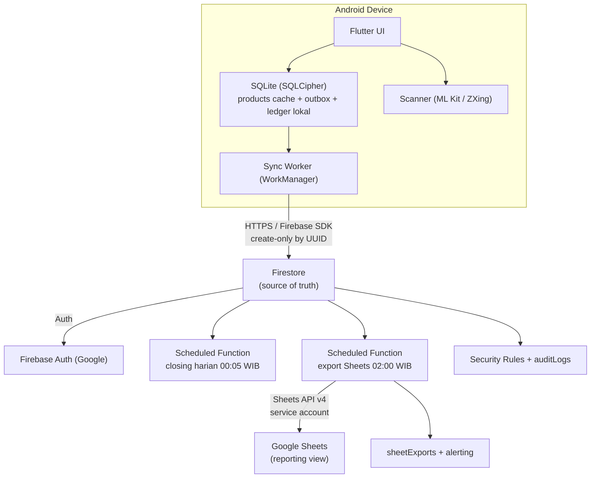
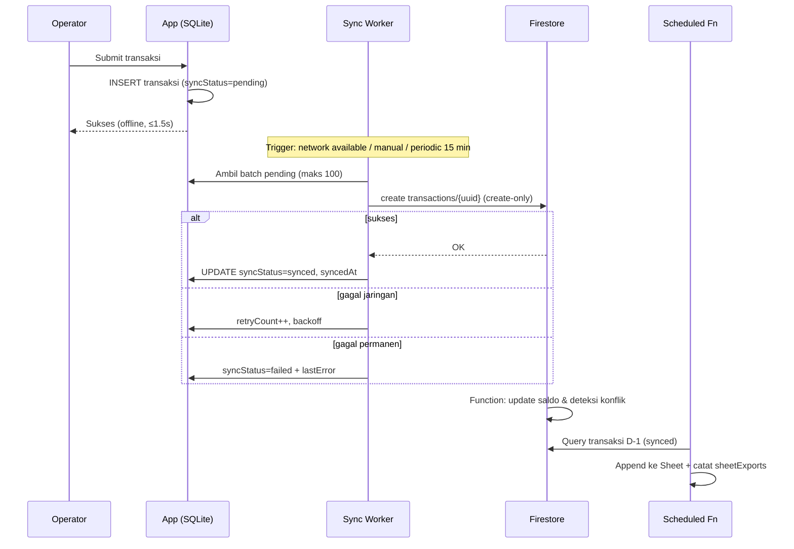
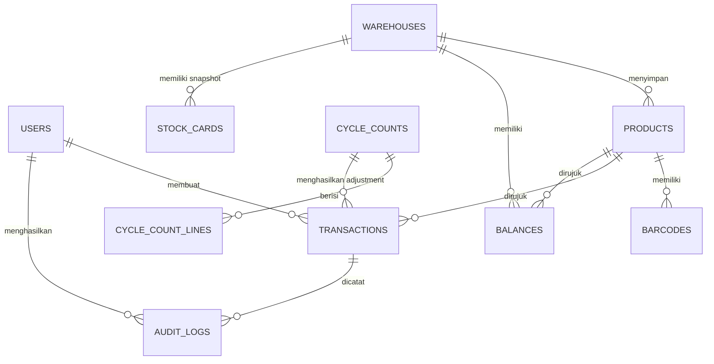
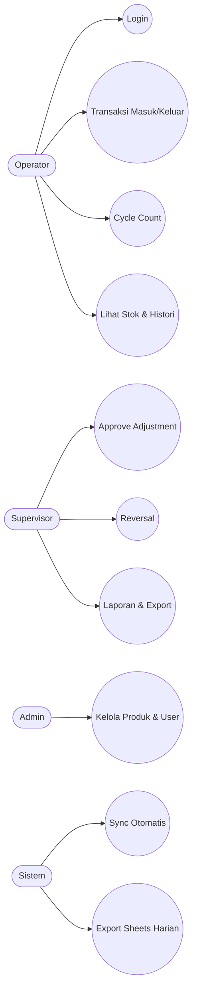

# PRD — Warehouse Mobile App (MVP) — Versi 2.0

| Field | Nilai |
|---|---|
| Dokumen | Product Requirements Document — Warehouse Mobile App |
| Versi | 2.0 (Draft untuk review) |
| Tanggal | 16 November 2026 |
| Menggantikan | PRD v1 (`4a37334b-2823-4ea8-821e-d8d661a6edb1.md`) |
| Pemilik produk | [PERLU KONFIRMASI] |
| Reviewer wajib | Operasional Gudang, Engineering Lead, Security |
| Dokumen terkait | `firestore-schema.md`, `use-case-matrix.md`, `firebase/firestore.rules`, `firebase/firestore.indexes.json`, `app/sqlite_schema.sql` |

> **Cara membaca:** setiap requirement punya ID stabil (`FR-*`, `NFR-*`, `BR-*`). Acceptance criteria didefinisikan sekali di `use-case-matrix.md` dan dirujuk dari sini — tidak diduplikasi, agar tidak ada versi yang saling bertentangan.

---

## 1. Ringkasan & Masalah

Gudang mencatat transaksi barang (masuk, keluar, cycle-count) di kertas, sehingga saldo stok tidak dapat dipercaya dan audit bulanan memakan waktu. Aplikasi Android ini memungkinkan operator mencatat transaksi dengan scan barcode secara **offline-first**, lalu menyinkronkan data ke cloud dan mengekspornya ke Google Sheets untuk kebutuhan laporan/audit.

**Yang berubah dari v1 (dan alasannya):**

| Temuan v1 | Keputusan v2 |
|---|---|
| SQLite + Realtime DB + Cloud Functions saling bertabrakan | **SQLite = outbox + cache**, **Firestore = source of truth cloud**. Realtime DB dihapus |
| Google Sheets dipakai sebagai database | Sheets = **reporting view append-only**, bukan system of record |
| Stock card menyimpan counter yang di-mutasi | **Ledger immutable** + snapshot periode; saldo selalu dapat dihitung ulang |
| Relasi ERD salah, tabel `WAREHOUSE` tidak ada, tidak ada `role` | Skema dinormalisasi; `warehouse`, `role`, `uom`, idempotency key ditambahkan |
| Cron server membaca "Pending Sync" dari SQLite (mustahil) | Sync dipicu **dari device** (WorkManager) → Firestore → export Sheets dari server |
| Formula cycle-count ambigu | Ditetapkan sebagai **adjustment transaction** (lihat BR-02) |
| Metrik hanya mengukur kecepatan, bukan akurasi | Ditambah **stock accuracy** dan **sync lag** sebagai metrik utama |
| Kontradiksi Android 6+ vs 7+ | Ditetapkan **Android 8.0 (API 26)** — lihat D6 |
| Catatan "tier Premium" (sisa template) | Dihapus |
| `bool synced` | Diganti state machine `syncStatus` + `retryCount` + `lastError` |

---

## 2. Keputusan Arsitektur (Decision Log)

| ID | Keputusan | Alasan | Konsekuensi |
|---|---|---|---|
| **D1** | Offline-first: Flutter + SQLite (Drift) sebagai outbox & cache; Firestore sebagai source of truth cloud | Gudang sering tanpa sinyal; transaksi tidak boleh gagal karena jaringan | Perlu logika merge/konflik & status sync yang terlihat user |
| **D2** | Google Sheets bersifat **append-only reporting view**; ditulis oleh scheduled function, bukan oleh device | Kredensial Sheets tidak boleh ada di device; Sheet tidak tahan sebagai database | Sheet tidak bisa diedit manual tanpa tercatat sebagai selisih |
| **D3** | Transaksi = ledger immutable. Saldo stok = hasil agregasi. Stock card = **snapshot per periode** | Audit membutuhkan jejak yang bisa direplay | Butuh job closing harian + rekonsiliasi |
| **D4** | Cycle-count menghasilkan **adjustment transaction**, bukan menimpa saldo | Menghindari double counting dan menjaga audit trail | Butuh approval Supervisor (FR-STK-05) |
| **D5** | Server otoritatif untuk saldo; device menghitung saldo optimistik untuk validasi offline | Mencegah dua device menghasilkan saldo berbeda permanen | Konflik harus terdeteksi & ditampilkan (UC-STK-07) |
| **D6** | Minimum **Android 8.0 (API 26)**, target SDK mengikuti kebijakan Play | API 24/25 sudah EOL untuk patch keamanan; WorkManager & ML Kit lebih stabil di 26+ | [PERLU KONFIRMASI] inventaris device gudang |
| **D7** | Cycle-count MVP = **full count per gudang**; sampling per rak = P2 | Full count memberi baseline akurasi yang bisa diukur | Sesi count bisa panjang → butuh fitur simpan progres |
| **D8** | Satu gudang per instalasi, namun skema tetap membawa `warehouseId` | Menghindari migrasi besar saat multi-gudang dibuka | Tidak ada UI pemilihan gudang di MVP |

---

## 3. Tujuan & Metrik

### 3.1 Tujuan produk
1. Semua pergerakan barang tercatat digital tanpa kertas.
2. Saldo stok sistem dapat dipercaya (mendekati fisik).
3. Data tersedia di Google Sheets untuk audit tanpa kerja manual.

### 3.2 Metrik (lagging & leading)

| ID | Metrik | Definisi / Formula | Baseline | Target MVP | Sumber data |
|---|---|---|---|---|---|
| M1 | **Stock accuracy** | `1 − Σ\|counted − system\| / Σ counted` per sesi cycle-count | Tidak diketahui | **≥ 98%** | Koleksi `cycleCounts` |
| M2 | Sync success rate | transaksi `synced` / transaksi `posted` dalam 24 jam | — | **≥ 99,5%** | Firestore + export log |
| M3 | Sync lag | p95 waktu `createdAtClient → syncedAt` saat online | — | **≤ 15 menit** | Firestore |
| M4 | Error transaksi | transaksi di-reverse/dikoreksi / total transaksi | — | **≤ 0,5%** | `auditLogs` |
| M5 | Scan-to-saved (offline) | p95 waktu scan ditekan → baris tersimpan lokal | — | **≤ 1,5 detik** | Telemetri lokal |
| M6 | Adopsi | operator aktif / operator terdaftar per minggu | 0% | **≥ 80%** | `auditLogs` |
| M7 | Waktu closing cycle-count | durasi sesi (mulai → submit) untuk 1 gudang | — | **≤ 1 hari kerja** | `cycleCounts` |

**Metrik yang sengaja dihapus dari v1:** "≥95% transaksi tanpa error" (ambang terlalu longgar untuk inventory), "≤1% deviasi sheet" (mengasumsikan tidak ada edit manual — asumsi yang menghapus variabel yang seharusnya diukur), dan "≤2 detik navigasi" (dipindah menjadi NFR, bukan metrik bisnis).

### 3.3 Non-goals MVP
Tidak mengukur: penghematan biaya, ROI, atau pengurangan headcount. Belum ada data baseline untuk itu.

---

## 4. Pengguna & Hak Akses

| Persona | Kebutuhan utama | Pain point |
|---|---|---|
| **Operator Gudang** | Scan cepat, saldo terlihat, input cycle-count | Kertas, salah catat, menunggu konfirmasi stok |
| **Supervisor Gudang** | Validasi, approve selisih, laporan harian | Tidak ada data real-time, rekap manual |
| **Admin Sistem** | Kelola user, produk, konfigurasi | Perubahan master data lewat chat/telepon |

### 4.1 Matriks RBAC (baru — tidak ada di v1)

| Kapabilitas | Operator | Supervisor | Admin |
|---|---|---|---|
| Scan transaksi masuk/keluar | ✅ | ✅ | ❌ |
| Lihat histori (gudang sendiri) | ✅ (miliknya) | ✅ (semua) | ❌ |
| Lihat saldo & stock card | ✅ | ✅ | ❌ |
| Mulai/isi cycle-count | ✅ | ✅ | ❌ |
| Submit cycle-count | ✅ | ✅ | ❌ |
| **Approve adjustment** | ❌ | ✅ | ❌ |
| **Reversal transaksi** | ❌ | ✅ | ❌ |
| Export laporan | ❌ | ✅ | ✅ |
| Kelola produk | ❌ | ❌ | ✅ |
| Kelola user & role | ❌ | ❌ | ✅ |

Role disimpan di `users/{uid}.role` dan **hanya dapat diubah oleh Admin melalui Firestore console/backoffice** (tidak ada self-service di MVP). Aturan ini ditegakkan di Security Rules, bukan hanya di UI.

---

## 5. Scope

### 5.1 In Scope — MVP (R1)

| Epic | Isi |
|---|---|
| Auth | Google Sign-In, sesi persisten, logout, penolakan akun tak terdaftar |
| Master data | Sinkron produk (kode, nama, tipe, UoM, barcode) ke cache lokal |
| Transaksi | Scan masuk / keluar, input manual, validasi stok, anti-duplikat, reversal |
| Stok | Saldo real-time (lokal), stock card periode, snapshot harian |
| Cycle-count | Sesi count, input fisik, review selisih, approval adjustment |
| Laporan | Histori + filter, laporan stok, export PDF/CSV |
| Sync | Outbox → Firestore, retry backoff, indikator status, sync manual |
| Export | Scheduled export ke Google Sheets (D-1, 02:00 WIB) |
| Admin | Import produk via template Sheet, kelola user/role |

### 5.2 Out of Scope
- iOS, web app, desktop.
- Multi-gudang aktif, transfer antar gudang.
- Batch/lot & expiry tracking (field disiapkan, fitur P2).
- RFID, GPS, pemetaan lokasi rak.
- Push notification real-time.
- Pembayaran, ekspedisi, integrasi ERP.
- Barcode printing / label generation.
- Offline login pertama (login pertama wajib online).

### 5.3 Roadmap

| Rilis | Fokus | Estimasi |
|---|---|---|
| **R1 (MVP)** | Semua di 5.1 | 10–12 minggu |
| R2 | Sampling cycle-count per rak, batch/expiry, notifikasi selisih | +4 minggu |
| R3 | Multi-gudang, transfer, dashboard supervisor | +6 minggu |

> Estimasi bersifat indikatif dan perlu dipecah bersama Engineering.

---

## 6. Aturan Bisnis (Business Rules)

| ID | Aturan |
|---|---|
| **BR-01** | Saldo berjalan: `ending = opening + incoming − outgoing + adjustment`. Tidak ada komponen lain. |
| **BR-02** | Cycle-count: `variance = countedQty − systemQty`. Jika `variance ≠ 0`, sistem membuat **satu transaksi `adjustment`** dengan `qty = variance` (boleh negatif) dan `cycleCountId` terkait. Saldo tidak pernah ditimpa langsung. |
| **BR-03** | Transaksi `outgoing` yang membuat `ending < 0` **ditolak**. Override hanya oleh Supervisor, wajib menyertakan alasan, dan tercatat di `auditLogs`. |
| **BR-04** | Idempotency: `transactionId` dibuat device (UUIDv7) dan dipakai sebagai **document ID** di Firestore dengan semantik *create-only*. Pengiriman ulang tidak pernah membuat baris ganda. |
| **BR-05** | Zona waktu tunggal: **Asia/Jakarta (WIB)**. Periode harian = 00:00:00–23:59:59 WIB. Export 02:00 WIB mengambil periode **D-1**. |
| **BR-06** | Transaksi tidak pernah di-`delete`. Koreksi dilakukan dengan transaksi `reversal` yang mereferensikan `refTransactionId`. |
| **BR-07** | Kuantitas berupa bilangan bulat pada satuan terkecil produk. Tidak ada desimal di MVP. |
| **BR-08** | Produk `active = false` tidak dapat ditransaksikan, tetapi tetap muncul di laporan historis. |
| **BR-09** | Operator hanya dapat melihat transaksi miliknya; Supervisor/Admin melihat seluruh gudang. Ditegakkan di Security Rules. |
| **BR-10** | Satu sesi cycle-count hanya boleh ada satu yang berstatus `open` per gudang. |
| **BR-11** | Perubahan master produk oleh Admin disinkronkan ke device melalui `updatedAt` (delta sync). Transaksi lokal yang sudah tercatat tidak berubah walau nama produk berubah (denormalisasi nama saat transaksi dibuat). |
| **BR-12** | Konflik saldo (server ≠ device) tidak pernah diperbaiki diam-diam. Sistem membuat entri `stockConflicts` untuk direview Supervisor. |
| **BR-13** | Impor master produk bersifat **all-or-nothing per file**: satu error menolak seluruh file, tidak ada perubahan parsial. Spesifikasi: `product-import-spec.md`. |

---

## 7. Requirements

### 7.1 Functional Requirements

#### Epic AUTH — Autentikasi & Otorisasi

| ID | Requirement | Prioritas | UC |
|---|---|---|---|
| FR-AUTH-01 | Pengguna login dengan akun Google melalui Firebase Authentication | Must | UC-AUTH-01 |
| FR-AUTH-02 | Sesi bertahan setelah app ditutup; token di-refresh otomatis | Must | UC-AUTH-04 |
| FR-AUTH-03 | Logout menghapus sesi & cache data sensitif, kembali ke layar login | Must | UC-AUTH-03 |
| FR-AUTH-04 | Role diambil dari `users/{uid}` dan menentukan menu serta aksi yang tersedia | Must | UC-AUTH-01, UC-ADM-02 |
| FR-AUTH-05 | Akun Google yang tidak terdaftar / `active=false` ditolak dengan pesan jelas | Must | UC-AUTH-02 |
| FR-AUTH-06 | Login pertama wajib online; setelah itu sesi offline berlaku maksimum 7 hari | Should | UC-AUTH-04 |

#### Epic MST — Master Data Produk

| ID | Requirement | Prioritas | UC |
|---|---|---|---|
| FR-MST-01 | Aplikasi menyinkronkan produk (kode, nama, tipe, UoM, barcode, status) ke SQLite secara delta berdasarkan `updatedAt` | Must | UC-ADM-01 |
| FR-MST-02 | Pencarian produk & barcode dilakukan **lokal** (tanpa jaringan) | Must | UC-SCN-01 |
| FR-MST-03 | UI menampilkan waktu sinkron master terakhir; jika > 24 jam, tampilkan peringatan | Should | UC-SCN-01 |
| FR-MST-04 | Admin mengimpor/mengubah produk melalui template Google Sheets yang divalidasi (kode unik, UoM wajib) | Must | UC-ADM-01 |
| FR-MST-05 | Satu produk dapat memiliki >1 barcode; satu barcode hanya boleh milik satu produk | Must | UC-SCN-01 |

#### Epic SCN — Scan & Transaksi

| ID | Requirement | Prioritas | UC |
|---|---|---|---|
| FR-SCN-01 | Scan barcode 1D (Code128/EAN-13) dan QR menggunakan kamera device | Must | UC-SCN-01, UC-SCN-02 |
| FR-SCN-02 | Hasil scan menampilkan kode, nama, tipe, UoM, dan saldo saat ini | Must | UC-SCN-01 |
| FR-SCN-03 | Barcode tidak dikenal menampilkan pesan + opsi input manual kode produk | Must | UC-SCN-03 |
| FR-SCN-04 | Operator memilih jenis transaksi: masuk / keluar | Must | UC-SCN-01, UC-SCN-02 |
| FR-SCN-05 | Qty wajib > 0; keyboard numerik; tombol +/− untuk koreksi cepat | Must | UC-SCN-01 |
| FR-SCN-06 | Submit bersifat **idempotent**: tap ganda tidak membuat transaksi ganda (BR-04) | Must | UC-SCN-07 |
| FR-SCN-07 | Transaksi tersimpan ke SQLite dengan `syncStatus = pending` dalam ≤1,5 detik | Must | UC-SCN-01 |
| FR-SCN-08 | Supervisor dapat melakukan reversal transaksi dengan alasan wajib | Must | UC-SCN-06 |
| FR-SCN-09 | Transaksi yang membuat stok negatif ditolak; override Supervisor + alasan | Must | UC-SCN-05 |
| FR-SCN-10 | Input manual kode produk untuk barcode rusak/tidak terbaca | Must | UC-SCN-04 |

#### Epic STK — Stok & Cycle-Count

| ID | Requirement | Prioritas | UC |
|---|---|---|---|
| FR-STK-01 | Saldo per produk ditampilkan dari agregasi ledger lokal dan diperbarui segera setelah transaksi | Must | UC-STK-01 |
| FR-STK-02 | Stock card menampilkan `opening, incoming, outgoing, adjustment, ending` per periode | Must | UC-STK-01 |
| FR-STK-03 | Operator dapat memulai sesi cycle-count; satu sesi `open` per gudang (BR-10) | Must | UC-STK-02 |
| FR-STK-04 | Dalam sesi, operator memindai/memilih produk dan memasukkan qty fisik; progres tersimpan otomatis | Must | UC-STK-03 |
| FR-STK-05 | Review menampilkan `systemQty`, `countedQty`, `variance` per baris sebelum submit | Must | UC-STK-04 |
| FR-STK-06 | Submit cycle-count membuat adjustment per baris selisih (BR-02) dan menunggu approval bila variance ≠ 0 | Must | UC-STK-04 |
| FR-STK-07 | Supervisor menyetujui/menolak adjustment dengan catatan | Must | UC-STK-05 |
| FR-STK-08 | Job closing harian membuat snapshot stock card dan mengunci periode | Must | UC-STK-06 |
| FR-STK-09 | Konflik saldo device vs server ditampilkan ke Supervisor untuk resolusi | Should | UC-STK-07 |

#### Epic RPT — Laporan

| ID | Requirement | Prioritas | UC |
|---|---|---|---|
| FR-RPT-01 | Histori transaksi dengan filter tanggal, jenis, produk, dan operator | Must | UC-RPT-01 |
| FR-RPT-02 | Laporan stok per periode menampilkan stock card seluruh produk | Must | UC-RPT-02 |
| FR-RPT-03 | Export laporan ke PDF (layout A4, kop gudang, tanda tangan) | Should | UC-RPT-02 |
| FR-RPT-04 | Export laporan ke CSV untuk analisis lanjutan | Should | UC-RPT-02 |
| FR-RPT-05 | Ringkasan dashboard: total produk, transaksi hari ini, item perlu restock | Should | UC-RPT-01 |

#### Epic SYN — Sinkronisasi & Export

| ID | Requirement | Prioritas | UC |
|---|---|---|---|
| FR-SYN-01 | Outbox dikirim ke Firestore otomatis saat jaringan tersedia (WorkManager, constraint network) | Must | UC-SYN-01 |
| FR-SYN-02 | Kegagalan di-retry dengan exponential backoff (maks 5 percobaan per siklus), lalu ditandai `failed` | Must | UC-SYN-02 |
| FR-SYN-03 | Status per transaksi terlihat: `pending / syncing / synced / failed` + alasan | Must | UC-SYN-02 |
| FR-SYN-04 | Tombol "Sync sekarang" untuk memicu manual | Must | UC-SYN-02 |
| FR-SYN-05 | Scheduled function mengekspor transaksi `synced` periode D-1 ke Sheet pada 02:00 WIB | Must | UC-SYN-03 |
| FR-SYN-06 | Export bersifat idempotent (satu `transactionId` = satu baris) dan mencatat `sheetExports` | Must | UC-SYN-03 |
| FR-SYN-07 | Rekonsiliasi harian membandingkan jumlah baris Sheet vs Firestore dan melaporkan selisih | Should | UC-SYN-04 |

#### Epic ADM — Administrasi

| ID | Requirement | Prioritas | UC |
|---|---|---|---|
| FR-ADM-01 | Admin dapat menambah/menonaktifkan user dan menetapkan role | Must | UC-ADM-02 |
| FR-ADM-02 | Admin dapat melihat daftar transaksi `failed` dan melakukan retry paksa | Should | UC-ADM-03 |
| FR-ADM-03 | Sistem mencatat audit log untuk aksi sensitif (approval, reversal, perubahan role, perubahan produk) | Must | UC-ADM-03 |

### 7.2 Non-Functional Requirements

| ID | Kategori | Requirement | Target / Cara verifikasi |
|---|---|---|---|
| NFR-PERF-01 | Performa | Navigasi antar layar utama | p95 ≤ 2 s pada device mid-range (RAM 3 GB) |
| NFR-PERF-02 | Performa | Scan → transaksi tersimpan lokal | p95 ≤ 1,5 s, **tanpa jaringan** |
| NFR-PERF-03 | Performa | Sync batch 100 transaksi @3 Mbps | ≤ 30 s |
| NFR-PERF-04 | Performa | Export 30 hari transaksi (≤50k baris) | ≤ 5 menit, tidak memblokir app |
| NFR-REL-01 | Keandalan | Transaksi dapat dibuat 100% tanpa jaringan | Uji airplane mode |
| NFR-REL-02 | Keandalan | Sync success rate | ≥ 99,5% per 24 jam |
| NFR-REL-03 | Keandalan | Crash-free sessions | ≥ 99,5% |
| NFR-REL-04 | Keandalan | Tidak ada kehilangan data lokal saat app di-kill saat submit | Uji force-stop 100× |
| NFR-SEC-01 | Keamanan | Transport | TLS 1.2+ untuk semua trafik |
| NFR-SEC-02 | Keamanan | Enkripsi lokal | SQLCipher (AES-256), kunci di Android Keystore, tidak pernah di log |
| NFR-SEC-03 | Keamanan | Kredensial Sheets | Service account hanya di server (Secret Manager); **tidak ada** di APK |
| NFR-SEC-04 | Keamanan | Firestore Security Rules menegakkan role & kepemilikan data | Diuji dengan rules unit test |
| NFR-SEC-05 | Keamanan | Sesi offline maksimum | 7 hari, lalu wajib re-auth |
| NFR-COMP-01 | Kompatibilitas | Minimum OS | Android 8.0 (API 26) |
| NFR-COMP-02 | Kompatibilitas | Perangkat tanpa Google Play Services | **Tidak didukung** — didokumentasikan & dicek saat instalasi |
| NFR-USA-01 | Usability | Material 3, kontras WCAG AA, target sentuh ≥48dp, teks ≥14sp | Audit aksesibilitas |
| NFR-USA-02 | Usability | Operasi utama maksimum 3 tap dari layar utama | Review desain |
| NFR-MNT-01 | Maintainability | Crash & error report otomatis (Crashlytics) + log lokal ter-flush saat online | Dashboard |
| NFR-MNT-02 | Maintainability | Versi API/skema punya `schemaVersion`; app menolak jalan jika di bawah minimum | Remote config |
| NFR-DATA-01 | Data | Retensi transaksi di Firestore | 24 bulan, lalu arsip ke Cloud Storage |
| NFR-DATA-02 | Data | Retensi Sheet | Satu tab per bulan; tab >24 bulan diarsipkan |
| NFR-DATA-03 | Data | Waktu pemulihan (RTO) / kehilangan data (RPO) | RTO ≤ 4 jam, RPO ≤ 15 menit |

---

## 8. Arsitektur

### 8.1 Alur sync (outbox)

### 8.2 Komponen

| Komponen | Teknologi | Tanggung jawab |
|---|---|---|
| Mobile app | Flutter (Dart) | UI, scan, cache, outbox, validasi lokal |
| Local DB | SQLite + Drift + SQLCipher | Cache produk, ledger lokal, antrean sync |
| Auth | Firebase Authentication (Google) | Identitas & sesi |
| Cloud DB | Firestore | Source of truth, dipakai untuk audit & laporan |
| Server logic | Firebase Cloud Functions (Node/TS) | Agregasi saldo, closing, export, rekonsiliasi |
| Reporting | Google Sheets API v4 | Output laporan ke stakeholder |
| Observability | Crashlytics + Cloud Logging + alert | Monitoring |

> **Catatan:** tidak ada Cloud Function yang membaca SQLite. Semua data masuk cloud melalui outbox device (memperbaiki UC-02 v1 yang secara teknis mustahil).

---

## 9. Model Data

Detail lengkap ada di **`firestore-schema.md`**. Ringkasan entitas:

Perbedaan utama dari v1:
- `WAREHOUSE` menjadi entitas nyata (menyelesaikan FK yatim).
- `STOCK_CARD` tidak lagi menunjuk ke transaksi; ia snapshot per `periodKey`.
- Saldo berjalan ada di `balances`, diturunkan dari ledger.
- `TRANSACTION` menyimpan `idempotencyKey` (= document ID), `syncStatus`, `deviceId`, snapshot nama produk.

---

## 10. Use Case

Daftar lengkap (27 use case) beserta alur utama, alur alternatif, dan matriks traceability ada di **`use-case-matrix.md`**.

---

## 11. Risiko & Mitigasi

| Risiko | Dampak | Prob. | Mitigasi | Owner |
|---|---|---|---|---|
| Device hilang sebelum sync | Kehilangan transaksi | Sedang | Sync tiap 15 menit + indikator "X transaksi belum terkirim" | Eng |
| Dua device transaksi produk sama → saldo konflik | Saldo tidak konsisten | Tinggi | Server otoritatif + `stockConflicts` (BR-12) | Eng |
| Sheet diedit manual | Laporan salah | Sedang | Export append-only + checksum per batch + rekonsiliasi | Ops |
| Barcode rusak/kotor | Transaksi gagal | Tinggi | Input manual (FR-SCN-10) + validasi kode | Produk |
| Device tanpa GMS | App tidak bisa login | Rendah–Sedang | Cek kompatibilitas saat kickoff + daftar device | Ops/IT |
| Kuota Sheets API | Export gagal | Rendah | Batch write, 1 export/hari, monitoring kuota | Eng |
| Operator menolak berubah | Adopsi rendah | Sedang | Training + dual-run 2 minggu + champion user | Ops |
| Perubahan master produk saat offline | Data lokal usang | Sedang | Delta sync + peringatan >24 jam | Eng |

**Dependensi:** Firebase (Auth, Firestore, Functions, Crashlytics), Google Sheets API v4, Google Cloud Secret Manager, Android 8+, Google Play Services, library scanner (ML Kit Barcode / ZXing fallback).

---

## 12. Rencana Pengukuran & QA

| Tahap | Aktivitas | Gate |
|---|---|---|
| Pre-dev | Review PRD v2, konfirmasi open question, finalisasi skema | Sign-off Ops + Eng |
| Dev | Unit test (validasi, BR-01..03), integration test (sync, idempotency), rules unit test | Coverage ≥ 70% pada modul bisnis |
| SIT | Uji 27 use case + skenario offline/kill/duplikat | 100% Must pass |
| UAT | Pilot 1 gudang, 2 minggu, ≥1 cycle-count penuh | M1 ≥ 98%, M2 ≥ 99,5% |
| Go-live | Training, dual-run 1 minggu, lalu kertas dihentikan | Sign-off Supervisor |

**Skenario uji wajib:** airplane mode penuh, force-stop saat submit, tap ganda submit, dua device transaksi bersamaan, barcode tidak terdaftar, stok negatif, retry sync setelah sukses (tidak boleh duplikat), perubahan produk saat offline, pergantian hari saat sesi count terbuka.

> Sebelum masuk development, jalankan **technical spike** 7 hari (`spike-backlog.md`). Jika SPK-01 (idempotency) atau SPK-02 (saldo) gagal, vertical slice tidak dimulai.

---

## 13. Traceability Matrix (ringkas)

| Requirement | Use Case | Metrik terkait | Prioritas |
|---|---|---|---|
| FR-AUTH-01..06 | UC-AUTH-01..04 | M6 | Must |
| FR-MST-01..05 | UC-ADM-01, UC-SCN-01 | M1 | Must |
| FR-SCN-01..10 | UC-SCN-01..07 | M4, M5 | Must |
| FR-STK-01..09 | UC-STK-01..07 | M1, M7 | Must |
| FR-RPT-01..05 | UC-RPT-01..02 | — | Must/Should |
| FR-SYN-01..07 | UC-SYN-01..04 | M2, M3 | Must |
| FR-ADM-01..03 | UC-ADM-02..03 | — | Must/Should |

Detail per-UC ada di `use-case-matrix.md` §4.

---

## 14. Open Questions (butuh keputusan sebelum dev)

| # | Pertanyaan | Dampak jika tidak dijawab | Default sementara |
|---|---|---|---|
| Q1 | Inventaris device gudang: Android versi berapa, punya GMS? | Menentukan min SDK & feasibility login | Android 8+ dengan GMS |
| Q2 | Berapa SKU dan transaksi/hari? | Menentukan strategi arsip Sheet & ukuran cache | < 5.000 SKU, < 1.000 tx/hari |
| Q3 | Siapa yang boleh approve adjustment saat Supervisor tidak ada? | Alur cycle-count bisa macet | Admin sebagai fallback |
| Q4 | Apakah cycle-count MVP full count atau sampling? | Mengubah desain UI & durasi sesi | Full count (D7) |
| Q5 | Apakah Sheet perlu format/kop khusus untuk audit eksternal? | Rework export | Template default |
| Q6 | Berapa lama data harus disimpan (kebijakan audit)? | Biaya penyimpanan & retensi | 24 bulan |
| Q7 | Apakah operator boleh memakai device bersama? | Model kepemilikan transaksi & audit | 1 device = 1 operator |
| Q8 | Apakah diperlukan dukungan bahasa selain Indonesia? | Lokalisasi | Indonesia saja |
