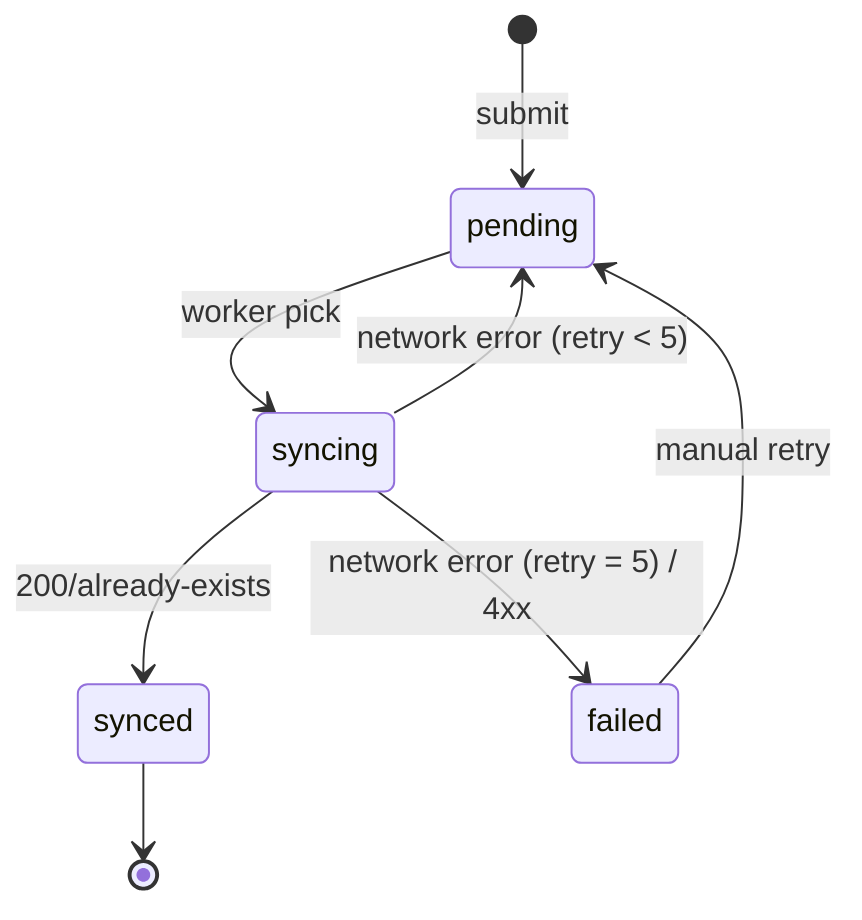

# Skema Firestore — Warehouse Mobile App v2

Dokumen pendamping: `PRD-v2.md`. Semua aturan bisnis mengacu ke `BR-*` di PRD.

**Prinsip desain**
1. **Ledger immutable** — dokumen `transactions` tidak pernah di-update isinya (selain metadata sync oleh server). Koreksi = dokumen baru.
2. **Saldo adalah turunan** — `balances` hanya cache agregat yang bisa dihitung ulang dari ledger.
3. **Idempotency by document ID** — ID transaksi dibuat device (UUIDv7) dan dipakai sebagai document ID dengan semantik *create-only*.
4. **Denormalisasi terkontrol** — nama/kode produk disalin ke transaksi agar histori tidak berubah saat master berubah (BR-11).
5. **Client tidak menulis angka saldo** — hanya Cloud Function yang boleh menulis `balances`, `stockCards`, `auditLogs`, `sheetExports`.

---

## 1. Peta Koleksi

| Path | Jenis | Ditulis oleh | Perkiraan ukuran |
|---|---|---|---|
| `users/{uid}` | Dokumen | Admin (console/backoffice) | ≤ 1.000 |
| `warehouses/{warehouseId}` | Dokumen | Admin | 1–5 |
| `products/{productId}` | Dokumen | Cloud Function (import Sheet) | ≤ 10.000 |
| `barcodes/{barcode}` | Dokumen (lookup) | Cloud Function | ≤ 20.000 |
| `importLocks/{warehouseId}` | Dokumen (kunci sementara) | Cloud Function | 1–5, hanya saat impor |
| `devices/{deviceId}` | Dokumen | Client | ≤ 100 |
| `transactions/{transactionId}` | Dokumen | **Client (create)**, Function (metadata) | 10k–500k/tahun |
| `warehouses/{wid}/balances/{productId}` | Dokumen | **Function only** | = jumlah produk |
| `warehouses/{wid}/periods/{periodKey}` | Dokumen | Function | 1/hari |
| `warehouses/{wid}/periods/{periodKey}/stockCards/{productId}` | Dokumen | Function | produk × hari |
| `cycleCounts/{cycleCountId}` | Dokumen | Client + Function | puluhan/tahun |
| `cycleCounts/{cycleCountId}/countLines/{productId}` | Dokumen | Client | produk × sesi |
| `stockConflicts/{conflictId}` | Dokumen | Function | sedikit |
| `auditLogs/{logId}` | Dokumen | Function | 10k–100k/tahun |
| `sheetExports/{exportId}` | Dokumen | Function | 1/hari |
| `appConfig/{docId}` | Dokumen | Admin | < 10 |

> **Catatan:** `syncStatus` dan outbox **tidak** disimpan di Firestore. Itu state lokal device (SQLite). Firestore hanya menyimpan kebenaran yang sudah diterima.

---

## 2. Definisi Dokumen

### 2.1 `users/{uid}`

`uid` = Firebase Auth UID (bukan email, agar tetap stabil jika email berubah).

| Field | Tipe | Wajib | Keterangan |
|---|---|---|---|
| `name` | string | ✅ | Nama tampilan |
| `email` | string | ✅ | Dari Google, untuk audit |
| `role` | string | ✅ | `operator` \| `supervisor` \| `admin` |
| `warehouseIds` | array\<string\> | ✅ | MVP: 1 elemen |
| `active` | boolean | ✅ | `false` = login ditolak (FR-AUTH-05) |
| `createdAt` | timestamp | ✅ | |
| `updatedAt` | timestamp | ✅ | |
| `lastLoginAt` | timestamp | ❌ | Diupdate function saat login |

```json
{
  "name": "Budi Santoso",
  "email": "budi@contoh.co.id",
  "role": "operator",
  "warehouseIds": ["wh_jkt01"],
  "active": true,
  "createdAt": "2026-11-01T08:00:00Z",
  "updatedAt": "2026-11-01T08:00:00Z"
}
```

### 2.2 `warehouses/{warehouseId}`

| Field | Tipe | Wajib | Keterangan |
|---|---|---|---|
| `code` | string | ✅ | Unik, mis. `JKT-01` |
| `name` | string | ✅ | |
| `timezone` | string | ✅ | Default `Asia/Jakarta` (BR-05) |
| `address` | string | ❌ | |
| `active` | boolean | ✅ | |
| `currentPeriodKey` | string | ✅ | `YYYY-MM-DD` WIB, dikelola job closing |
| `createdAt` / `updatedAt` | timestamp | ✅ | |

### 2.3 `products/{productId}`

| Field | Tipe | Wajib | Keterangan |
|---|---|---|---|
| `code` | string | ✅ | Kode barang, unik (lowercase, trimmed) |
| `name` | string | ✅ | |
| `type` | string | ✅ | Kategori bebas, mis. `consumable`, `spare_part` |
| `uom` | string | ✅ | Satuan terkecil, mis. `pcs`, `box`, `kg` (BR-07) |
| `minStock` | number | ❌ | Untuk indikator restock |
| `note` | string | ❌ | Keterangan bebas, ≤200 karakter (dari kolom `keterangan` saat import) |
| `barcodes` | array\<string\> | ✅ | Denormalisasi untuk tampilan cepat |
| `active` | boolean | ✅ | BR-08 |
| `warehouseIds` | array\<string\> | ✅ | Produk terlihat di gudang mana |
| `updatedAt` | timestamp | ✅ | **Kunci delta sync** (FR-MST-01) |
| `updatedBy` | string | ✅ | uid admin |
| `schemaVersion` | number | ✅ | Mulai `1` |

> `products/{productId}` memakai auto-ID **atau** `productId = code` yang sudah dinormalisasi. Rekomendasi: auto-ID + field `code` unik, karena kode bisa berubah.

### 2.4 `barcodes/{barcode}` (lookup unik)

Document ID = barcode yang sudah dinormalisasi (trim, uppercase untuk 1D). Ini menjamin **satu barcode hanya milik satu produk** (FR-MST-05) tanpa perlu index unik (Firestore tidak punya unique constraint).

| Field | Tipe | Wajib | Keterangan |
|---|---|---|---|
| `productId` | string | ✅ | |
| `productCode` | string | ✅ | Denormalisasi |
| `format` | string | ✅ | `CODE128` \| `EAN13` \| `QR` \| `MANUAL` \| `UNKNOWN` |
| `createdAt` | timestamp | ✅ | |

> Import dari sheet tidak membawa format barcode, jadi `importProducts`
> menulis `UNKNOWN`; app juga menyimpan `UNKNOWN` di SQLite karena
> `products.barcodes` hanya array string. Format yang lebih presisi bisa
> ditambahkan tanpa migrasi (field sudah ada).

### 2.4a `importLocks/{warehouseId}` (kunci impor sementara)

Mencegah dua admin mengimpor ke gudang yang sama pada saat bersamaan
(VS1-06). Hanya Cloud Function (Admin SDK) yang membaca/menulis; rules
menolak semua akses klien.

| Field | Tipe | Wajib | Keterangan |
|---|---|---|---|
| `owner` | string | ✅ | `importId` pemegang kunci |
| `actorUid` | string | ✅ | Admin yang menjalankan impor |
| `expiresAt` | timestamp | ✅ | TTL 5 menit; kunci kedaluwarsa boleh diambil alih |
| `updatedAt` | timestamp | ✅ | |

> Kunci dihapus di blok `finally` setelah impor selesai. Bila Function mati
> mendadak, kunci kedaluwarsa sendiri setelah 5 menit.

### 2.5 `devices/{deviceId}`

`deviceId` = installation ID yang dibuat app saat pertama jalan (bukan Android ID mentah, demi privasi).

| Field | Tipe | Keterangan |
|---|---|---|
| `userId` | string | Pemilik aktif |
| `model` / `osVersion` / `appVersion` | string | Diagnostik |
| `lastSeenAt` | timestamp | |
| `lastSyncAt` | timestamp | |
| `pendingCount` | number | Dilaporkan app saat sync (bukan real-time) |

### 2.6 `transactions/{transactionId}` ⭐

`transactionId` = **UUIDv7 dari device** (sortable berdasarkan waktu). Ini adalah idempotency key (BR-04).

| Field | Tipe | Wajib | Keterangan |
|---|---|---|---|
| `schemaVersion` | number | ✅ | `1` |
| `warehouseId` | string | ✅ | |
| `productId` | string | ✅ | |
| `productCode` | string | ✅ | Snapshot |
| `productName` | string | ✅ | Snapshot (BR-11) |
| `productType` | string | ✅ | Snapshot |
| `uom` | string | ✅ | Snapshot |
| `type` | string | ✅ | `incoming` \| `outgoing` \| `adjustment` \| `reversal` |
| `qty` | number | ✅ | Bulat. `adjustment` boleh negatif (BR-02). `incoming`/`outgoing` selalu positif |
| `signedQty` | number | ✅ | Nilai turunan: `incoming:+qty`, `outgoing:−qty`, `adjustment/reversal:qty` — memudahkan agregasi |
| `periodKey` | string | ✅ | `YYYY-MM-DD` WIB dari `occurredAt` (mempermudah export & stock card) |
| `userId` | string | ✅ | |
| `userName` | string | ✅ | Snapshot |
| `deviceId` | string | ✅ | |
| `occurredAt` | timestamp | ✅ | Waktu device; divalidasi server ±24 jam dari `createdAtServer` |
| `createdAtClient` | timestamp | ✅ | Waktu device |
| `createdAtServer` | timestamp | ✅ | `serverTimestamp()` |
| `note` | string | ❌ | |
| `refTransactionId` | string | ❌ | Wajib untuk `reversal` (BR-06) |
| `cycleCountId` | string | ❌ | Wajib untuk `adjustment` dari cycle-count |
| `approval` | map | ❌ | `{ status: 'not_required'\|'pending'\|'approved'\|'rejected', approvedBy, approvedAt, reason }`. Client hanya boleh mengirim `status='pending'` + `reason` (≥10 karakter) saat override stok negatif; keputusan akhir ditulis Function |
| `serverStatus` | string | ✅ | `applied` \| `awaiting_approval` \| `rejected` — ditulis Function. VS-2 baru menulis `applied`/`rejected`; `awaiting_approval` disiapkan untuk alur approval VS-5 |
| `appVersion` | string | ✅ | Diagnostik |
| `source` | string | ✅ | `scan` \| `manual` \| `cycle_count` \| `server` |

**Contoh:**

```json
{
  "schemaVersion": 1,
  "warehouseId": "wh_jkt01",
  "productId": "p_7f3a91",
  "productCode": "BRG-00412",
  "productName": "Sarung Tangan Nitril M",
  "productType": "consumable",
  "uom": "box",
  "type": "outgoing",
  "qty": 3,
  "signedQty": -3,
  "periodKey": "2026-11-16",
  "userId": "uid_budi",
  "userName": "Budi Santoso",
  "deviceId": "dev_9c21ab",
  "occurredAt": "2026-11-16T02:14:33Z",
  "createdAtClient": "2026-11-16T02:14:33Z",
  "createdAtServer": "<serverTimestamp>",
  "note": "Permintaan line produksi A",
  "approval": { "status": "not_required" },
  "serverStatus": "applied",
  "appVersion": "1.0.0",
  "source": "scan"
}
```

### 2.7 `warehouses/{wid}/balances/{productId}`

Cache saldo berjalan. **Hanya Function** yang menulis.

> **VS-2:** yang sudah diisi baru `schemaVersion`, `warehouseId`, `productId`,
> `endingQty`, `lastTransactionId`, dan `updatedAt`. Kolom akumulasi periode
> (`openingQty`, `incomingQty`, dst.) baru ditulis job closing di VS-4; selama
> VS-2 saldo mengikuti penjumlahan `signedQty` ledger.

| Field | Tipe | Keterangan |
|---|---|---|
| `openingQty` | number | Saldo awal periode |
| `incomingQty` | number | Akumulasi periode |
| `outgoingQty` | number | Akumulasi periode (positif) |
| `adjustmentQty` | number | Akumulasi signed (boleh negatif) |
| `endingQty` | number | `opening + incoming − outgoing + adjustment` (BR-01) |
| `periodKey` | string | Periode aktif |
| `lastTransactionId` | string | Untuk audit & deteksi replay |
| `lastAppliedAt` | timestamp | |
| `version` | number | Naik tiap update (optimistic check) |
| `updatedAt` | timestamp | |

### 2.8 `warehouses/{wid}/periods/{periodKey}`

| Field | Tipe | Keterangan |
|---|---|---|
| `status` | string | `open` \| `closed` |
| `openedAt` | timestamp | |
| `closedAt` | timestamp | |
| `closedBy` | string | `system` |
| `snapshotChecksum` | string | Hash agregat untuk verifikasi |
| `transactionCount` | number | |

### 2.9 `.../periods/{periodKey}/stockCards/{productId}`

| Field | Tipe | Keterangan |
|---|---|---|
| `warehouseId` | string | Denormalisasi untuk collection-group query |
| `periodKey` | string | Denormalisasi dari parent (index historis produk) |
| `productId` | string | = document ID, denormalisasi untuk collection-group query |
| `productCode` / `productName` / `uom` | string | Snapshot |
| `openingQty` | number | |
| `incomingQty` | number | |
| `outgoingQty` | number | |
| `adjustmentQty` | number | Termasuk reversal (BR-01, BR-06) |
| `endingQty` | number | |
| `countedQty` | number \| null | Dari cycle-count, jika ada |
| `variance` | number \| null | `counted − system` |
| `transactionCount` | number | |
| `computedAt` | timestamp | |

### 2.10 `cycleCounts/{cycleCountId}`

| Field | Tipe | Keterangan |
|---|---|---|
| `warehouseId` | string | |
| `periodKey` | string | |
| `status` | string | `open` \| `submitted` \| `approved` \| `rejected` \| `cancelled` |
| `startedBy` / `startedAt` | string / timestamp | |
| `submittedBy` / `submittedAt` | string / timestamp | |
| `reviewedBy` / `reviewedAt` | string / timestamp | Supervisor |
| `lineCount` | number | |
| `varianceLineCount` | number | Baris dengan selisih ≠ 0 |
| `totalVarianceQty` | number | Σ signed variance |
| `note` | string | |
| `adjustmentTxnIds` | array\<string\> | Diisi Function saat approval |

### 2.11 `cycleCounts/{cycleCountId}/countLines/{productId}`

| Field | Tipe | Keterangan |
|---|---|---|
| `productId` | string | = document ID; **wajib dikirim client** (dicek rules) |
| `productCode` / `productName` / `uom` | string | Snapshot |
| `systemQty` | number | Saldo saat baris dibuat |
| `countedQty` | number | Input fisik (BR-07) |
| `variance` | number | `counted − system` (BR-02); ditulis client, **divalidasi rules** agar konsisten |
| `countedBy` / `countedAt` | string / timestamp | `countedBy` wajib = uid pemanggil |
| `note` | string | |
| `adjustmentTxnId` | string \| null | Hasil approval (diisi Function) |
| `approvalStatus` | string | `none` \| `pending` \| `approved` \| `rejected` |

### 2.12 `stockConflicts/{conflictId}`

| Field | Tipe | Keterangan |
|---|---|---|
| `warehouseId` / `productId` | string | |
| `deviceId` / `transactionId` | string | Pemicu |
| `deviceEndingQty` | number | Klaim device |
| `serverEndingQty` | number | Hasil server |
| `delta` | number | |
| `detectedAt` | timestamp | |
| `status` | string | `open` \| `resolved` \| `ignored` |
| `resolvedBy` / `resolvedAt` / `resolution` | | Wajib alasan |

### 2.13 `auditLogs/{logId}`

| Field | Tipe | Keterangan |
|---|---|---|
| `at` | timestamp | |
| `actorUid` / `actorRole` | string | |
| `action` | string | `transaction.create`, `transaction.reversal`, `cycleCount.approve`, `product.update`, `user.role.update`, `conflict.resolve`, `export.retry` |
| `entityType` / `entityId` | string | |
| `before` / `after` | map | Field yang berubah saja (tanpa data sensitif) |
| `reason` | string | Wajib untuk aksi supervisor |
| `deviceId` | string | |

### 2.14 `sheetExports/{exportId}`

Document ID rekomendasi: `{periodKey}_{attempt}` atau auto-ID.

| Field | Tipe | Keterangan |
|---|---|---|
| `periodKey` | string | Periode yang diekspor (D-1) |
| `spreadsheetId` / `tabName` | string | |
| `rowCount` | number | |
| `status` | string | `running` \| `success` \| `failed` \| `partial` |
| `attempts` | number | |
| `startedAt` / `finishedAt` | timestamp | |
| `checksum` | string | SHA-256 atas baris yang dikirim (deteksi edit manual) |
| `error` | string \| null | |
| `duplicateRows` | number | Hasil rekonsiliasi (FR-SYN-07) |

### 2.15 `appConfig/{docId}`

| Doc | Field | Keterangan |
|---|---|---|
| `appConfig/version` | `minAppVersion`, `latestAppVersion`, `schemaVersion` | Gerbang versi (NFR-MNT-02) |
| `appConfig/sheets` | `spreadsheetId`, `exportHourWib`, `enabled` | Konfigurasi export |
| `appConfig/features` | `samplingCount`, `pdfExport`, `manualOverride` | Feature flag, bisa dimatikan tanpa rilis |

---

## 3. Index Komposit

Firestore membuat index single-field otomatis. Index komposit didefinisikan di
[`firebase/firestore.indexes.json`](../firebase/firestore.indexes.json) dan **wajib** dibuat
sebelum rilis (jalankan `firebase deploy --only firestore:indexes`).

| Koleksi | Fields | Dipakai untuk |
|---|---|---|
| `transactions` | `warehouseId` ASC, `periodKey` ASC, `occurredAt` DESC | Export harian, laporan |
| `transactions` | `warehouseId` ASC, `occurredAt` DESC | Histori gudang tanpa filter periode |
| `transactions` | `warehouseId` ASC, `type` ASC, `occurredAt` DESC | Filter histori (FR-RPT-01) |
| `transactions` | `warehouseId` ASC, `productId` ASC, `occurredAt` DESC | Kartu stok per produk |
| `transactions` | `userId` ASC, `occurredAt` DESC | Histori milik operator (BR-09) |
| `transactions` | `serverStatus` ASC, `createdAtServer` ASC | Retry/monitoring admin (FR-ADM-02) |
| `products` | `warehouseIds` CONTAINS, `updatedAt` ASC | Delta sync master (FR-MST-01) |
| `cycleCounts` | `warehouseId` ASC, `status` ASC, `startedAt` DESC | Cari sesi open (BR-10) |
| `countLines` (collection group) | `productId` ASC, `countedAt` DESC | Analisis akurasi per produk |
| `stockCards` (collection group) | `warehouseId` ASC, `productId` ASC, `periodKey` DESC | Riwayat kartu stok |
| `stockConflicts` | `warehouseId` ASC, `status` ASC, `detectedAt` DESC | Review supervisor |
| `auditLogs` | `entityId` ASC, `at` DESC | Jejak per entitas |
| `auditLogs` | `actorUid` ASC, `at` DESC | Jejak per user |
| `sheetExports` | `periodKey` ASC, `startedAt` DESC | Monitoring export |
| `devices` | `userId` ASC, `lastSeenAt` DESC | Monitoring device admin |

**Jangan** membuat query tanpa index ini. Firestore error saat runtime, bukan saat compile.

---

## 4. Security Rules (draft)

> **Sumber kebenaran:** [`firebase/firestore.rules`](../firebase/firestore.rules).
> Dokumen ini menjelaskan *mengapa* aturan itu ada. Jangan menyalin rules ke sini agar tidak terjadi drift.

| Path | Baca | Tulis |
|---|---|---|
| `users` | uid sendiri; supervisor/admin semua | admin |
| `warehouses` | anggota gudang; admin | admin |
| `.../balances` | anggota gudang; admin | **tidak ada** (Function) |
| `.../periods` + `stockCards` | anggota gudang; admin | **tidak ada** (Function) |
| `products`, `barcodes` | semua user aktif | admin / Function |
| `importLocks` | **tidak ada** | **tidak ada** (Function) |
| `transactions` | pemilik; supervisor/admin semua | **create-only** oleh operator/supervisor |
| `cycleCounts` + `countLines` | anggota gudang | hanya saat status `open`; submit dari `open` ke `submitted` |
| `stockConflicts`, `auditLogs` | supervisor/admin | **tidak ada** |
| `sheetExports` | admin | **tidak ada** |
| `devices` | pemilik; supervisor | pemilik |
| `appConfig` | user aktif | admin |

**Catatan implementasi:**
- `get()` dibatasi 10 per evaluasi request. Aturan final memakai maksimal sekitar 7 (termasuk `exists()`).
- Rules **hanya lapisan kedua**. Validasi bisnis (stok negatif, barcode valid) tetap dijalankan di Function karena butuh baca/tulis lintas dokumen.
- Query operator **wajib** menyertakan `where('userId','==',uid)`; rules bukan filter, query tanpa filter akan ditolak.
- Rules **wajib** diuji dengan `@firebase/rules-unit-testing` untuk operator/supervisor/admin dan user nonaktif.

**Catatan implementasi rules:**
- `get()` dibatasi 10 per evaluasi request — rules di atas masih aman (maks ±3).
- Rules **hanya lapisan kedua**. Validasi bisnis (stok negatif, barcode valid) tetap dijalankan di Function karena butuh baca/tulis lintas dokumen.
- Semua rules harus punya **unit test** (`@firebase/rules-unit-testing`) untuk role operator/supervisor/admin dan user nonaktif.

---

## 5. Pola Tulis (Write Patterns)

### 5.1 Client membuat transaksi

```
App → runTransaction:
        baca transactions/{uuid}
        jika sudah ada → "already exists" → anggap sukses (idempoten)
        jika belum     → set(transactions/{uuid}, payload)
```

Tidak ada update saldo dari client. Setelah create sukses, baris lokal ditandai
`synced`. Pola baca-lalu-tulis dipakai karena `set()` biasa akan menimpa dokumen
dan merusak semantik create-only (BR-04).

### 5.2 Function menerapkan transaksi ke saldo

Trigger `onDocumentCreated('transactions/{txnId}')`:

```
if data.serverStatus sudah ada → return            // retry trigger, sudah diproses
runTransaction:
  balanceRef = warehouses/{wid}/balances/{productId}
  actorRole  = users/{userId}.role
  putuskan (lib/apply-balance.js):
    - signedQty harus sama dengan expectedSignedQty(type, qty)
    - replay: balance.lastTransactionId == txnId → skip
    - ending = endingQty + signedQty
    - ending < 0:
        override sah? (approval.status='pending' DAN reason ≥10 DAN
                       actorRole supervisor/admin)
          ya   → apply, approval.status='approved'
          tidak → reject (negative_stock / override_not_allowed)
  reject → tulis serverStatus='rejected' + rejectedReason + auditLog
  apply  → tulis balances (endingQty, lastTransactionId, updatedAt),
           serverStatus='applied' + createdAtServer, lalu auditLog
```

Selama VS-2 Function **tidak** menulis `stockCards`; agregasi periode dan
closing harian masuk VS-4.

**VS-3 — reversal (BR-06):** sebelum memutuskan, trigger membaca konteks di
dalam transaksi Firestore yang sama dengan penulisan saldo:

```
ref = transactions/{refTransactionId}
originalStatus     = ref.serverStatus            // harus 'applied'
previousReversal   = query transactions where refTransactionId == ref
                       and type == 'reversal' and serverStatus == 'applied'
                       limit 1                  // harus kosong
originalSignedQty  = ref.signedQty               // reversal = -originalSignedQty

reject: original_not_applied | already_reversed | reversal_qty_mismatch
```

Index gabungan `(refTransactionId, type, serverStatus)` ada di
`firebase/firestore.indexes.json`. Transaksi asli tidak pernah diubah/dihapus.

**Batas penting:** Firestore membatasi **1 write/detik per dokumen**. Untuk SKU "panas" yang di-scan beberapa device bersamaan, Function bisa gagal karena contention. Mitigasi:
- retry otomatis (idempotent karena `lastTransactionId`),
- jika sustained > 1 write/detik pada satu produk, pecah ke **sub-counter** (`balances/{productId}/shards/{n}`) dan jumlahkan saat baca/closing.

### 5.3 Approval adjustment

```
Supervisor approve → Function:
  1. set approval.status = 'approved'
  2. create transactions/{uuid} type='adjustment', qty=variance, source='cycle_count'
  3. trigger 5.2 menerapkan ke saldo
  4. update cycleCounts.status = 'approved'
  5. auditLog
```

Approval **tidak** menulis langsung ke `balances` — selalu lewat transaksi (BR-02, D4).

### 5.4 Closing harian (00:05 WIB)

```
Function:
  - lock period D-1 (status='closed')
  - hitung ulang opening/incoming/outgoing/adjustment/ending dari ledger
  - bandingkan dengan balances; jika beda → stockConflicts
  - tulis stockCards per produk + checksum
  - period berikutnya: opening = ending D-1
```

### 5.5 Export Sheets (02:00 WIB)

```
Function:
  - query transactions warehouseId + periodKey D-1 + serverStatus='applied'
  - urutkan occurredAt, transactionId
  - tulis header jika tab belum ada; append rows
  - kolom: Tanggal, TransactionID, Kode Barang, Nama, Tipe, Jenis, Qty, UoM, User, Keterangan, CycleCountID
  - catat sheetExports (checksum, rowCount)
  - jika gagal → retry terjadwal 3× + alert
```

### 5.6 Delta sync master produk ke device

```
App: query products where warehouseIds array-contains wid and updatedAt > lastSyncAt order by updatedAt limit 500
     → upsert ke SQLite products_cache + barcodes_cache
     → simpan lastSyncAt
```

### 5.7 Import produk dari sheet (callable `importProducts`)

```
Admin (app/Apps Script) → callable importProducts { warehouseId, fileId, batchIndex, rows[<=100] }
  1. verifikasi users/{uid}.role == 'admin' && active == true
  2. validasi seluruh baris (all-or-nothing per kiriman, BR-13)
  3. importId = SHA-256(fileId + baris kanonik + warehouseId + schemaVersion)
  4. auditLogs/{importId} sudah ada? → status 'skipped', 0 tulisan
  5. batas 5 file/jam per admin (hanya batchIndex 0 yang dihitung)
  6. ambil kunci importLocks/{warehouseId} (TTL 5 menit)
  7. satu transaksi Firestore: baca produk per code + barcode yang bentrok,
     rencanakan create/update/unchanged, tolak barcode milik produk lain,
     tulis products + barcodes, tulis auditLogs/{importId}
  8. lepas kunci (finally)
```

> Batas 100 baris per kiriman berasal dari batas ~500 dokumen/transaksi
> Firestore (1 baris = 1 produk + minimal 1 barcode). File 5.000 baris
> dipecah klien menjadi 50 batch dengan `fileId` sama dan `batchIndex`
> 0..49. Replay batch yang sama menghasilkan `0 perubahan` karena
> `importId` sama. All-or-nothing berlaku per batch, bukan per file — lihat
> [`product-import-spec.md`](product-import-spec.md) §6.3a.

---

## 6. Padanan SQLite di Device (ringkas)

Skema SQL lengkap ada di [`app/sqlite_schema.sql`](../app/sqlite_schema.sql).

| Tabel / view lokal | Isi | Sinkron |
|---|---|---|
| `products` | mirror `products` (kunci: `updated_at`) | Firestore → lokal (read-only) |
| `product_barcodes` | mirror `barcodes` | Firestore → lokal (read-only) |
| `transactions` | ledger lokal **sekaligus outbox** (`sync_status`, `retry_count`, `last_error`) | → Firestore (create-only) |
| `v_product_balance` | saldo turunan untuk validasi offline | dihitung ulang dari ledger; diverifikasi server |
| `v_stock_card` | kartu stok per produk per `period_key` | dihitung ulang dari ledger |
| `cycle_counts`, `cycle_count_lines` | sesi count & progres baris | → Firestore |
| `stock_conflicts_cache` | konflik untuk direview supervisor | ← Firestore |
| `meta` | `device_id`, kursor sync, `last_sync_at` | lokal |
| `error_log` | log untuk dikirim saat online | → Crashlytics/Cloud Logging |

`transactions` memakai `PRIMARY KEY (transaction_id)` agar tap ganda ditolak di level database (lapisan kedua setelah UI debounce), dan **trigger** menolak perubahan kolom bisnis (immutable) serta penghapusan transaksi yang sudah tersinkron.

State machine `syncStatus`:



---

## 7. Estimasi Kapasitas & Biaya

Asumsi: 1 gudang, 2.000 SKU, 500 transaksi/hari, 10 operator, 10 device.

| Item | Perhitungan | Hasil |
|---|---|---|
| Dokumen transaksi/tahun | 500 × 365 | 182.500 |
| Ukuran per dokumen | ± 700 byte | ± 128 MB/tahun |
| Write/hari | 500 create + 500 balance update + audit | ± 1.500 |
| Read/hari (app + export) | ± 10.000 | masih dalam free tier harian |
| `stockCards`/tahun | 2.000 × 365 | 730.000 dokumen (± 300 MB) |
| Sheet rows/tahun | 182.500 | aman (batas 10 juta sel) |

**Kesimpulan:** Firestore aman untuk skala ini. Titik perhatian bukan ukuran, tapi **write contention per dokumen saldo** (§5.2) dan **biaya read** jika app melakukan query tanpa cache.

**Arsip:** setelah 24 bulan (NFR-DATA-01), pindahkan `transactions` periode lama ke Cloud Storage (NDJSON) dan hapus dari Firestore. Satu tab Sheet per bulan (NFR-DATA-02).

---

## 8. Versioning & Migrasi Skema

1. Setiap dokumen membawa `schemaVersion`.
2. Perubahan **aditif** (field baru opsional) tidak menaikkan versi.
3. Perubahan **breaking** menaikkan versi + backfill script + app lama ditolak via `appConfig/version.minAppVersion`.
4. Backfill dijalankan sebagai Function dengan batch 500 dokumen dan idempotent (aman diulang).
5. `appConfig` dibaca saat startup; jika `schemaVersion` app < minimum → tampilkan layar "update diperlukan".

---

## 9. Checklist Implementasi

- [ ] Aktifkan **Firestore Security Rules** versi 2 + unit test semua role.
- [ ] Buat composite index (§3) sebelum rilis — definisi sudah ada di [`firebase/firestore.indexes.json`](../firebase/firestore.indexes.json).
- [ ] Pastikan **tidak ada** jalur client yang menulis `balances`, `stockCards`, `auditLogs`, `sheetExports`.
- [ ] Terapkan `create-only` untuk `transactions` dan uji kirim ulang 100× → harus tetap 1 dokumen.
- [ ] Function idempotent dengan guard `lastTransactionId`.
- [ ] Scheduled function memakai timezone `Asia/Jakarta` eksplisit (bukan UTC).
- [ ] Secret Sheets (service account) di **Secret Manager**, bukan env var plaintext.
- [ ] Aktifkan backup harian Firestore (RPO ≤ 15 menit → export harian + PITR jika tersedia).
- [ ] Alert: export gagal, `sheetExports.failed` > 0, `stockConflicts.open` > 0, sync success < 99%.
- [ ] Uji kuota: 1 export/hari, batch write ≤ 1.000 baris per request.
