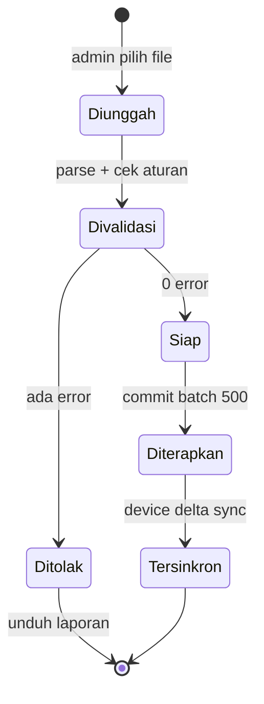

# Spesifikasi Import Produk — Warehouse Mobile App v2

| Field | Nilai |
|---|---|
| Versi | 1.0 |
| Tanggal | 16 November 2026 |
| Pemilik | Admin Sistem (operasional: Supervisor IT) |
| Requirement | FR-MST-04, FR-MST-05, UC-ADM-01 |
| Template | `templates/product-import-template.csv` |
| Validator | `tools/validate-products.ps1` |
| Contoh laporan | `templates/product-import-errors-example.csv` |

---

## 1. Tujuan

Menyediakan satu jalur resmi untuk memasukkan dan memperbarui master produk (2.000–5.000 SKU) tanpa input satu per satu, dengan validasi yang **menolak seluruh file jika ada satu kesalahan** dan laporan yang bisa diperbaiki operator.

**Ruang lingkup:** produk, barcode, UoM, stok minimum, status aktif, penugasan gudang.
**Di luar ruang lingkup:** stok awal/opening balance (lewat transaksi atau cycle-count), harga, supplier, batch/expiry.

---

## 2. Format File

| Atribut | Ketentuan |
|---|---|
| Format | CSV (UTF-8) |
| Delimiter | Koma (`,`) — **bukan** titik koma |
| Baris pertama | Header, harus persis seperti daftar kolom di §3 |
| Maksimum baris data | **5.000** per file |
| Maksimum ukuran file | **2 MB** |
| Baris kosong di akhir | Diabaikan |
| Encoding | UTF-8. Jika memakai Excel: **CSV UTF-8 (Comma delimited)** |
| Nama file | Bebas, disarankan `produk-YYYYMMDD.csv` |

**Header yang diharapkan:**

```
kode_produk,nama_produk,tipe,uom,barcode_1,barcode_2,barcode_3,stok_minimum,status,kode_gudang,keterangan
```

> Urutan kolom harus sama. Nama kolom tidak boleh diubah, ditambah, atau diterjemahkan.

---

## 3. Definisi Kolom

| # | Kolom | Wajib | Tipe | Aturan | Contoh |
|---|---|---|---|---|---|
| 1 | `kode_produk` | Ya | Teks | 3–32 karakter; `A-Z`, `0-9`, `.`, `_`, `-`; diawali huruf/angka; disimpan **UPPERCASE**; unik | `BRG-00001` |
| 2 | `nama_produk` | Ya | Teks | 3–200 karakter; tidak boleh diawali `=`, `+`, `-`, `@` | `Sarung Tangan Nitril M` |
| 3 | `tipe` | Ya | Enum | Lihat §4 | `consumable` |
| 4 | `uom` | Ya | Enum | Satuan **terkecil** yang dipakai di gudang | `box` |
| 5 | `barcode_1` | Ya | Teks | 4–48 karakter; `A-Z`, `0-9`, `.`, `_`, `-`; disimpan uppercase | `8991000000017` |
| 6 | `barcode_2` | Tidak | Teks | Aturan sama; boleh kosong | `8991000000024` |
| 7 | `barcode_3` | Tidak | Teks | Aturan sama; boleh kosong | — |
| 8 | `stok_minimum` | Tidak | Integer | 0–1.000.000; kosong = `0` | `10` |
| 9 | `status` | Ya | Enum | `aktif` atau `nonaktif` | `aktif` |
| 10 | `kode_gudang` | Ya | Teks | Harus kode gudang yang ada dan bisa diakses admin | `JKT-01` |
| 11 | `keterangan` | Tidak | Teks | Maksimum 200 karakter; tidak boleh diawali `=`, `+`, `-`, `@` | `Ukuran M` |

**Catatan implementasi:**
- Barcode yang sama pada beberapa kolom `barcode_*` dalam satu produk akan dideduplikasi (warning, bukan error).
- Barcode **unik secara global** (lintas gudang), sesuai skema `barcodes/{barcode}`.
- `kode_produk` adalah **kunci**: jika sudah ada, baris dianggap **update**; jika baru, **create**.

---

## 4. Nilai yang Diizinkan

### 4.1 `tipe`

| Nilai | Arti |
|---|---|
| `consumable` | Bahan habis pakai (sarung tangan, lakban) |
| `spare_part` | Suku cadang |
| `tool` | Alat yang tidak habis pakai |
| `packaging` | Kemasan |
| `other` | Lain-lain (gunakan catatan di `keterangan`) |

### 4.2 `uom`

`pcs`, `box`, `pack`, `roll`, `kg`, `g`, `liter`, `ml`, `meter`, `set`, `unit`

> UoM adalah **satuan terkecil** yang dicatat. Jika gudang menerima dalam karton tetapi mengeluarkan per box, gunakan `box` dan catat konversi di luar sistem (MVP tidak mendukung multi-UoM).

### 4.3 `status`

`aktif` (boleh ditransaksikan) · `nonaktif` (tidak boleh ditransaksikan, histori tetap tampil).

---

## 5. Aturan Validasi

Semua baris divalidasi; **semua kesalahan dikumpulkan**, bukan berhenti di yang pertama.

| Kode | Tingkat | Kolom | Aturan | Pesan |
|---|---|---|---|---|
| `E-FILE-SIZE` | Error | — | File ≤2 MB | Ukuran file melebihi 2 MB |
| `E-HEADER-MISSING` | Error | — | Semua kolom wajib ada | Kolom wajib tidak ditemukan |
| `E-HEADER-UNKNOWN` | Error | — | Tidak ada kolom asing | Kolom tidak dikenal |
| `E-PARSE` | Error | — | File dapat dibaca sebagai CSV | File tidak dapat dibaca |
| `E-EMPTY` | Error | — | Minimal 1 baris data | File tidak berisi baris produk |
| `E-BATCH-SIZE` | Error | — | ≤5.000 baris | Maksimum 5.000 baris per file |
| `E-CODE-REQUIRED` | Error | `kode_produk` | Tidak kosong | Kode produk wajib diisi |
| `E-CODE-FORMAT` | Error | `kode_produk` | Regex `^[A-Z0-9][A-Z0-9._-]{2,31}$` | Format kode tidak valid |
| `E-CODE-DUPLICATE` | Error | `kode_produk` | Unik dalam file | Kode sudah dipakai di baris N |
| `E-NAME-REQUIRED` | Error | `nama_produk` | Tidak kosong | Nama produk wajib diisi |
| `E-NAME-LENGTH` | Error | `nama_produk` | 3–200 karakter | Nama minimal/maksimum |
| `E-TYPE-INVALID` | Error | `tipe` | Ada di §4.1 | Tipe tidak dikenal |
| `E-UOM-INVALID` | Error | `uom` | Ada di §4.2 | Satuan tidak dikenal |
| `E-BARCODE-REQUIRED` | Error | `barcode_1` | Minimal satu barcode | Minimal satu barcode wajib |
| `E-BARCODE-FORMAT` | Error | `barcode_*` | Regex `^[A-Z0-9._-]{4,48}$` | Format barcode tidak valid |
| `E-BARCODE-DUPLICATE` | Error | `barcode_*` | Unik dalam file | Barcode sudah dipakai baris N |
| `E-BARCODE-EXISTS` | Error | `barcode_*` | Tidak dimiliki produk lain di DB | Barcode sudah dimiliki produk X |
| `E-MINSTOCK-NUMBER` | Error | `stok_minimum` | Bilangan bulat | Harus bilangan bulat |
| `E-MINSTOCK-RANGE` | Error | `stok_minimum` | 0–1.000.000 | Di luar rentang |
| `E-STATUS-INVALID` | Error | `status` | `aktif`/`nonaktif` | Status tidak dikenal |
| `E-WAREHOUSE-INVALID` | Error | `kode_gudang` | Kode gudang terdaftar | Kode gudang tidak dikenal |
| `E-NOTE-LENGTH` | Error | `keterangan` | ≤200 karakter | Keterangan terlalu panjang |
| `E-CSV-INJECTION` | Error | `nama_produk`, `keterangan` | Tidak diawali `= + - @` | Berisiko formula |
| `W-BARCODE-SELF` | Warning | `barcode_*` | Barcode berulang dalam satu produk | Hanya satu yang disimpan |

**Error = file ditolak. Warning = file tetap bisa diimpor.**

### 5.1 Normalisasi

| Nilai | Perlakuan |
|---|---|
| Spasi di awal/akhir | Dipangkas |
| `kode_produk` | Diubah ke UPPERCASE |
| `barcode_*` | Diubah ke UPPERCASE |
| `tipe`, `uom`, `status` | Diubah ke lowercase |
| `kode_gudang` | Diubah ke UPPERCASE |
| `stok_minimum` kosong | Menjadi `0` |
| `barcode_*` kosong | Diabaikan |

---

## 6. Semantik Impor

### 6.1 Create vs Update

| Kondisi | Perilaku |
|---|---|
| `kode_produk` belum ada | **Create** produk baru |
| `kode_produk` sudah ada | **Update** field: `nama_produk`, `tipe`, `uom`, `barcode_*`, `stok_minimum`, `status`, `keterangan` |
| `kode_produk` berubah | Dianggap produk **baru**; produk lama tidak berubah (nonaktifkan manual jika perlu) |
| Barcode dilepas dari produk | Dokumen `barcodes/{kode}` dihapus; produk lain tidak terpengaruh |
| Produk tidak ada di file | **Tidak dihapus** dan tidak diubah |
| `status=nonaktif` | Produk tidak bisa ditransaksikan; histori tetap |

**Tidak ada hard delete.** Penghapusan produk dilakukan dengan `status=nonaktif`.

### 6.2 All-or-nothing

- Validasi dijalankan untuk **seluruh file** sebelum satu pun dokumen ditulis.
- Jika ada **minimal satu error**, **nol** perubahan diterapkan.
- Warning tidak memblokir.
- Ini menggantikan perilaku "baris valid tetap masuk" pada UC-ADM-01 v1 agar master data tidak pernah setengah jadi.

### 6.3 Idempotensi

- `importId = SHA-256(isi file + kode_gudang + schemaVersion)`.
- File yang sama diimpor dua kali → hasil kedua **0 perubahan**, tercatat `skipped (duplicate)`.
- Update dengan isi identik → tidak menulis ulang dokumen (hindari biaya & version churn).

### 6.4 Audit

Setiap impor membuat satu dokumen `auditLogs`:

| Field | Isi |
|---|---|
| `action` | `product.import` |
| `actorUid` | Admin yang menjalankan |
| `reason` | Nama file + jumlah baris |
| `before` / `after` | Ringkasan: `{created, updated, unchanged, skipped}` |
| `at` | Timestamp server |

Perubahan per produk (nama, status, barcode) dicatat dengan nilai sebelum/sesudah.

### 6.5 Kunci konkurensi

- Hanya **satu impor aktif per gudang**. Jika ada impor berjalan, permintaan kedua ditolak dengan `E-IMPORT-LOCKED`.
- Batas 5 impor per jam per admin untuk mencegah loop.

---

## 7. Alur Impor



**Langkah operasional:**

1. Isi template (§9).
2. Jalankan validator — di Google Sheets: **Produk → Validasi sheet aktif**, atau `tools/validate-products.ps1` untuk file CSV.
3. Unggah file ke fitur **Import Produk** (admin).
4. Sistem menampilkan ringkasan: `baru / update / tidak berubah / error`.
5. Jika ada error: unduh laporan, perbaiki, ulangi dari langkah 2.
6. Jika bersih: konfirmasi **Terapkan**.
7. Device operator menerima perubahan pada delta sync berikutnya (≤15 menit saat online, atau saat app dibuka).

---

## 8. Format Laporan Error

File CSV dengan kolom:

```
baris,kode_error,tingkat,kolom,nilai,pesan
```

| Kolom | Arti |
|---|---|
| `baris` | Nomor baris di file (header = 1) |
| `kode_error` | Kode dari §5 |
| `tingkat` | `error` atau `warning` |
| `kolom` | Nama kolom penyebab |
| `nilai` | Nilai yang bermasalah (dipotong bila panjang) |
| `pesan` | Penjelasan yang bisa dibaca operator |

Contoh (lihat `templates/product-import-errors-example.csv`):

```csv
"baris","kode_error","tingkat","kolom","nilai","pesan"
"2","E-CODE-REQUIRED","error","kode_produk","","Kode produk wajib diisi."
"5","E-CODE-DUPLICATE","error","kode_produk","BRG-00010","Kode sudah dipakai di baris 4."
"8","E-UOM-INVALID","error","uom","salah","Satuan harus salah satu: pcs, box, ..."
```

**Aturan UX laporan:** tampilkan jumlah error per jenis di atas, lalu daftar baris. Jangan hanya menampilkan error pertama.

---

## 9. Template Google Sheets

### 9.1 Struktur tab

| Tab | Isi |
|---|---|
| `produk` | Data yang diisi (header + baris) |
| `petunjuk` | Ringkasan kolom & nilai yang diizinkan |
| `daftar_nilai` | Daftar tipe, uom, status, kode gudang (untuk dropdown) |

### 9.2 Membuat dropdown (Data validation)

> Cara tercepat: pasang Apps Script (§15.4) lalu jalankan **Produk → Buat / perbarui template**. Dropdown, format teks, dan sheet pendukung dibuat otomatis. Langkah manual di bawah hanya untuk yang tidak memakai script.

1. Isi `daftar_nilai`:
   - `A2:A6` → tipe (`consumable`, `spare_part`, `tool`, `packaging`, `other`)
   - `B2:B12` → uom (`pcs`, `box`, `pack`, `roll`, `kg`, `g`, `liter`, `ml`, `meter`, `set`, `unit`)
   - `C2:C3` → status (`aktif`, `nonaktif`)
   - `D2:D10` → kode gudang
2. Di tab `produk`, pilih kolom C (`tipe`) → **Data → Data validation → Dropdown (from a range)** → `daftar_nilai!A2:A6`.
3. Ulangi untuk `uom`, `status`, `kode_gudang`.
4. Format kolom barcode sebagai **Plain text** agar angka tidak berubah (`Format → Number → Plain text`).
5. Bekukan baris 1 (`View → Freeze → 1 row`).

### 9.3 Petunjuk singkat untuk tab `petunjuk`

```
CARA MENGISI
1. Jangan mengubah nama/urutan kolom.
2. Satu baris = satu produk.
3. kode_produk: 3-32 karakter, huruf besar, unik. Contoh: BRG-00001
4. Minimal satu barcode (barcode_1). Barcode tidak boleh sama antar produk.
5. uom = satuan terkecil (pcs/box/roll/kg/...).
6. status: aktif atau nonaktif. Jangan menghapus produk; ubah ke nonaktif.
7. keterangan maksimal 200 karakter.
8. Sebelum mengirim: File > Download > Comma-separated values (.csv, current sheet).
```

### 9.4 Export dari Sheets

`File → Download → Comma-separated values (.csv, current sheet)`.

> Pastikan sheet aktif adalah `produk`. Jangan mengunduh "entire workbook".

### 9.5 Jika memakai Excel

- `File → Save As → CSV UTF-8 (Comma delimited) (*.csv)`.
- Format kolom barcode sebagai **Text** sebelum mengetik.
- Jangan membuka CSV hasil export dengan Excel lalu menyimpan ulang tanpa memeriksa encoding.

---

## 10. Keamanan

| Aspek | Ketentuan |
|---|---|
| Otorisasi | Hanya `admin`; diperiksa di server, bukan hanya UI |
| Formula injection | Nilai teks yang diawali `= + - @` **ditolak**; saat menulis ke Sheet, prefix `'` |
| Ukuran & jumlah | ≤2 MB, ≤5.000 baris, ≤5 impor/jam |
| Penyimpanan file | Tidak disimpan publik; disimpan sementara ≤30 hari untuk audit |
| Data sensitif | Tidak ada PII; jangan mencantumkan harga/harga beli di kolom bebas |
| Audit | Semua impor tercatat; tidak bisa dihapus admin |
| Kunci gudang | Admin hanya boleh mengimpor untuk gudang yang menjadi kewenangannya |

---

## 11. Batas & Performa

| Metrik | Target |
|---|---|
| Validasi 5.000 baris (server) | ≤10 detik |
| Commit 5.000 baris (batch 500) | ≤2 menit |
| Delta sync ke device (50 perubahan) | ≤5 detik |
| Full sync awal 2.000 produk | ≤60 detik @3 Mbps |
| Ukuran DB lokal setelah import | ≤20 MB untuk 2.000 SKU |

---

## 12. Prosedur Operasional

### 12.1 Sebelum impor pertama

1. Pastikan gudang (`kode_gudang`) sudah dibuat.
2. Siapkan daftar UoM yang benar-benar dipakai gudang (jangan menambah enum tanpa persetujuan).
3. Ekspor master produk lama (jika ada) sebagai baseline rollback.
4. Uji dengan 20 baris di gudang uji.

### 12.2 Dry-run

- Jalankan validator lokal, lalu unggah. Sistem **tidak** menulis sebelum admin menekan **Terapkan**.
- Bandingkan ringkasan `baru/update` dengan perkiraan.

### 12.3 Rollback

- Tidak ada hard delete. Untuk membatalkan:
  1. Unggah file versi sebelumnya (upsert) untuk mengembalikan field.
  2. Produk yang tidak seharusnya dibuat → set `nonaktif`.
- Catat alasan di `auditLogs`.

### 12.4 Jadwal

- Impor besar di luar jam sibuk (setelah 17:00 atau sebelum 07:00).
- Hindari impor saat cycle-count berjalan (bisa mengubah `systemQty` referensi).

---

## 13. Uji Validasi (sudah diverifikasi)

File `templates/product-import-invalid-sample.csv` berisi 15 baris dan menghasilkan **13 error**:

| Baris | Kode error | Penyebab |
|---|---|---|
| 2 | `E-CODE-REQUIRED` | Kode kosong |
| 3 | `E-CODE-FORMAT` | Kode mengandung spasi |
| 5 | `E-CODE-DUPLICATE` | Kode sama dengan baris 4 |
| 6 | `E-BARCODE-REQUIRED` | Semua barcode kosong |
| 7 | `E-TYPE-INVALID` | `chemical` tidak ada di enum |
| 8 | `E-UOM-INVALID` | `salah` tidak ada di enum |
| 10 | `E-BARCODE-DUPLICATE` | Barcode sama dengan baris 9 |
| 11 | `E-MINSTOCK-RANGE` | `-5` di luar rentang |
| 12 | `E-STATUS-INVALID` | `aktifkan` bukan enum |
| 13 | `E-WAREHOUSE-INVALID` | `JKT-99` tidak terdaftar |
| 14 | `E-CSV-INJECTION` | Nama diawali `=` |
| 15 | `E-NAME-LENGTH` | Nama hanya 2 karakter |
| 16 | `E-NOTE-LENGTH` | Keterangan 259 karakter |

Baris 4 dan 9 valid — memastikan validator tidak menolak baris yang benar.

---

## 14. Acceptance Criteria (untuk FR-MST-04)

| # | Skenario | Kriteria |
|---|---|---|
| AC-1 | Impor 2.000 baris valid | Semua produk ada; 0 error; waktu ≤2 menit |
| AC-2 | Satu baris error | **0** perubahan; laporan memuat **semua** error (bukan hanya satu) |
| AC-3 | File sama diimpor 2× | Impor kedua: 0 perubahan; status `skipped` |
| AC-4 | Barcode milik produk lain | `E-BARCODE-EXISTS`; 0 perubahan |
| AC-5 | Update nama & status produk | Produk berubah; `updatedAt` naik; audit mencatat before/after |
| AC-6 | Barcode dilepas | `barcodes/{kode}` terhapus; scan barcode itu → "tidak dikenal" |
| AC-7 | Produk nonaktif | Tidak bisa ditransaksikan; histori tetap tampil |
| AC-8 | Device offline saat impor | Perubahan masuk saat sync berikutnya; tidak ada duplikat |
| AC-9 | File dengan formula | Ditolak `E-CSV-INJECTION` |
| AC-10 | Dua admin impor bersamaan | Yang kedua ditolak `E-IMPORT-LOCKED` |

---

## 15. Alat yang Disediakan

### 15.1 Template

`templates/product-import-template.csv` — header + 3 contoh valid.

### 15.2 Contoh file salah

`templates/product-import-invalid-sample.csv` — 15 baris, 13 error (untuk QA & pelatihan).

### 15.3 Validator

```powershell
# validasi dasar
.\tools\validate-products.ps1 .\templates\product-import-template.csv

# dengan daftar gudang lain
.\tools\validate-products.ps1 .\file.csv -Warehouses JKT-01,JKT-02

# cek barcode yang sudah dipakai produk existing
.\tools\validate-products.ps1 .\file.csv -ExistingProductsCsv .\produk-existing.csv
```

**Keluaran:** `file.errors.csv` + exit code `1` jika ada error.

Format `produk-existing.csv` (minimal):

```
kode_produk,barcode_1,barcode_2,barcode_3
BRG-00001,8991000000017,8991000000024,
```

### 15.4 Google Sheets + Apps Script (disarankan untuk admin gudang)

Paket siap pasang ada di folder `apps-script/`:

| File | Isi |
|---|---|
| `apps-script/Code.gs` | Menu **Produk**, validasi, laporan, export CSV, self-test |
| `apps-script/appsscript.json` | Manifest: V8, `Asia/Jakarta`, scope minimal |
| `apps-script/README.md` | Langkah pemasangan, alur kerja, troubleshooting |

Setelah dipasang, spreadsheet punya menu **Produk**:

| Menu | Fungsi |
|---|---|
| Validasi sheet aktif | Cek semua aturan, warnai sel bermasalah, tulis sheet `laporan_validasi` |
| Buat / perbarui template | Siapkan `produk`, `petunjuk`, `daftar_nilai` + dropdown + format teks |
| Unduh CSV | Validasi dulu; 0 error → buat file CSV di Drive |
| Jalankan self-test | Uji 13 kode error utama tanpa mengubah sheet |

Perbedaan dengan validator PowerShell (kode error & pesan tetap sama):

| Hal | PowerShell | Apps Script |
|---|---|---|
| Sumber data | File CSV | Sheet aktif |
| Formula di sel | Tidak terlihat di CSV | Terdeteksi → `E-CSV-INJECTION` |
| `E-FILE-SIZE` | Ya (≤2 MB) | Tidak berlaku (batas 10 juta sel Spreadsheet) |
| `E-BARCODE-EXISTS` | Ya, jika `-ExistingProductsCsv` diberikan | Tidak tersedia (butuh database) |
| Baris kosong | Dilewati | Dilewati |

Aturan yang hanya bisa dicek server: kode produk sudah ada (create vs update), barcode milik produk lain, dan kunci import bersamaan.

### 15.5 Catatan validator

- Validator memeriksa **aturan lokal** (format, enum, duplikat dalam file).
- Validator **tidak** memeriksa keberadaan `kode_produk` di database — itu dilakukan server (update vs create).
- `E-BARCODE-EXISTS` hanya dicek jika `-ExistingProductsCsv` diberikan.
- Server tetap wajib menjalankan validasi yang sama; validator lokal bersifat pencegahan, bukan pengganti.

---

## 16. Penyelarasan Dokumen

Keputusan "all-or-nothing" mengubah perilaku yang tertulis di dokumen lain:

| Dokumen | Perubahan |
|---|---|
| `use-case-matrix.md` UC-ADM-01 alt A1 | Dari "baris valid tetap masuk" → **seluruh file ditolak** |
| `PRD-v2.md` BR-13 (baru) | Impor produk bersifat all-or-nothing per file |
| `firestore-schema.md` §2.3 | Tambah field `note` (opsional) pada `products` |

---

## 17. FAQ

**Q: Produk tanpa barcode bagaimana?**
A: MVP mewajibkan minimal satu barcode karena alur utama adalah scan. Jika barang benar-benar tidak punya barcode, buat barcode internal (mis. `INT-000123`) dan cetak label. Input manual tetap tersedia sebagai fallback.

**Q: Bisa menambah UoM baru?**
A: Belum. Enum dijaga agar laporan konsisten. Ajukan perubahan lewat rilis aplikasi.

**Q: Bagaimana mengubah kode produk?**
A: Tidak bisa lewat impor. Nonaktifkan produk lama, buat kode baru. Histori tetap di kode lama.

**Q: Apakah stok awal bisa diisi lewat file ini?**
A: Tidak. Stok awal masuk melalui cycle-count pertama atau transaksi "masuk" dengan keterangan "saldo awal". Ini menjaga ledger tetap konsisten.

**Q: Kenapa file saya ditolak padahal hanya satu baris salah?**
A: Agar master data tidak setengah jadi dan sulit direkonsiliasi. Perbaiki baris tersebut lalu impor ulang; tidak ada perubahan yang tertinggal.

**Q: Apakah file saya tersimpan?**
A: File disimpan maksimal 30 hari untuk audit, tidak dapat diakses publik.
