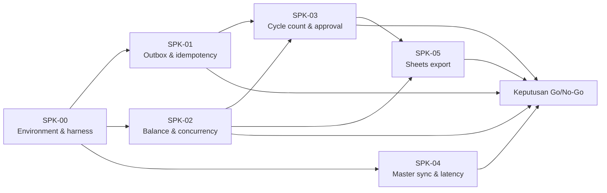

# Technical Spike Backlog — Warehouse Mobile App v2

| Field | Nilai |
|---|---|
| Versi | 1.0 |
| Tanggal | 16 November 2026 |
| Timebox total | **7 hari kerja** (1 sprint pendek) |
| Tim | 1 Flutter dev, 1 backend dev, 1 QA/Ops (device & data) |
| Dokumen acuan | `PRD-v2.md`, `firestore-schema.md`, `use-case-matrix.md` |
| Status | Siap dieksekusi setelah decision workshop (Q1, Q4, Q7) |

---

## 1. Tujuan Spike

Membuktikan **5 asumsi paling berisiko** di arsitektur sebelum tim menghabiskan berminggu-minggu membangun UI di atasnya:

1. Outbox offline benar-benar **exactly-once** (tidak ada duplikat, tidak ada data hilang).
2. Saldo di server **selalu sama** dengan ledger, termasuk saat dua device bersamaan.
3. Cycle-count → adjustment → approval menghasilkan saldo yang **sesuai fisik** dan jejak audit.
4. Master produk 2.000 SKU bisa dipakai **offline** dengan latency yang bisa diterima operator.
5. Export ke Google Sheets **idempoten** dan terverifikasi (tidak ada duplikat, bisa mendeteksi edit manual).

**Bukan tujuan spike:** kode produksi, UI final, PDF export, multi-warehouse, integrasi ERP.

### Aturan main

- Kode spike di branch `spike/*`, **tidak di-merge** ke `main`. Yang di-merge hanya: temuan, ADR, dan measurement report.
- Setiap spike punya **kriteria lulus biner**. Tidak ada "hampir lulus".
- Pengukuran memakai **device target nyata** (bukan emulator) untuk semua metrik latency.
- Jika device belum tersedia di hari 1, hasil latency ditandai **kondisional** dan spike tetap jalan untuk aspek fungsional.
- Waktu habis tetapi belum lulus → hentikan, tulis temuan, dan bawa ke keputusan arsitektur. Jangan memperpanjang diam-diam.

---

## 2. Deliverable

| # | Artefak | Format | Disimpan di |
|---|---|---|---|
| D1 | Measurement report per spike (p50/p95, jumlah operasi, device) | Markdown + CSV mentah | `docs/spikes/` |
| D2 | Bukti: screenshot, log, Firestore export, isi Sheet | Lampiran tiket | Tiket |
| D3 | ADR baru/terupdate (mis. pilihan scanner, strategi balance) | `docs/adr/ADR-00x.md` | Repo |
| D4 | Daftar bug/risiko yang ditemukan + mitigasi | Tabel | `docs/spikes/risks.md` |
| D5 | Estimasi ulang untuk vertical slice (berdasarkan temuan) | Tabel | Tiket |

---

## 3. Prasyarat (harus selesai di hari 1 pagi)

- [ ] 2 device target (Android 8+, punya Google Play Services), satu boleh mid-range.
- [ ] Firebase project **dev** (bukan produksi) + billing aktif untuk Functions.
- [ ] Google Spreadsheet uji, service account diberi akses **Editor**.
- [ ] Test data generator: 2.000 produk, 10.000 barcode, 500 transaksi historis.
- [ ] Akun uji: 2 operator, 1 supervisor, 1 admin (seed manual di Firestore).
- [ ] Scanner library kandidat: `mobile_scanner` (ML Kit) dan `zxing2` sebagai fallback.
- [ ] SQLCipher/Drift berjalan dan database **terbukti terenkripsi**.
- [ ] Harness pengukuran: `Stopwatch` → CSV (`op, iteration, duration_ms, ts`).

### 3.1 Spesifikasi data uji

| Data | Jumlah | Variasi wajib |
|---|---|---|
| Produk | 2.000 | 1 produk nonaktif, 1 produk stok 0, 1 nama 200 karakter, 1 dengan karakter non-ASCII |
| Barcode | 10.000 | 5 barcode/produk (Code128 + EAN-13 + 1 QR), 3 barcode sengaja duplikat untuk uji konflik |
| Transaksi | 500 | 30 hari, 3 operator, campuran masuk/keluar/adjustment |
| Cycle count | 1 sesi | 120 baris, 5 selisih (3 di antaranya >5%) |
| Device | 2 | 1 low-end (RAM 2–3 GB), 1 mid-range |

### 3.2 Cara ukur latency (wajib konsisten)

1. Warm-up 10 iterasi, dibuang.
2. Ukur minimal 200 iterasi.
3. Simpan tiap durasi ke CSV.
4. Hitung p50/p95: urutkan naik, `index = ceil(0.95 × n) − 1`.
5. Laporkan juga `max` dan jumlah outlier (>3× p50).
6. Setiap angka **wajib** disertai: device, versi OS, build app, kondisi jaringan.

---

## 4. Peta Dependensi & Urutan



**Paralelisasi:** S1 (client) dan S2 (backend) jalan bersamaan di hari 2–3. S4 (client) bisa mulai hari 3. S3 butuh S1+S2. S5 butuh S2.

---

## 5. Backlog Spike

---

### SPK-00 — Environment & test harness

| | |
|---|---|
| **Pemilik** | QA/Ops + Flutter dev |
| **Timebox** | 1 hari |
| **Dependensi** | Device & Firebase dev project |
| **Terkait** | NFR-REL-04, NFR-SEC-02 |

**Tujuan:** memastikan semua alat ukur siap sebelum spike fungsional, sehingga angka yang dikumpulkan konsisten.

**Langkah**
1. Buat project Flutter skeleton: login stub (boleh `signInAnonymously` untuk spike), SQLite + SQLCipher, layar scan stub.
2. Seed data uji ke Firestore + SQLite.
3. Buat harness CSV untuk latency dan log operasi.
4. Verifikasi enkripsi: buka file `.db` di luar app → harus gagal/tidak terbaca.
5. Verifikasi jam device sinkron (NTP) dan timezone `Asia/Jakarta`.

**Kriteria lulus**
- [ ] App berjalan di **2 device target** tanpa crash selama 30 menit.
- [ ] Database lokal terenkripsi (dibuktikan: file tidak dapat dibuka tanpa kunci).
- [ ] Data uji lengkap sesuai §3.1 dan bisa di-query offline.
- [ ] Harness menghasilkan CSV valid (≥200 baris) dan perhitungan p95 cocok dengan hitung manual.
- [ ] Waktu device dan server selisih **< 2 detik**.

**Bukti:** screenshot, output verifikasi enkripsi, contoh CSV.

---

### SPK-01 — Outbox offline & idempotency (S1)

| | |
|---|---|
| **Pemilik** | Flutter dev |
| **Timebox** | 2 hari |
| **Dependensi** | SPK-00 |
| **Terkait** | BR-04, FR-SCN-06/07, FR-SYN-01/02, NFR-REL-01/04, NFR-PERF-02 |

**Hipotesis:** dengan document ID = UUIDv7 dan semantik create-only, pengiriman ulang tidak akan pernah menghasilkan duplikat, dan force-stop tidak menghasilkan baris setengah jadi.

**Langkah**
1. Implementasi `transactions` lokal + `INSERT` atomik (satu transaksi SQLite per submit).
2. Worker: ambil batch 100, kirim `create` (bukan `set`), tandai `synced` hanya setelah ACK.
3. Uji A: 100 transaksi offline → sync → hitung dokumen di Firestore.
4. Uji B: kirim ulang seluruh batch **10×** (simulasi ACK hilang) → hitung dokumen.
5. Uji C: force-stop saat submit, 20×, acak antara tap dan commit → cek konsistensi lokal.
6. Uji D: airplane mode penuh selama 30 menit dengan 300 transaksi → nyalakan jaringan → verifikasi semua terkirim.
7. Uji E: ukur scan→saved 200 iterasi, offline.

**Kriteria lulus (semua wajib)**

| # | Kriteria | Ambang |
|---|---|---|
| 1 | Dokumen di Firestore setelah Uji A | **tepat 100**, 0 duplikat |
| 2 | Dokumen setelah 10× replay | **tetap 100** |
| 3 | Baris setengah jadi setelah force-stop | **0 dari 20 percobaan** |
| 4 | Kehilangan data setelah 20 kill/restart | **0 transaksi** |
| 5 | Batch 300 setelah offline 30 menit | **100% terkirim**, tanpa intervensi manual |
| 6 | Scan→saved p95 (offline) | **≤ 1,5 detik** |
| 7 | Retry/backoff | retry ke-6 berhenti, status `failed`, alasan tersimpan |

**Sinyal gagal:** ada duplikat, ada baris tanpa `signed_qty`, tombol submit bisa membuat 2 baris, sync macet tanpa status.

**Bukti:** jumlah dokumen via query/export, log force-stop, CSV latency.

---

### SPK-02 — Balance apply & concurrency (S2)

| | |
|---|---|
| **Pemilik** | Backend dev |
| **Timebox** | 2–3 hari |
| **Dependensi** | SPK-00 |
| **Terkait** | BR-01/03/12, D5, FR-STK-01/09, UC-STK-07, NFR-REL-02 |

**Hipotesis:** satu Cloud Function dengan Firestore transaction mampu menjaga `ending = Σ signed_qty` pada beban realistis, dan konflik antar-device terdeteksi, bukan hilang.

**Langkah**
1. Trigger `onDocumentCreated('transactions/{id}')` → `runTransaction` pada `balances/{productId}`.
2. Guard replay: `lastTransactionId` + cek idempotensi.
3. Tolak `outgoing` yang membuat `ending < 0` (kecuali override supervisor) → set `serverStatus='rejected'`.
4. Uji A: 1.000 operasi acak (masuk/keluar/adjustment) → bandingkan saldo dengan Σ `signedQty`.
5. Uji B: 2 device, 1 SKU, **50 transaksi keluar bersamaan** → cek lost update.
6. Uji C: kirim ulang 1 transaksi 100× → saldo tidak berubah.
7. Uji D: 2 device menghitung saldo lokal berbeda (simulasi edit manual) → pastikan `stockConflicts` dibuat.
8. Uji E: beban 2 write/detik ke dokumen yang sama selama 60 detik → catat kegagalan/retry.

**Kriteria lulus**

| # | Kriteria | Ambang |
|---|---|---|
| 1 | Saldo vs ledger setelah 1.000 operasi | **selisih 0** untuk semua produk |
| 2 | 50 transaksi bersamaan, 1 SKU | **tidak ada lost update**; saldo = awal − 50 |
| 3 | Replay 100× | saldo berubah **tepat 1×** |
| 4 | Outgoing melebihi stok | ditolak, saldo **tidak berubah**, alasan tersimpan |
| 5 | Konflik device vs server | **100%** tercatat di `stockConflicts` |
| 6 | Beban 2 write/detik | kegagalan terdokumentasi + retry berhasil; tidak ada saldo korup |

**Sinyal gagal:** saldo drift, write contention menyebabkan Function gagal permanen, konflik tidak terdeteksi.

**Keputusan yang mungkin keluar:** jika contention > 1 write/detik tidak tertangani, aktifkan **sharded counters** (lihat `firestore-schema.md` §5.2) sebelum vertical slice.

---

### SPK-03 — Cycle count → adjustment → approval (S3)

| | |
|---|---|
| **Pemilik** | Backend dev + Flutter dev |
| **Timebox** | 2 hari |
| **Dependensi** | SPK-01, SPK-02 |
| **Terkait** | BR-02/10, D4, FR-STK-03..07, UC-STK-02..05 |

**Hipotesis:** alur cycle-count dapat menghasilkan saldo yang sama dengan hitungan fisik tanpa menimpa ledger, dan approval bersifat idempoten.

**Langkah**
1. Buat sesi dengan 120 baris, 5 variance (−3, −3, +4, 0, 0), 3 di antaranya >5%.
2. Submit → pastikan status `submitted`, **belum ada** perubahan saldo.
3. Approve → verifikasi 3 transaksi `adjustment` dibuat (baris variance 0 tidak).
4. Approve ulang (double-click / retry) → verifikasi tidak ada adjustment kedua.
5. Tolak sesi → status `rejected`, alasan tersimpan, operator bisa recount dan submit ulang.
6. Uji sesi semua variance 0 → auto-approve tanpa adjustment.
7. Cek `auditLogs`: aktor, alasan, timestamp, entity.

**Kriteria lulus**

| # | Kriteria | Ambang |
|---|---|---|
| 1 | Saldo akhir semua produk | **= `countedQty`** |
| 2 | Jumlah adjustment | **= jumlah baris variance ≠ 0** |
| 3 | Approval ganda | tetap **1 set** adjustment |
| 4 | Penolakan | status `rejected`, **0** adjustment, alasan wajib ada |
| 5 | Variance 0 | **0** adjustment, status `approved` |
| 6 | Audit log | lengkap untuk submit, approve, reject |
| 7 | Sesi `open` ganda per gudang | ditolak (BR-10) |

**Sinyal gagal:** adjustment dobel, saldo tidak sama dengan fisik, approval tanpa jejak.

---

### SPK-04 — Master data sync & scan latency (S4)

| | |
|---|---|
| **Pemilik** | Flutter dev |
| **Timebox** | 2 hari |
| **Dependensi** | SPK-00 |
| **Terkait** | FR-MST-01..05, FR-SCN-02, NFR-PERF-02 |

**Hipotesis:** 2.000 SKU + 10.000 barcode bisa disinkronkan dan dipakai offline dengan latency yang tidak mengganggu operator, pada device low-end.

**Langkah**
1. Full sync 2.000 produk → ukur waktu dan ukuran DB.
2. Ubah 50 produk di server → delta sync → ukur waktu.
3. Uji lookup barcode 1.000× acak (offline) → ukur p50/p95.
4. Uji scan→saved 200× pada device low-end dan mid-range.
5. Uji barcode duplikat: dua produk mengklaim kode sama → pastikan import menolak, device tidak ambigu.
6. Uji master usang: majukan `lastSyncAt` 25 jam → banner muncul.
7. Uji produk nonaktif & nama 200 karakter → tampilan tidak rusak.

**Kriteria lulus**

| # | Kriteria | Ambang |
|---|---|---|
| 1 | Full sync 2.000 SKU @3 Mbps | **≤ 60 detik** |
| 2 | Delta sync 50 perubahan | **≤ 5 detik** |
| 3 | Lookup barcode offline p95 | **≤ 50 ms** |
| 4 | Scan→saved p95 device low-end | **≤ 1,5 detik** |
| 5 | Ukuran DB lokal 2.000 SKU | **≤ 20 MB** |
| 6 | Barcode duplikat | **0** kebingungan: import ditolak, lookup unik |
| 7 | Banner master usang | muncul tepat setelah >24 jam |

**Sinyal gagal:** lookup > 100 ms, scan→saved > 2 detik, UI freeze saat sync.

**Keputusan yang mungkin keluar:** ganti library scanner, tambah index SQLite, atau naikkan spesifikasi minimum device.

---

### SPK-05 — Export Sheets & rekonsiliasi (S5)

| | |
|---|---|
| **Pemilik** | Backend dev |
| **Timebox** | 1–2 hari |
| **Dependensi** | SPK-02 |
| **Terkait** | BR-05, D2, FR-SYN-05/06/07, NFR-PERF-03/04, NFR-DATA-02 |

**Hipotesis:** export harian dapat idempoten, terverifikasi checksum, dan tahan terhadap retry/kuota.

**Langkah**
1. Siapkan 5.000 transaksi pada periode D-1.
2. Jalankan export 02:00 WIB (simulasi manual trigger) → catat durasi & `rowCount`.
3. Jalankan ulang untuk periode sama → pastikan tidak ada baris ganda.
4. Bandingkan checksum Sheet vs Firestore.
5. Simulasikan edit manual 1 baris → jalankan rekonsiliasi.
6. Simulasikan error kuota (mock 429) → verifikasi retry/backoff dan status `failed`.
7. Uji tanggal: pastikan periode yang diekspor benar-benar D-1 dalam WIB, bukan UTC.

**Kriteria lulus**

| # | Kriteria | Ambang |
|---|---|---|
| 1 | `rowCount` Sheet vs Firestore | **sama persis** |
| 2 | Export ulang | **0 duplikat** |
| 3 | Checksum | cocok; edit manual terdeteksi sebagai `tampered` |
| 4 | Retry kuota | 3 percobaan, status akhir tercatat |
| 5 | Waktu export 5.000 baris | **≤ 5 menit** |
| 6 | Zona waktu | D-1 WIB benar (uji di 23:59 dan 00:01 WIB) |
| 7 | Kolom | lengkap sesuai `firestore-schema.md` §5.5 |

**Sinyal gagal:** duplikat setelah retry, baris hilang, periode salah.

**Keputusan yang mungkin keluar:** jika Sheets API tidak stabil/terblokir kebijakan organisasi, ganti output ke **CSV di Cloud Storage + link**, bukan Sheets.

---

### SPK-06 — (Opsional, P2) Enkripsi & pemulihan

| | |
|---|---|
| **Pemilik** | Flutter dev |
| **Timebox** | 0,5 hari |
| **Terkait** | NFR-SEC-02, NFR-DATA-03 |

**Kriteria lulus**
- [ ] Kunci SQLCipher tersimpan di Android Keystore, tidak muncul di log/crash report.
- [ ] DB tidak bisa dibuka setelah app di-uninstall lalu dipasang ulang tanpa login.
- [ ] Restore dari backup Firestore (jika tersedia) mengembalikan saldo & transaksi konsisten.

---

## 6. Kriteria Go / No-Go

Rapat keputusan di akhir hari 7. Setiap baris bernilai **Lulus / Tidak**.

| Spike | Pertanyaan keputusan | Jika Tidak Lulus |
|---|---|---|
| SPK-00 | Alat ukur & data uji valid? | Ulangi setup, jangan lanjut |
| SPK-01 | Exactly-once terbukti? | **Stop.** Perbaiki desain outbox sebelum UI |
| SPK-02 | Saldo selalu = ledger? | **Stop.** Pertimbangkan sharded counter / desain ulang |
| SPK-03 | Cycle-count menghasilkan saldo fisik? | Perbaiki alur adjustment sebelum vertical slice |
| SPK-04 | Latency & master data layak? | Ganti library/device, atau revisi NFR |
| SPK-05 | Export akurat & idempoten? | Ganti mekanisme output (CSV/Storage) |

**Aturan:** jika SPK-01 **atau** SPK-02 gagal, vertical slice **tidak dimulai**. Dua spike itu adalah fondasi seluruh produk.

---

## 7. Rencana 7 Hari

| Hari | Flutter dev | Backend dev | QA/Ops |
|---|---|---|---|
| 1 | SPK-00 skeleton, SQLCipher | SPK-00 Firebase dev, seed | Device, akun uji, spreadsheet |
| 2 | SPK-01 outbox | SPK-02 trigger saldo | Data uji lengkap, harness |
| 3 | SPK-01 kill/replay + latency | SPK-02 concurrency | Observasi, catat anomali |
| 4 | SPK-04 master sync & lookup | SPK-02 selesai, mulai SPK-03 | Uji device low-end |
| 5 | SPK-04 latency & duplikat barcode | SPK-03 approval | Verifikasi audit log |
| 6 | Perbaikan temuan SPK-01/04 | SPK-05 export | Uji edit manual & zona waktu |
| 7 | Konsolidasi angka | Konsolidasi angka | Rapat Go/No-Go, tulis laporan |

**Output hari 7:** measurement report, daftar risiko, ADR terupdate, estimasi vertical slice.

---

## 8. Risiko Spike

| Risiko | Dampak | Mitigasi |
|---|---|---|
| Device target belum tersedia | Latency tidak valid | Pinjam dari gudang hari 1; jika gagal, tandai hasil kondisional |
| Firebase billing/quota | Function tidak jalan | Gunakan project dev berbayar; pantau kuota |
| Kebijakan Workspace memblokir service account | SPK-05 gagal karena organisasi, bukan kode | Minta izin hari 1; siapkan fallback CSV |
| Data uji tidak realistis | Kesimpulan menyesatkan | Gunakan barcode & nama produk asli dari gudang |
| SQLCipher/Drift tidak kompatibel | Blocker teknis | Uji di SPK-00, siapkan alternatif (Room + SQLCipher) |
| Spike melebar jadi fitur | Waktu habis | Timebox ketat, branch terpisah, tidak ada polish UI |
| Pengukuran tidak konsisten | Angka tidak bisa dibandingkan | Wajib pakai protokol §3.2 dan device yang sama |

---

## 9. Template Tiket (siap copy ke Jira/Trello)

```
Judul      : [SPK-0x] <nama spike>
Tipe       : Spike (timebox)
Timebox    : <n> hari
Pemilik    : <nama>
Dependensi : <SPK-xx>
Tujuan     : <satu kalimat>
Hipotesis  : <satu kalimat yang bisa dibuktikan salah>

Langkah
1. ...
2. ...

Kriteria lulus (biner)
[ ] ...
[ ] ...

Metrik & ambang
- <metrik> : <ambang>

Bukti yang dilampirkan
- CSV pengukuran
- Screenshot / log
- Query/export Firestore

Hasil
Status     : Lulus / Tidak
Temuan     : ...
Keputusan  : ...
Tindak lanjut (tiket produksi): ...
```

---

## 10. Definition of Done Spike

- [ ] Semua 5 spike wajib punya status **Lulus/Tidak** yang eksplisit.
- [ ] Setiap angka punya CSV mentah dan keterangan device.
- [ ] Setiap kegagalan punya analisis akar masalah (bukan hanya "gagal").
- [ ] ADR diperbarui untuk keputusan yang berubah (scanner, counter, output Sheets).
- [ ] Risiko baru masuk ke register PRD §11.
- [ ] Estimasi vertical slice diperbarui berdasarkan kecepatan nyata.
- [ ] Kode spike diberi tag `spike-complete` dan **tidak** masuk `main`.

---

## 11. Setelah Spike

Jika semua lulus, urutan berikutnya:

1. **Vertical slice** — auth + scan masuk/keluar + sync + stock card (bukan semua fitur). Rincian tiket & gate: `vertical-slice-backlog.md`.
2. **Pilot 1 gudang** dengan 50–100 SKU asli, 2 minggu, target M1 ≥98%.
3. **Baru** perluas: cycle-count di pilot penuh, laporan, export PDF.

Jika ada yang gagal, kembali ke **decision workshop** dengan data — jangan menambah fitur di atas fondasi yang belum terbukti.
