# Matriks Use Case Lengkap — Warehouse Mobile App v2

Dokumen pendamping: `PRD-v2.md` (requirement & aturan bisnis) dan `firestore-schema.md` (data).

**Legenda**
- **Prioritas:** `Must` = wajib MVP, `Should` = MVP jika waktu memungkinkan, `Could` = P2.
- **Status dokumen:** semua UC berstatus *Specified* (siap masuk desain & test), bukan *Implemented*.
- Setiap UC memiliki ID stabil dan tidak boleh dipakai ulang.

---

## 1. Aktor

| Aktor | Tipe | Deskripsi |
|---|---|---|
| **Operator Gudang** | Manusia | Mencatat transaksi, menghitung fisik, melihat stok |
| **Supervisor Gudang** | Manusia | Approve selisih, reversal, laporan, resolusi konflik |
| **Admin Sistem** | Manusia | Kelola produk, user, role, monitoring |
| **Sistem (Scheduler)** | Non-manusia | Closing harian, export Sheets, rekonsiliasi |
| **Sistem (Sync Worker)** | Non-manusia | Outbox device → Firestore |
| **Firebase Auth** | Sistem eksternal | Identitas Google |
| **Google Sheets API** | Sistem eksternal | Tujuan export |

---

## 2. Diagram Use Case

```mermaid
graph LR
    OP([Operator])
    SP([Supervisor])
    AD([Admin])
    SYS([Sistem])

    subgraph Auth
      A1(("UC-AUTH-01<br/>Login"))
      A2(("UC-AUTH-02<br/>Akun ditolak"))
      A3(("UC-AUTH-03<br/>Logout"))
      A4(("UC-AUTH-04<br/>Sesi berakhir"))
    end

    subgraph Transaksi
      T1(("UC-SCN-01<br/>Barang masuk"))
      T2(("UC-SCN-02<br/>Barang keluar"))
      T3(("UC-SCN-03<br/>Barcode tak dikenal"))
      T4(("UC-SCN-04<br/>Input manual"))
      T5(("UC-SCN-05<br/>Stok negatif"))
      T6(("UC-SCN-06<br/>Reversal"))
      T7(("UC-SCN-07<br/>Anti duplikat"))
    end

    subgraph Stok
      S1(("UC-STK-01<br/>Lihat stock card"))
      S2(("UC-STK-02<br/>Mulai cycle count"))
      S3(("UC-STK-03<br/>Hitung fisik"))
      S4(("UC-STK-04<br/>Review & submit"))
      S5(("UC-STK-05<br/>Approve adjustment"))
      S6(("UC-STK-06<br/>Closing harian"))
      S7(("UC-STK-07<br/>Resolusi konflik"))
    end

    subgraph Laporan
      R1(("UC-RPT-01<br/>Histori"))
      R2(("UC-RPT-02<br/>Laporan & export"))
    end

    subgraph Sinkronisasi
      Y1(("UC-SYN-01<br/>Sync otomatis"))
      Y2(("UC-SYN-02<br/>Sync manual/gagal"))
      Y3(("UC-SYN-03<br/>Export Sheets"))
      Y4(("UC-SYN-04<br/>Rekonsiliasi"))
    end

    subgraph Administrasi
      D1(("UC-ADM-01<br/>Kelola produk"))
      D2(("UC-ADM-02<br/>Kelola user"))
      D3(("UC-ADM-03<br/>Monitoring"))
    end

    OP --> A1
    OP --> A3
    OP --> A4
    OP --> T1
    OP --> T2
    OP --> T4
    OP --> S1
    OP --> S2
    OP --> S3
    OP --> S4
    OP --> R1
    OP --> Y2

    SP --> T5
    SP --> T6
    SP --> S1
    SP --> S5
    SP --> S7
    SP --> R2
    SP --> Y2

    AD --> A2
    AD --> D1
    AD --> D2
    AD --> D3

    SYS --> S6
    SYS --> Y1
    SYS --> Y3
    SYS --> Y4
    T3 -.->|"extend"| T1
```

---

## 3. Detail Use Case

### 3.1 Autentikasi

#### UC-AUTH-01 — Login dengan Google
| | |
|---|---|
| **Aktor** | Operator, Supervisor, Admin |
| **Precondition** | App terpasang; perangkat punya Google Play Services; koneksi internet tersedia (login pertama wajib online) |
| **Trigger** | Pengguna membuka app dan belum punya sesi |
| **Main flow** | 1. App menampilkan layar login. 2. Pengguna menekan "Masuk dengan Google". 3. Pengguna memilih akun Google. 4. Firebase Auth memvalidasi dan mengembalikan UID. 5. App membaca `users/{uid}`; memeriksa `active` dan `role`. 6. App memuat delta master produk ke SQLite. 7. App menampilkan home sesuai role. |
| **Alternate** | A1: Tidak ada jaringan → pesan "Butuh koneksi untuk login pertama", tetap di layar login. A2: `users/{uid}` tidak ada atau `active=false` → **UC-AUTH-02**. A3: Master produk gagal dimuat → masuk home dengan banner "Master data belum lengkap", scan dinonaktifkan sampai sync sukses. |
| **Postcondition** | Sesi aktif; `lastLoginAt` tercatat; cache master tersedia atau banner peringatan tampil |
| **FR terkait** | FR-AUTH-01, FR-AUTH-04, FR-MST-01 |
| **Prioritas** | Must |

#### UC-AUTH-02 — Akun Google ditolak
| | |
|---|---|
| **Aktor** | Operator/Supervisor/Admin |
| **Precondition** | Autentikasi Google berhasil, tetapi otorisasi aplikasi gagal |
| **Main flow** | 1. App menerima UID dari Firebase Auth. 2. App tidak menemukan `users/{uid}` atau `active=false`. 3. App menampilkan pesan "Akun belum terdaftar. Hubungi admin." beserta kontak admin. 4. App melakukan sign-out Firebase. 5. App tidak menulis data apa pun ke cache. |
| **Alternate** | A1: `role` tidak dikenali → diperlakukan sama seperti akun ditolak. A2: `warehouseIds` kosong → pesan "Akun belum ditugaskan ke gudang". |
| **Postcondition** | Tidak ada sesi aktif; tidak ada data tersimpan |
| **FR terkait** | FR-AUTH-05 |
| **Prioritas** | Must |

#### UC-AUTH-03 — Logout
| | |
|---|---|
| **Aktor** | Operator, Supervisor, Admin |
| **Precondition** | Sesi aktif |
| **Main flow** | 1. Pengguna membuka menu dan memilih "Logout". 2. App menampilkan konfirmasi. 3. App memeriksa jumlah transaksi `pending`. 4. App menghapus sesi Firebase, database lokal terenkripsi, dan cache. 5. App kembali ke layar login. |
| **Alternate** | A1: Ada transaksi `pending` → app memblokir logout dan menawarkan "Sync sekarang"; logout hanya bisa dilanjutkan setelah sync sukses **atau** pengguna mencentang "Saya paham data akan hilang" (tercatat di log lokal). A2: Sync gagal → opsi ekspor data ke file sebelum logout. |
| **Postcondition** | Sesi berakhir; tidak ada residu data di perangkat |
| **FR terkait** | FR-AUTH-03 |
| **Prioritas** | Must |

#### UC-AUTH-04 — Sesi berakhir / re-autentikasi
| | |
|---|---|
| **Aktor** | Operator, Supervisor, Admin |
| **Precondition** | Sesi tersimpan tetapi token tidak valid, atau offline > 7 hari (NFR-SEC-05) |
| **Main flow** | 1. App dibuka dan memvalidasi sesi. 2. Validasi gagal (token kedaluwarsa / batas offline terlampaui). 3. App menampilkan layar login dengan pesan "Sesi berakhir, silakan masuk kembali". 4. Pengguna login ulang. 5. App mempertahankan transaksi `pending` dan melanjutkan sync. |
| **Alternate** | A1: Login dengan akun berbeda → transaksi `pending` milik akun lama tidak boleh terkirim; app meminta upload dengan akun lama atau ekspor data. |
| **Postcondition** | Sesi baru aktif; data yang belum terkirim tetap utuh |
| **FR terkait** | FR-AUTH-02, FR-AUTH-06 |
| **Prioritas** | Must |

---

### 3.2 Transaksi (Scan)

#### UC-SCN-01 — Mencatat transaksi barang masuk
| | |
|---|---|
| **Aktor** | Operator |
| **Precondition** | Login; master produk tersinkron; izin kamera diberikan; barcode terdaftar |
| **Trigger** | Operator memilih menu "Scan" |
| **Main flow** | 1. App membuka kamera dan overlay scanner. 2. Operator memindai barcode. 3. App mencari barcode di `barcodes_cache` lokal (tanpa jaringan). 4. App menampilkan kode, nama, tipe, UoM, dan saldo saat ini. 5. Operator memilih "Masuk". 6. Operator memasukkan qty (default 1, tombol +/−). 7. Operator menekan "Simpan". 8. App memvalidasi qty > 0 dan produk `active`. 9. App menulis ke SQLite dengan `syncStatus=pending` dan memperbarui saldo lokal. 10. App menampilkan konfirmasi dan mengaktifkan scanner lagi. |
| **Alternate** | A1: Barcode tidak ditemukan → **UC-SCN-03**. A2: Kamera gagal/izin ditolak → **UC-SCN-04** (input manual). A3: Produk nonaktif → pesan "Produk tidak aktif", transaksi ditolak (BR-08). A4: Tap "Simpan" berulang → **UC-SCN-07**. A5: Master data > 24 jam → banner peringatan, transaksi tetap boleh (FR-MST-03). |
| **Postcondition** | 1 transaksi `incoming` tersimpan lokal (`pending`); saldo lokal bertambah; entri outbox dibuat |
| **FR terkait** | FR-SCN-01, FR-SCN-02, FR-SCN-04, FR-SCN-05, FR-SCN-07, FR-MST-02, FR-STK-01 |
| **Prioritas** | Must |

#### UC-SCN-02 — Mencatat transaksi barang keluar
| | |
|---|---|
| **Aktor** | Operator |
| **Precondition** | Sama seperti UC-SCN-01; saldo produk > 0 |
| **Main flow** | 1–4. Sama seperti UC-SCN-01 (scan & tampil detail). 5. Operator memilih "Keluar". 6. Operator memasukkan qty. 7. App menghitung `ending = saldo lokal − qty`. 8. Jika `ending ≥ 0`, simpan sebagai `outgoing` (`pending`). 9. App menampilkan konfirmasi. |
| **Alternate** | A1: `ending < 0` → **UC-SCN-05**. A2: Produk tidak ditemukan → **UC-SCN-03** / **UC-SCN-04**. A3: Qty melebihi saldo tetapi operator punya izin override (supervisor) → **UC-SCN-05**. |
| **Postcondition** | 1 transaksi `outgoing` tersimpan lokal; saldo lokal berkurang |
| **FR terkait** | FR-SCN-01, FR-SCN-04, FR-SCN-09 |
| **Prioritas** | Must |

#### UC-SCN-03 — Barcode tidak dikenal
| | |
|---|---|
| **Aktor** | Operator |
| **Precondition** | Hasil scan tidak ada di `barcodes_cache` |
| **Main flow** | 1. App menampilkan "Barang tidak dikenal". 2. App menawarkan tiga opsi: scan ulang, cari berdasarkan kode/nama, atau input manual. 3. Operator memilih pencarian; app menampilkan hasil dari cache lokal. 4. Jika produk ditemukan, alur berlanjut ke UC-SCN-01/02. 5. Jika tidak ditemukan, app menampilkan "Hubungi admin untuk mendaftarkan produk". |
| **Alternate** | A1: Barcode terbaca tetapi format tidak didukung → pesan "Format barcode tidak didukung". A2: Perangkat offline dan produk baru belum tersinkron → pesan yang sama, disarankan sync. |
| **Postcondition** | Tidak ada transaksi dibuat; event dicatat untuk analisis master data |
| **FR terkait** | FR-SCN-03, FR-MST-02 |
| **Prioritas** | Must |

#### UC-SCN-04 — Input manual (barcode rusak)
| | |
|---|---|
| **Aktor** | Operator |
| **Precondition** | Login; barcode fisik rusak/tidak terbaca, atau kamera bermasalah |
| **Main flow** | 1. Operator memilih "Input manual" pada layar scan. 2. Operator mengetik kode produk (atau sebagian nama). 3. App mencari di cache lokal dan menampilkan maksimal 20 hasil. 4. Operator memilih produk. 5. Alur berlanjut ke UC-SCN-01/02 dengan `source = manual`. |
| **Alternate** | A1: Kode tidak ditemukan → **UC-SCN-03** langkah 5. A2: Lebih dari satu produk cocok (nama mirip) → operator memilih berdasarkan kode & UoM yang ditampilkan. |
| **Postcondition** | Transaksi tercatat dengan `source = manual` untuk analisis kualitas barcode |
| **FR terkait** | FR-SCN-10 |
| **Prioritas** | Must |

#### UC-SCN-05 — Penolakan / override stok negatif
| | |
|---|---|
| **Aktor** | Operator (ditolak), Supervisor (override) |
| **Precondition** | Transaksi `outgoing` akan membuat `ending < 0` (BR-03) |
| **Main flow** | 1. App mendeteksi `ending < 0`. 2. App menolak submit dan menampilkan saldo saat ini. 3. Untuk Supervisor, app menampilkan opsi "Override". 4. Supervisor mengisi alasan (wajib, ≥ 10 karakter). 5. App menyimpan transaksi dengan `approval.status = pending` dan flag override. 6. Server mencatat `auditLogs` dan menerapkan transaksi. |
| **Alternate** | A1: Operator (bukan supervisor) → tidak ada opsi override; hanya "Batal" atau "Ubah qty". A2: Saldo lokal usang (belum sync) → server dapat menolak saat sync; transaksi ditandai `failed` dengan alasan "stok tidak cukup di server" dan masuk antrean review. |
| **Postcondition** | Transaksi ditolak, atau tersimpan dengan jejak override yang dapat diaudit |
| **FR terkait** | FR-SCN-09 |
| **Prioritas** | Must |

#### UC-SCN-06 — Reversal transaksi (Supervisor)
| | |
|---|---|
| **Aktor** | Supervisor |
| **Precondition** | Transaksi asli berstatus `applied`; belum pernah di-reverse |
| **Main flow** | 1. Supervisor membuka histori dan memilih transaksi. 2. Menekan "Batalkan transaksi". 3. Mengisi alasan (wajib). 4. App membuat transaksi baru `type=reversal`, `refTransactionId` = transaksi asli, qty berlawanan (BR-06). 5. Saldo diperbarui; audit log dicatat. 6. Transaksi asli tetap ada dan ditandai "Sudah di-reverse". |
| **Alternate** | A1: Transaksi sudah di-reverse → tombol nonaktif, pesan jelas. A2: Transaksi masih `pending` di device → reversal dilakukan lokal (belum terkirim) dan kedua transaksi dikirim berurutan. |
| **Postcondition** | Saldo kembali ke nilai sebelum transaksi asli; tidak ada data yang dihapus |
| **FR terkait** | FR-SCN-08, FR-ADM-03 |
| **Prioritas** | Must |

#### UC-SCN-07 — Pencegahan duplikat scan/submit
| | |
|---|---|
| **Aktor** | Operator |
| **Precondition** | Operator menekan simpan dua kali, atau scan produk sama berulang dalam waktu singkat |
| **Main flow** | 1. App menonaktifkan tombol simpan segera setelah tap pertama. 2. `transactionId` (UUIDv7) dibuat sekali per submit. 3. `INSERT` ke SQLite dengan PRIMARY KEY pada `transaction_id`. 4. Jika ID sama sudah ada, insert gagal dan app menganggapnya sukses (idempoten). 5. Saat sync, Firestore menolak `create` untuk dokumen yang sudah ada. |
| **Alternate** | A1: Scan produk sama dalam < 3 detik → app menampilkan "Barang ini baru saja discan. Tambah lagi?" sebelum membuat transaksi baru. A2: Worker mengirim ulang batch karena timeout → tidak ada duplikat (BR-04). |
| **Postcondition** | Tepat satu transaksi per konfirmasi pengguna |
| **FR terkait** | FR-SCN-06 |
| **Prioritas** | Must |

---

### 3.3 Stok & Cycle Count

#### UC-STK-01 — Melihat saldo & stock card
| | |
|---|---|
| **Aktor** | Operator, Supervisor |
| **Precondition** | Login; minimal ada master produk |
| **Main flow** | 1. Pengguna membuka "Laporan Stok" atau mencari produk. 2. App menampilkan saldo lokal (dengan indikator "termasuk transaksi belum sync"). 3. Pengguna memilih periode. 4. App menampilkan stock card: `opening, incoming, outgoing, adjustment, ending` (FR-STK-02). 5. Jika periode sudah ditutup, data diambil dari snapshot server. |
| **Alternate** | A1: Periode belum ditutup → label "sementara (belum closing)". A2: Offline dan periode lama belum pernah diunduh → tampilkan data lokal + pesan "data historis butuh koneksi". |
| **Postcondition** | Tidak ada perubahan data |
| **FR terkait** | FR-STK-01, FR-STK-02, FR-RPT-02 |
| **Prioritas** | Must |

#### UC-STK-02 — Memulai sesi cycle-count
| | |
|---|---|
| **Aktor** | Operator, Supervisor |
| **Precondition** | Tidak ada sesi `open` untuk gudang (BR-10) |
| **Main flow** | 1. Pengguna membuka menu "Cycle Count". 2. App memeriksa sesi aktif; jika tidak ada, tampilkan "Mulai sesi baru". 3. Pengguna mengonfirmasi (menampilkan periode & perkiraan jumlah produk). 4. App membuat `cycleCounts/{id}` dengan `status=open` dan menyimpannya lokal. 5. App menampilkan daftar produk (belum dihitung / sudah dihitung). |
| **Alternate** | A1: Sudah ada sesi `open` → app menawarkan melanjutkan sesi tersebut atau membatalkannya (hanya Supervisor). A2: Offline total → sesi tetap dapat dimulai lokal; ID sesi dibuat device agar idempoten. |
| **Postcondition** | Sesi `open` aktif; progres dapat dilanjutkan |
| **FR terkait** | FR-STK-03 |
| **Prioritas** | Must |

#### UC-STK-03 — Menghitung fisik
| | |
|---|---|
| **Aktor** | Operator |
| **Precondition** | Ada sesi `open` |
| **Main flow** | 1. Operator memindai barcode produk (atau memilih dari daftar). 2. App menampilkan `systemQty` saat baris dibuat (snapshot) dan input `countedQty`. 3. Operator memasukkan jumlah fisik dan menekan simpan. 4. App menyimpan baris lokal (`systemQty`, `countedQty`, `variance`), progres tersimpan otomatis. 5. App menampilkan variance sementara dan melanjutkan ke produk berikut. |
| **Alternate** | A1: Produk tidak ada di daftar (barang tak terdaftar) → app menolak dan mengarahkan ke **UC-SCN-03**; barang fisik tanpa master tidak boleh dihitung di MVP. A2: Operator berhenti di tengah → progres tersimpan; dapat dilanjutkan kapan saja. A3: Produk dihitung dua kali dalam sesi → baris diperbarui, bukan ditambah, dengan konfirmasi. |
| **Postcondition** | Baris count tersimpan; progres bertambah |
| **FR terkait** | FR-STK-04 |
| **Prioritas** | Must |

#### UC-STK-04 — Review & submit cycle-count
| | |
|---|---|
| **Aktor** | Operator |
| **Precondition** | Minimal 1 baris terisi |
| **Main flow** | 1. Operator membuka "Ringkasan". 2. App menampilkan semua baris: `systemQty`, `countedQty`, `variance`, plus daftar produk yang belum dihitung. 3. App menampilkan total variance dan jumlah baris selisih. 4. Untuk produk yang tidak dihitung, app menandai `countedQty = systemQty` dengan label "tidak dihitung" (default full count, D7). 5. Operator menekan "Submit". 6. Status berubah menjadi `submitted`; data dikirim ke Firestore. 7. Jika semua variance = 0 → sistem langsung `approved` dan tidak membuat adjustment. |
| **Alternate** | A1: Ada variance ≠ 0 → status `submitted`, menunggu **UC-STK-05**. A2: Jaringan mati → status lokal `submitted`, data masuk outbox; tetap menunggu approval setelah sync. A3: Operator ingin memperbaiki baris → dapat kembali ke UC-STK-03 selama status masih `open`. |
| **Postcondition** | Sesi `submitted`; adjustment belum diterapkan sampai disetujui |
| **FR terkait** | FR-STK-05, FR-STK-06 |
| **Prioritas** | Must |

#### UC-STK-05 — Approval adjustment (Supervisor)
| | |
|---|---|
| **Aktor** | Supervisor |
| **Precondition** | Ada sesi `submitted` dengan variance ≠ 0 |
| **Main flow** | 1. Supervisor membuka daftar sesi menunggu review. 2. Memilih sesi dan melihat baris dengan selisih terbesar. 3. Supervisor memeriksa `variance` per baris dan catatan operator. 4. Supervisor menekan "Setujui". 5. Sistem membuat satu transaksi `adjustment` per baris variance (BR-02). 6. Saldo diperbarui; sesi menjadi `approved`; audit log dicatat. |
| **Alternate** | A1: Supervisor menolak → status `rejected`, alasan wajib, sesi dapat dibuka kembali untuk recount (kembali ke UC-STK-03). A2: Supervisor tidak tersedia → Admin dapat menyetujui (default Q3). A3: Variance di atas ambang material (mis. > 5% dari systemQty) → wajib catatan investigasi sebelum approve. |
| **Postcondition** | Adjustment diterapkan; jejak audit lengkap (siapa, kapan, alasan) |
| **FR terkait** | FR-STK-07, FR-ADM-03 |
| **Prioritas** | Must |

#### UC-STK-06 — Closing harian (Sistem)
| | |
|---|---|
| **Aktor** | Sistem (scheduler) |
| **Precondition** | Periode D-1 berstatus `open` |
| **Main flow** | 1. Function berjalan 00:05 WIB. 2. Menghitung ulang saldo dari ledger untuk seluruh produk. 3. Membandingkan hasil hitung dengan `balances`; selisih → buat `stockConflicts`. 4. Menulis snapshot `stockCards` per produk + checksum. 5. Menutup periode D-1 dan membuka periode baru dengan `opening = ending` D-1. |
| **Alternate** | A1: Masih ada transaksi `pending` di device → **tidak** menunggu; transaksi yang datang terlambat masuk ke periode baru sebagai "late arrival" + flag, dengan adjustment carry-forward agar periode tertutup tidak berubah. A2: Perhitungan gagal → periode tetap `open`, alert ke admin, job diulang 3×. |
| **Postcondition** | Periode tertutup; snapshot tersedia; saldo awal periode baru konsisten |
| **FR terkait** | FR-STK-08 |
| **Prioritas** | Must |

#### UC-STK-07 — Resolusi konflik saldo
| | |
|---|---|
| **Aktor** | Supervisor |
| **Precondition** | Ada `stockConflicts` berstatus `open` |
| **Main flow** | 1. Supervisor membuka daftar konflik. 2. Melihat `deviceEndingQty`, `serverEndingQty`, `delta`, dan transaksi pemicu. 3. Memeriksa fisik atau menanyakan operator. 4. Memilih resolusi: terima angka server, atau buat adjustment (via cycle-count cepat). 5. Mengisi alasan; status menjadi `resolved`. |
| **Alternate** | A1: Konflik berasal dari bug/perangkat rusak → eskalasi ke admin; konflik ditandai `ignored` dengan alasan. |
| **Postcondition** | Konflik tertutup dengan jejak keputusan; saldo final disepakati |
| **FR terkait** | FR-STK-09, FR-ADM-03 |
| **Prioritas** | Should |

---

### 3.4 Laporan

#### UC-RPT-01 — Histori transaksi
| | |
|---|---|
| **Aktor** | Operator (miliknya), Supervisor (semua) |
| **Precondition** | Login |
| **Main flow** | 1. Pengguna membuka "Histori". 2. Memilih filter: tanggal, jenis transaksi, produk, operator. 3. App menampilkan daftar dengan status sync per baris. 4. Pengguna membuka detail untuk melihat snapshot produk, waktu, dan catatan. |
| **Alternate** | A1: Offline → hanya transaksi lokal yang tampil, dengan badge "data lokal, mungkin belum lengkap". A2: Filter terlalu luas → pagination 50 baris + peringatan. |
| **Postcondition** | Read-only |
| **FR terkait** | FR-RPT-01, FR-RPT-05 |
| **Prioritas** | Must |

#### UC-RPT-02 — Laporan stok & export
| | |
|---|---|
| **Aktor** | Supervisor, Admin |
| **Precondition** | Minimal satu periode memiliki data |
| **Main flow** | 1. Supervisor memilih periode. 2. App menampilkan ringkasan stock card seluruh produk + total nilai qty. 3. Supervisor memilih "Export PDF" atau "Export CSV". 4. App membuat file (kop gudang, periode, tanda tangan) dan menyimpan ke folder Download / share sheet. 5. App mencatat event export. |
| **Alternate** | A1: Periode belum closing → label "sementara"/draft pada file. A2: Jumlah baris besar (>5.000) → proses di latar belakang dengan notifikasi selesai. |
| **Postcondition** | File laporan tersedia di perangkat |
| **FR terkait** | FR-RPT-02, FR-RPT-03, FR-RPT-04 |
| **Prioritas** | Should |

---

### 3.5 Sinkronisasi & Export

#### UC-SYN-01 — Sync otomatis
| | |
|---|---|
| **Aktor** | Sistem (Sync Worker) |
| **Precondition** | Ada transaksi `pending`; jaringan tersedia |
| **Main flow** | 1. Worker dipicu oleh WorkManager (network available / periodik 15 menit). 2. Mengambil maksimal 100 transaksi `pending` (urut waktu). 3. Mengirim dengan `create` ke Firestore menggunakan `transactionId` sebagai document ID. 4. Transaksi sukses → `syncStatus=synced` + `syncedAt`. 5. Mengulang hingga outbox kosong atau batas waktu tercapai. |
| **Alternate** | A1: Jaringan putus di tengah → batch berikutnya dijadwalkan, tidak ada data hilang. A2: Sebagian gagal validasi (4xx) → item ditandai `failed`, item lain tetap lanjut. A3: Dokumen sudah ada di server → dianggap sukses (idempoten). |
| **Postcondition** | Semua transaksi `synced`, atau status per item tercatat jelas |
| **FR terkait** | FR-SYN-01, FR-SYN-06 |
| **Prioritas** | Must |

#### UC-SYN-02 — Sync manual & penanganan gagal
| | |
|---|---|
| **Aktor** | Operator, Supervisor |
| **Precondition** | Ada transaksi `pending` atau `failed` |
| **Main flow** | 1. App menampilkan indikator "X transaksi belum terkirim". 2. Pengguna menekan "Sync sekarang". 3. App menampilkan progres dan hasil (berhasil/gagal per item). 4. Jika gagal, pengguna melihat alasan dan tombol "Coba lagi". |
| **Alternate** | A1: `retryCount` > 5 → status `failed`; tombol retry manual tidak lagi melakukan backoff otomatis, perlu tindakan admin. A2: Data ditolak server (mis. stok tidak cukup) → app menawarkan koreksi (ubah qty / buat reversal). A3: Tidak ada jaringan → pesan jelas, bukan error generik. |
| **Postcondition** | Status sync transparan bagi pengguna |
| **FR terkait** | FR-SYN-02, FR-SYN-03, FR-SYN-04 |
| **Prioritas** | Must |

#### UC-SYN-03 — Export harian ke Google Sheets
| | |
|---|---|
| **Aktor** | Sistem (scheduler) |
| **Precondition** | `appConfig/sheets.enabled = true`; kredensial service account valid |
| **Main flow** | 1. Function berjalan 02:00 WIB. 2. Mengambil transaksi `serverStatus=applied` untuk `periodKey` D-1. 3. Mengurutkan berdasarkan `occurredAt` lalu `transactionId`. 4. Menulis header (jika tab baru) dan append baris. 5. Menghitung checksum dan menyimpan `sheetExports` (`status=success`, `rowCount`). |
| **Alternate** | A1: Kuota API habis → status `failed`, retry 3× dengan backoff 5/15/45 menit, lalu alert admin. A2: Tab bulan berjalan sudah mencapai batas baris → buat tab baru dengan suffix `-2`. A3: Tidak ada transaksi → tetap catat `rowCount=0`, tidak membuat tab kosong. |
| **Postcondition** | Sheet berisi data D-1 tanpa duplikat |
| **FR terkait** | FR-SYN-05, FR-SYN-06 |
| **Prioritas** | Must |

#### UC-SYN-04 — Rekonsiliasi Sheets
| | |
|---|---|
| **Aktor** | Sistem, Admin |
| **Precondition** | Export hari sebelumnya selesai |
| **Main flow** | 1. Function membandingkan `rowCount` dan checksum Sheet vs Firestore. 2. Jika cocok → tandai `verified`. 3. Jika tidak cocok → tandai `partial`, hitung selisih baris/duplikat. 4. Admin menerima notifikasi dan dapat memicu export ulang untuk periode tersebut. |
| **Alternate** | A1: Baris diedit manual (checksum beda tetapi jumlah sama) → ditandai `tampered`, dilaporkan; sistem tidak menimpa data. |
| **Postcondition** | Status keakuratan Sheet diketahui dan terdokumentasi |
| **FR terkait** | FR-SYN-07 |
| **Prioritas** | Should |

---

### 3.6 Administrasi

#### UC-ADM-01 — Kelola master produk
| | |
|---|---|
| **Aktor** | Admin |
| **Precondition** | Admin login; template Sheet tersedia |
| **Main flow** | 1. Admin mengisi template (kode, nama, tipe, UoM, barcode, minStock, active). 2. Admin memicu import. 3. Function memvalidasi: kode unik, UoM wajib, barcode tidak dipakai produk lain. 4. Jika **0 error**, semua baris di-commit (batch 500); `updatedAt` diperbarui. 5. Device menerima perubahan melalui delta sync (FR-MST-01). |
| **Alternate** | A1: Ada baris invalid → **seluruh file ditolak (all-or-nothing, BR-13)**, 0 perubahan, laporan error per baris diunduh. A2: Barcode duplikat → seluruh file ditolak; produk lama tidak berubah. A3: Produk dinonaktifkan → tidak bisa ditransaksikan (BR-08), histori tetap tampil. |
| **Postcondition** | Master produk terbarui dan tersinkron ke seluruh device |
| **FR terkait** | FR-MST-01, FR-MST-04, FR-MST-05, FR-ADM-03 |
| **Prioritas** | Must |

#### UC-ADM-02 — Kelola user & role
| | |
|---|---|
| **Aktor** | Admin |
| **Precondition** | Admin login |
| **Main flow** | 1. Admin membuka daftar user. 2. Menambah user berdasarkan email Google. 3. Menetapkan `role`, `warehouseIds`, dan `active`. 4. Menyimpan; audit log dicatat. 5. User dapat login pada percobaan berikutnya. |
| **Alternate** | A1: User mencoba login sebelum didaftarkan → ditolak (UC-AUTH-02). A2: Role diturunkan saat user punya transaksi `pending` → tetap boleh sync, tetapi tidak boleh membuat transaksi baru. A3: Menonaktifkan user → sesi berakhir pada refresh token berikutnya. |
| **Postcondition** | Hak akses berlaku di seluruh device dan ditegakkan Security Rules |
| **FR terkait** | FR-AUTH-04, FR-ADM-01, FR-ADM-03 |
| **Prioritas** | Must |

#### UC-ADM-03 — Monitoring & tindakan admin
| | |
|---|---|
| **Aktor** | Admin |
| **Precondition** | Admin login |
| **Main flow** | 1. Admin membuka dashboard operasional. 2. Melihat: transaksi `failed`, `stockConflicts` terbuka, status export, sync success rate, device terakhir aktif. 3. Admin memilih item dan melakukan tindakan: retry paksa, resolve konflik, atau eskalasi. 4. Semua tindakan tercatat di `auditLogs`. |
| **Alternate** | A1: Export gagal berulang → admin mematikan/menyalakan flag `sheets.enabled` setelah perbaikan. A2: Device tidak aktif > 7 hari dengan transaksi `pending` → admin menghubungi operator. |
| **Postcondition** | Masalah operasional tertangani dan terdokumentasi |
| **FR terkait** | FR-ADM-02, FR-ADM-03, FR-SYN-03 |
| **Prioritas** | Should |

---

## 4. Matriks Ringkas (UC × Aktor × FR × Prioritas)

| UC | Nama | Aktor utama | FR terkait | Prioritas | Rilis |
|---|---|---|---|---|---|
| UC-AUTH-01 | Login Google | Operator, Supervisor, Admin | FR-AUTH-01, 04; FR-MST-01 | Must | R1 |
| UC-AUTH-02 | Akun ditolak | Operator, Admin | FR-AUTH-05 | Must | R1 |
| UC-AUTH-03 | Logout | Semua | FR-AUTH-03 | Must | R1 |
| UC-AUTH-04 | Sesi berakhir | Semua | FR-AUTH-02, 06 | Must | R1 |
| UC-SCN-01 | Barang masuk | Operator | FR-SCN-01, 02, 04, 05, 07; FR-MST-02 | Must | R1 |
| UC-SCN-02 | Barang keluar | Operator | FR-SCN-01, 04, 09 | Must | R1 |
| UC-SCN-03 | Barcode tak dikenal | Operator | FR-SCN-03, FR-MST-02 | Must | R1 |
| UC-SCN-04 | Input manual | Operator | FR-SCN-10 | Must | R1 |
| UC-SCN-05 | Stok negatif | Operator, Supervisor | FR-SCN-09 | Must | R1 |
| UC-SCN-06 | Reversal | Supervisor | FR-SCN-08, FR-ADM-03 | Must | R1 |
| UC-SCN-07 | Anti duplikat | Operator | FR-SCN-06 | Must | R1 |
| UC-STK-01 | Stock card | Operator, Supervisor | FR-STK-01, 02 | Must | R1 |
| UC-STK-02 | Mulai cycle-count | Operator, Supervisor | FR-STK-03 | Must | R1 |
| UC-STK-03 | Hitung fisik | Operator | FR-STK-04 | Must | R1 |
| UC-STK-04 | Review & submit | Operator | FR-STK-05, 06 | Must | R1 |
| UC-STK-05 | Approve adjustment | Supervisor | FR-STK-07 | Must | R1 |
| UC-STK-06 | Closing harian | Sistem | FR-STK-08 | Must | R1 |
| UC-STK-07 | Resolusi konflik | Supervisor | FR-STK-09 | Should | R1 |
| UC-RPT-01 | Histori | Operator, Supervisor | FR-RPT-01, 05 | Must | R1 |
| UC-RPT-02 | Laporan & export | Supervisor, Admin | FR-RPT-02, 03, 04 | Should | R1 |
| UC-SYN-01 | Sync otomatis | Sistem | FR-SYN-01, 06 | Must | R1 |
| UC-SYN-02 | Sync manual/gagal | Operator, Supervisor | FR-SYN-02, 03, 04 | Must | R1 |
| UC-SYN-03 | Export Sheets | Sistem | FR-SYN-05, 06 | Must | R1 |
| UC-SYN-04 | Rekonsiliasi | Sistem, Admin | FR-SYN-07 | Should | R1 |
| UC-ADM-01 | Kelola produk | Admin | FR-MST-01, 04, 05 | Must | R1 |
| UC-ADM-02 | Kelola user | Admin | FR-AUTH-04, FR-ADM-01 | Must | R1 |
| UC-ADM-03 | Monitoring | Admin | FR-ADM-02, 03 | Should | R1 |

**Total: 27 use case** (30 dengan varian Should jika dihitung per-aksi).

---

## 5. Traceability Terbalik (FR → UC)

| Requirement | Use Case | Tercover |
|---|---|---|
| FR-AUTH-01 | UC-AUTH-01 | ✅ |
| FR-AUTH-02 | UC-AUTH-04 | ✅ |
| FR-AUTH-03 | UC-AUTH-03 | ✅ |
| FR-AUTH-04 | UC-AUTH-01, UC-ADM-02 | ✅ |
| FR-AUTH-05 | UC-AUTH-02 | ✅ |
| FR-AUTH-06 | UC-AUTH-04 | ✅ |
| FR-MST-01 | UC-ADM-01, UC-AUTH-01 | ✅ |
| FR-MST-02 | UC-SCN-01, UC-SCN-03 | ✅ |
| FR-MST-03 | UC-SCN-01 (alt A5) | ✅ |
| FR-MST-04 | UC-ADM-01 | ✅ |
| FR-MST-05 | UC-ADM-01, UC-SCN-01 | ✅ |
| FR-SCN-01 | UC-SCN-01, UC-SCN-02 | ✅ |
| FR-SCN-02 | UC-SCN-01 | ✅ |
| FR-SCN-03 | UC-SCN-03 | ✅ |
| FR-SCN-04 | UC-SCN-01, UC-SCN-02 | ✅ |
| FR-SCN-05 | UC-SCN-01 | ✅ |
| FR-SCN-06 | UC-SCN-07 | ✅ |
| FR-SCN-07 | UC-SCN-01, UC-SYN-01 | ✅ |
| FR-SCN-08 | UC-SCN-06 | ✅ |
| FR-SCN-09 | UC-SCN-02, UC-SCN-05 | ✅ |
| FR-SCN-10 | UC-SCN-04 | ✅ |
| FR-STK-01 | UC-STK-01, UC-SCN-01 | ✅ |
| FR-STK-02 | UC-STK-01 | ✅ |
| FR-STK-03 | UC-STK-02 | ✅ |
| FR-STK-04 | UC-STK-03 | ✅ |
| FR-STK-05 | UC-STK-04 | ✅ |
| FR-STK-06 | UC-STK-04 | ✅ |
| FR-STK-07 | UC-STK-05 | ✅ |
| FR-STK-08 | UC-STK-06 | ✅ |
| FR-STK-09 | UC-STK-07 | ✅ |
| FR-RPT-01 | UC-RPT-01 | ✅ |
| FR-RPT-02 | UC-RPT-02, UC-STK-01 | ✅ |
| FR-RPT-03 | UC-RPT-02 | ✅ |
| FR-RPT-04 | UC-RPT-02 | ✅ |
| FR-RPT-05 | UC-RPT-01 | ✅ |
| FR-SYN-01 | UC-SYN-01 | ✅ |
| FR-SYN-02 | UC-SYN-02 | ✅ |
| FR-SYN-03 | UC-SYN-02 | ✅ |
| FR-SYN-04 | UC-SYN-02 | ✅ |
| FR-SYN-05 | UC-SYN-03 | ✅ |
| FR-SYN-06 | UC-SYN-01, UC-SYN-03 | ✅ |
| FR-SYN-07 | UC-SYN-04 | ✅ |
| FR-ADM-01 | UC-ADM-02 | ✅ |
| FR-ADM-02 | UC-ADM-03 | ✅ |
| FR-ADM-03 | UC-SCN-06, UC-STK-05, UC-STK-07, UC-ADM-01, UC-ADM-02 | ✅ |

**Tidak ada FR yang tidak tercover.** Sebaliknya, semua UC memetakan ke minimal satu FR — tidak ada fitur "liar" di luar requirement.

---

## 6. Skenario Uji per Use Case (untuk QA)

| UC | Happy path | Edge case wajib |
|---|---|---|
| UC-AUTH-01 | Login akun valid → home sesuai role | Tanpa jaringan; akun nonaktif; master data gagal sync |
| UC-AUTH-02 | — | User tidak ada; `active=false`; `warehouseIds` kosong |
| UC-AUTH-03 | Logout tanpa pending | Logout dengan 10 pending; sync gagal saat logout |
| UC-AUTH-04 | Login ulang setelah token kedaluwarsa | Offline 8 hari; login dengan akun berbeda |
| UC-SCN-01 | Scan → masuk → qty 5 → simpan | Barcode asing; produk nonaktif; qty 0; kamera ditolak |
| UC-SCN-02 | Scan → keluar → qty 3 | Stok 2 lalu keluar 3; qty > saldo dengan override |
| UC-SCN-03 | — | Barcode format aneh; offline + produk baru |
| UC-SCN-04 | Input kode persis → transaksi | Kode parsial → banyak hasil; kode tidak ada |
| UC-SCN-05 | — | Operator vs supervisor; saldo lokal usang |
| UC-SCN-06 | Reversal transaksi keluar | Reversal ganda; reversal transaksi pending |
| UC-SCN-07 | Tap simpan 5× cepat | Kirim ulang batch 10×; force-stop saat submit |
| UC-STK-01 | Lihat stock card periode tertutup | Periode belum closing; offline & periode lama |
| UC-STK-02 | Mulai sesi baru | Sudah ada sesi open; mulai saat offline |
| UC-STK-03 | Hitung 50 produk | Produk dihitung 2×; app di-kill di tengah |
| UC-STK-04 | Submit semua variance 0 → auto approved | Variance besar; submit saat offline |
| UC-STK-05 | Approve 3 baris selisih | Reject lalu recount; variance > 5%; supervisor tidak ada |
| UC-STK-06 | Closing normal | Transaksi late arrival; ledger vs balance selisih |
| UC-STK-07 | Resolve konflik kecil | Konflik dari bug; ignore dengan alasan |
| UC-RPT-01 | Filter 7 hari | Offline; filter 1 tahun (pagination) |
| UC-RPT-02 | Export PDF 30 hari | 5.000+ baris; periode belum closing |
| UC-SYN-01 | 100 transaksi tersinkron | Putus jaringan di tengah; replay batch |
| UC-SYN-02 | Manual sync sukses | retry > 5; item ditolak server |
| UC-SYN-03 | Export D-1 sukses | Kuota habis; tab penuh; 0 transaksi |
| UC-SYN-04 | Checksum cocok | Sheet diedit manual; baris duplikat |
| UC-ADM-01 | Import 100 produk baru | Barcode duplikat; UoM kosong; batch campuran valid/invalid |
| UC-ADM-02 | Tambah operator baru | Login sebelum didaftarkan; turunkan role dengan pending |
| UC-ADM-03 | Lihat dashboard | Retry paksa; device hilang > 7 hari |

---

## 7. Catatan Konsistensi

1. **UC-02 v1 dihapus** (cron server membaca SQLite) karena mustahil secara teknis; digantikan UC-SYN-01/03.
2. **Export PDF** yang tadinya hanya muncul di acceptance criteria kini punya UC eksplisit (UC-RPT-02) dan FR (FR-RPT-03/04), sehingga tidak lagi scope creep implisit.
3. **Multi-warehouse** tetap di luar scope MVP, tetapi `warehouseId` ada di semua UC dan skema agar R3 tidak memerlukan migrasi data.
4. **Aktor "Sistem"** kini dipisahkan tegas dari manusia: UC-STK-06, UC-SYN-01/03/04 tidak dapat dipicu manual oleh operator.
5. Setiap perubahan requirement **wajib** memperbarui tabel §4 dan §5; PR tanpa pembaruan traceability dianggap belum lengkap.
