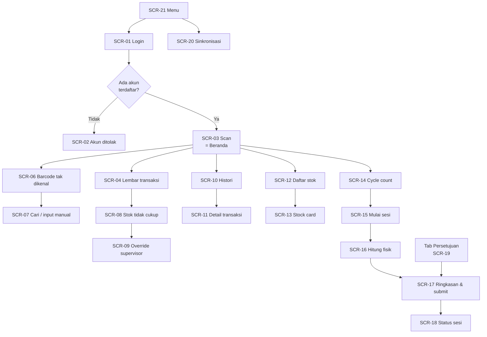
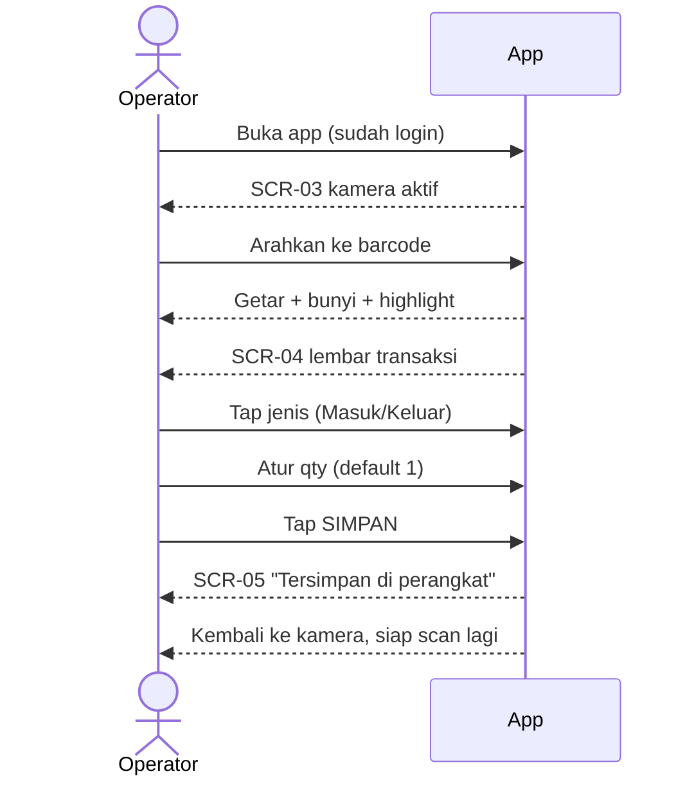
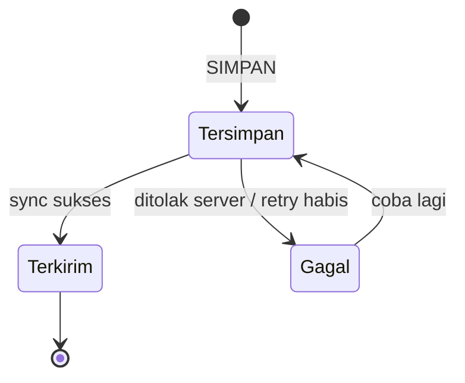
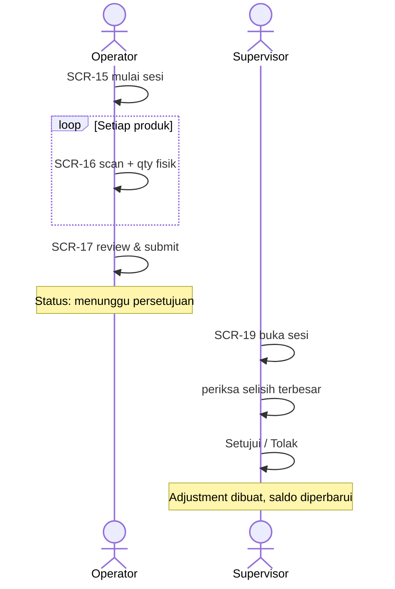

# UX Flow Spec — Warehouse Mobile App (MVP)

| Field | Nilai |
|---|---|
| Versi | 0.1 (siap dieksekusi desainer) |
| Tanggal | 16 November 2026 |
| Status | Draft untuk review Produk + Ops |
| Dokumen acuan | `PRD-v2.md`, `use-case-matrix.md`, `firestore-schema.md` |
| Target perangkat | Android 8+, portrait, lebar 360–430 dp, satu tangan |
| Yang membuat | Desainer UX/UI (Figma) |
| Yang menyetujui | Produk + Supervisor Gudang |

> **Ruang lingkup:** spesifikasi **alur & perilaku**, bukan visual branding. Fokus pada 3 alur kritis dan seluruh kondisi gagal. Desain hi-fi dan design system dikerjakan setelah alur ini lolos usability test.

---

## 1. Tujuan Fase Desain

1. Operator dapat menyelesaikan satu transaksi **≤3 tap setelah barcode terbaca**, tanpa training >2 menit.
2. Operator **selalu tahu** status data: sudah terkirim, belum, atau gagal — tanpa harus membuka menu tersembunyi.
3. Supervisor dapat menyelesaikan review cycle-count **tanpa dibantu** dan memahami arti setiap selisih.
4. Semua kondisi gagal (offline, kamera, barcode, stok, sesi) punya **jalan keluar yang terlihat**.

**Bukan tujuan fase ini:** branding, ilustrasi, animasi kompleks, desain backoffice admin, desain iOS.

---

## 2. Prinsip Desain (berbasis kondisi gudang)

| # | Prinsip | Konsekuensi desain |
|---|---|---|
| P1 | **Offset adalah kondisi normal**, bukan error | Jangan tampilkan layar error merah saat offline; gunakan status netral "Tersimpan di perangkat" |
| P2 | **Satu tangan, mungkin bersarung** | Target sentuh ≥48 dp (utama 56 dp), aksi utama di 1/3 bawah layar |
| P3 | **Scan adalah layar utama**, bukan dashboard | App dibuka → langsung kamera siap scan |
| P4 | **Tidak ada dead-end** | Setiap pesan error menyertakan minimal satu tombol aksi |
| P5 | **Status tidak boleh disembunyikan** | Chip sync selalu terlihat di layar scan & histori |
| P6 | **Jangan andalkan gestur** | Tidak ada swipe-to-delete, tidak ada long-press untuk aksi penting |
| P7 | **Angka harus besar dan jelas** | Qty minimal 32 sp; saldo 20 sp; label 14 sp |
| P8 | **Kontras terhadap cahaya gudang** | Rasio ≥4,5:1; jangan pakai abu-abu muda untuk teks penting |
| P9 | **Umpan balik ganda saat scan** | Getar + bunyi (dapat dimatikan), lalu highlight hijau 400 ms |
| P10 | **Bahasa operator, bukan bahasa sistem** | "Gagal kirim" bukan "HTTP 500"; "Belum terkirim" bukan "pending sync" |

**Artefak desain yang harus dihasilkan:** wireframe low-fi, prototype klik 3 alur, state matrix tervisualisasi, copy deck, dan catatan aksesibilitas.

---

## 3. Peta Navigasi



**Bottom navigation (operator):** `Scan` · `Histori` · `Stok` · `Lainnya`
**Supervisor** mendapat item tambahan `Persetujuan` (badge jumlah item menunggu).
**Tidak ada** menu "Dashboard"/"Home" terpisah — Scan adalah beranda.

---

## 4. Daftar Layar

| ID | Layar | Aktor | Prioritas | UC terkait |
|---|---|---|---|---|
| SCR-01 | Login | Semua | Must | UC-AUTH-01 |
| SCR-02 | Akun ditolak | Semua | Must | UC-AUTH-02 |
| SCR-03 | Scan (beranda) | Operator, Supervisor | Must | UC-SCN-01/02 |
| SCR-04 | Lembar transaksi (jenis + qty) | Operator | Must | UC-SCN-01/02 |
| SCR-05 | Umpan balik tersimpan (overlay) | Operator | Must | UC-SCN-01 |
| SCR-06 | Barcode tidak dikenal | Operator | Must | UC-SCN-03 |
| SCR-07 | Cari / input manual | Operator | Must | UC-SCN-04 |
| SCR-08 | Stok tidak cukup | Operator | Must | UC-SCN-05 |
| SCR-09 | Override stok (supervisor) | Supervisor | Must | UC-SCN-05 |
| SCR-10 | Histori transaksi | Operator, Supervisor | Must | UC-RPT-01 |
| SCR-11 | Detail transaksi | Operator, Supervisor | Must | UC-RPT-01/06 |
| SCR-12 | Daftar stok | Semua | Must | UC-STK-01 |
| SCR-13 | Stock card periode | Supervisor | Must | UC-STK-01 |
| SCR-14 | Cycle count — daftar sesi | Operator, Supervisor | Must | UC-STK-02 |
| SCR-15 | Cycle count — mulai sesi | Operator, Supervisor | Must | UC-STK-02 |
| SCR-16 | Cycle count — hitung fisik | Operator | Must | UC-STK-03 |
| SCR-17 | Cycle count — ringkasan & submit | Operator | Must | UC-STK-04 |
| SCR-18 | Cycle count — status sesi | Operator, Supervisor | Must | UC-STK-04/05 |
| SCR-19 | Persetujuan (tab: Cycle count, Konflik) | Supervisor | Must | UC-STK-05/07 |
| SCR-20 | Sinkronisasi | Operator, Supervisor | Must | UC-SYN-02 |
| SCR-21 | Menu & pengaturan | Semua | Must | UC-AUTH-03/04 |
| SCR-22 | Laporan & export | Supervisor, Admin | Should (P1) | UC-RPT-02 |

---

## 5. Alur Kritis #1 — Scan → Simpan

**Tujuan:** operator mencatat barang masuk/keluar dalam ≤3 tap setelah barcode terbaca, tetap berhasil saat offline.



### 5.1 Langkah & target tap

| # | Layar | Aksi | Tap |
|---|---|---|---|
| 1 | SCR-03 | Kamera sudah aktif, arahkan ke barcode | 0 |
| 2 | SCR-04 | Pilih **Masuk** / **Keluar** (chip besar) | 1 |
| 3 | SCR-04 | Ubah qty (opsional; default 1) | 0–2 |
| 4 | SCR-04 | Tap **SIMPAN** | 1 |
| 5 | SCR-05 | Otomatis kembali ke kamera | 0 |
| | | **Total** | **2–4** |

**Target waktu:** scan → baris tersimpan lokal **p95 ≤1,5 detik**.

### 5.2 Wireframe — SCR-03 Scan

```
┌────────────────────────────────┐
│  Scan                     ⚡  ☰ │
│                                │
│      ┌──────────────────┐      │
│      │                  │      │
│      │     [ kamera ]   │      │
│      │                  │      │
│      └──────────────────┘      │
│   Arahkan kamera ke barcode    │
│                                │
│   ┌──────────────────────────┐ │
│   │  ⌨  Input manual         │ │
│   └──────────────────────────┘ │
│                                │
│  ⚠ Master produk 26 jam lalu   │
│  ┌──────────────────────────┐  │
│  │ 12 transaksi belum       │  │
│  │ terkirim              ›  │  │
│  └──────────────────────────┘  │
│                                │
│  Scan     Histori   Stok   ⋯   │
└────────────────────────────────┘
```

**Elemen wajib:**
- Tombol torch (⚡) selalu terlihat — gudang sering redup.
- Tombol **Input manual** di area jempol, bukan di menu.
- Chip sync: warna netral saat normal, kuning jika ada `failed`, merah hanya jika butuh tindakan.
- Banner peringatan master data muncul **hanya** jika >24 jam (FR-MST-03).
- Setelah 5 detik tanpa scan: tampilkan hint halus "Coba dekatkan lagi atau nyalakan lampu".

### 5.3 Wireframe — SCR-04 Lembar transaksi

```
┌────────────────────────────────┐
│  (kamera meredup di belakang)  │
├────────────────────────────────┤
│  BRG-00412                 ✕   │
│  Sarung Tangan Nitril M        │
│  consumable · box              │
│                                │
│  Saldo saat ini   42 box       │
│  ───────────────────────────   │
│  ┌──────────────┬────────────┐ │
│  │   MASUK      │   KELUAR   │ │
│  └──────────────┴────────────┘ │
│                                │
│      ┌────┐   3   ┌────┐       │
│      │ −  │       │ +  │       │
│      └────┘       └────┘       │
│          qty (box)             │
│                                │
│  Catatan (opsional)            │
│  ┌──────────────────────────┐  │
│  │                          │  │
│  └──────────────────────────┘  │
│  ┌──────────────────────────┐  │
│  │        SIMPAN            │  │
│  └──────────────────────────┘  │
└────────────────────────────────┘
```

**Aturan:**
- Jenis transaksi **wajib dipilih** (default: tidak ada). Mencegah salah masuk/keluar.
- Qty default **1**; tombol − tidak boleh membuat qty < 1.
- Setelah memilih **Keluar**, saldo yang tersisa ditampilkan langsung (`Sisa: 39 box`) agar operator melihat dampaknya.
- Tombol SIMPAN **sticky** di bawah, tinggi 56 dp.
- Tombol SIMPAN nonaktif hanya bila qty tidak valid; jangan nonaktif karena alasan yang tidak terlihat.

### 5.4 Cabang kegagalan

| Kondisi | Layar | Perilaku | Tombol |
|---|---|---|---|
| Barcode tidak ada di cache | SCR-06 | "Barang tidak dikenal" + kode yang terbaca | `Scan ulang`, `Cari manual`, `Lapor admin` |
| Kamera ditolak | SCR-03 | Panel penjelasan, bukan halaman kosong | `Izinkan kamera`, `Input manual` |
| Produk nonaktif | SCR-06 | "Produk tidak aktif" | `Kembali` |
| Stok tidak cukup | SCR-08 | Tampilkan saldo & kekurangan | `Ubah qty`, `Batal`, (`Override` hanya supervisor) |
| Master data >24 jam | SCR-03 | Banner, transaksi tetap boleh | `Sync sekarang` |
| Simpan ditekan 2× | — | Tombol langsung nonaktif, tidak ada transaksi kedua | — |
| App ditutup saat simpan | — | Saat dibuka, transaksi sudah ada atau tidak ada sama sekali (**tidak boleh setengah**) | — |

### 5.5 Wireframe — SCR-08 Stok tidak cukup

```
┌────────────────────────────────┐
│  Stok tidak cukup              │
│                                │
│  Sarung Tangan Nitril M        │
│  Saldo saat ini     42 box     │
│  Diminta            50 box     │
│  Kurang              8 box     │
│                                │
│  Periksa jumlah fisik, atau    │
│  minta supervisor melakukan    │
│  override.                     │
│                                │
│  ┌──────────────────────────┐  │
│  │        Ubah qty          │  │
│  └──────────────────────────┘  │
│  ┌──────────────────────────┐  │
│  │   Override (supervisor)  │  │
│  └──────────────────────────┘  │
│  ┌──────────────────────────┐  │
│  │          Batal           │  │
│  └──────────────────────────┘  │
└────────────────────────────────┘
```

> Tombol override **hanya muncul** untuk role supervisor; operator melihat penjelasan tanpa tombol (bukan tombol nonaktif yang membingungkan).

---

## 6. Alur Kritis #2 — Status Sinkronisasi & Kegagalan

**Tujuan:** operator tahu persis berapa data yang belum aman, dan bisa memperbaiki yang gagal tanpa menebak.



### 6.1 Tiga level informasi

| Level | Di mana | Isi | Kapan muncul |
|---|---|---|---|
| **Chip** | SCR-03 (bawah), SCR-10 (atas) | "12 belum terkirim" / "Semua terkirim" | Selalu |
| **Layar** | SCR-20 | Rincian per transaksi + aksi | Saat chip ditekan |
| **Baris** | SCR-10, SCR-11 | Badge per transaksi | Selalu |

**Aturan warna & ikon (jangan hanya warna):**

| Status | Ikon | Warna | Teks |
|---|---|---|---|
| Belum terkirim | ○ jam | netral/abu | "Belum terkirim" |
| Sedang kirim | ⟳ | biru | "Mengirim…" |
| Terkirim | ✓ | hijau | "Terkirim" |
| Gagal | ! | merah | "Gagal — perlu tindakan" |

### 6.2 Wireframe — SCR-20 Sinkronisasi

```
┌────────────────────────────────┐
│  ‹  Sinkronisasi               │
│                                │
│  ┌──────────────────────────┐  │
│  │  12 belum terkirim       │  │
│  │   3 gagal — perlu aksi   │  │
│  │  87 terkirim hari ini    │  │
│  └──────────────────────────┘  │
│                                │
│  ┌──────────────────────────┐  │
│  │      SYNC SEKARANG       │  │
│  └──────────────────────────┘  │
│                                │
│  Perlu tindakan (3)            │
│  ───────────────────────────   │
│  ! BRG-00991 · Keluar 5 box    │
│    Server menolak: stok tidak  │
│    cukup (tersedia 2).         │
│    [ Ubah qty ]  [ Batalkan ]  │
│  ───────────────────────────   │
│  ! BRG-00412 · Masuk 10 box    │
│    Koneksi terputus 5×.        │
│    [ Coba lagi ]               │
│  ───────────────────────────   │
│  ○ BRG-00200 · Keluar 1 box    │
│    Menunggu jaringan.          │
└────────────────────────────────┘
```

### 6.3 Perilaku wajib

1. **Sync berjalan otomatis** tanpa perlu menekan apa pun; tombol hanya untuk memaksa.
2. Selama sync, tampilkan progres nyata (`Mengirim 34/87`), bukan spinner tanpa konteks.
3. **Kegagalan tidak boleh hilang** hanya karena app ditutup.
4. Setiap item gagal punya **satu aksi utama** + satu aksi sekunder.
5. Jika `retry > 5`, tampilkan "Perlu bantuan admin" dan sembunyikan tombol retry otomatis (agar tidak loop).
6. Jangan pernah bilang "Berhasil" jika masih ada item gagal — gunakan "Selesai dengan 3 masalah".

### 6.4 Cabang kegagalan

| Kondisi | Perilaku | Copy |
|---|---|---|
| Tidak ada jaringan | Tetap bisa scan; chip netral | "Tersimpan di perangkat. Akan dikirim otomatis saat ada internet." |
| Server menolak stok | Item ditandai gagal, tawarkan ubah qty / batalkan | "Server menolak: stok tidak cukup (tersedia 2)." |
| Timeout berulang | Berhenti retry, arahkan ke admin | "Gagal 5×. Hubungi admin atau coba lagi nanti." |
| Logout dengan data belum terkirim | Blokir + tawarkan sync / ekspor | "Ada 12 transaksi belum terkirim. Sync dulu sebelum keluar?" |

---

## 7. Alur Kritis #3 — Cycle Count → Review → Approval

**Tujuan:** operator menghitung fisik tanpa kehilangan progres; supervisor memahami dan menyetujui selisih dengan percaya diri.



### 7.1 Langkah & target

| # | Layar | Aksi | Catatan |
|---|---|---|---|
| 1 | SCR-14 | Tap **Mulai sesi baru** | Jika sudah ada sesi `open`, tawarkan lanjutkan |
| 2 | SCR-15 | Konfirmasi periode & jumlah produk | Jelaskan bahwa stock opname mengunci sesi |
| 3 | SCR-16 | Scan → input qty fisik → simpan | Progres auto-save setiap baris |
| 4 | SCR-16 | (opsional) jeda & lanjutkan | Harus bisa dilanjutkan hari berikutnya |
| 5 | SCR-17 | Review selisih | Tampilkan 5 selisih terbesar lebih dulu |
| 6 | SCR-17 | **Kirim untuk persetujuan** | Konfirmasi karena tidak bisa diubah setelah submit |
| 7 | SCR-19 | Supervisor setujui / tolak | Wajib alasan saat menolak |

**Target:** 120 produk selesai ≤1 hari kerja; tidak ada baris hilang saat app ditutup.

### 7.2 Wireframe — SCR-16 Hitung fisik

```
┌────────────────────────────────┐
│  ‹  Cycle Count · 16 Nov        │
│  Dihitung 118/120     ▓▓▓▓▓░   │
│                                │
│  ┌──────────────────────────┐  │
│  │      [ kamera ]          │  │
│  └──────────────────────────┘  │
│                                │
│  BRG-00412                     │
│  Sarung Tangan Nitril M        │
│  Sistem: 42 box                │
│                                │
│  Fisik                         │
│      ┌────┐  39  ┌────┐        │
│      │ −  │      │ +  │        │
│      └────┘      └────┘        │
│                                │
│  Selisih: −3 box               │
│                                │
│  ┌──────────────────────────┐  │
│  │     SIMPAN & LANJUT      │  │
│  └──────────────────────────┘  │
│  [ Jeda sesi ]                 │
└────────────────────────────────┘
```

### 7.3 Wireframe — SCR-17 Ringkasan

```
┌────────────────────────────────┐
│  ‹  Ringkasan · 16 Nov         │
│                                │
│  Dihitung      118 / 120       │
│  Baris selisih   5             │
│  Total selisih  −7 box         │
│                                │
│  ⚠ 3 selisih besar (>5%)       │
│  ───────────────────────────   │
│  BRG-00412  sistem 42 → 39     │
│             selisih −3         │
│  BRG-00991  sistem 12 → 9      │
│             selisih −3         │
│  BRG-00310  sistem 80 → 84     │
│             selisih +4         │
│  ───────────────────────────   │
│  [ Lihat semua 120 baris ]     │
│                                │
│  Produk belum dihitung (2)     │
│  [ Lihat daftar ]              │
│                                │
│  ┌──────────────────────────┐  │
│  │  KIRIM UNTUK PERSETUJUAN │  │
│  └──────────────────────────┘  │
└────────────────────────────────┘
```

**Aturan penting:**
- Selisih **selalu** ditampilkan sebagai `fisik − sistem`, dengan tanda + / −.
- Produk yang belum dihitung **tidak boleh diam-diam** dianggap cocok; tampilkan jumlahnya dan minta konfirmasi.
- Setelah submit, baris **terkunci**; perubahan hanya lewat penolakan supervisor.
- Jika semua selisih 0: tampilkan "Tidak ada selisih. Sesi langsung disetujui." tanpa membuat adjustment.

### 7.4 Wireframe — SCR-19 Persetujuan (supervisor)

```
┌────────────────────────────────┐
│  Persetujuan                   │
│  [ Cycle count 3 ] [ Konflik 1 ]│
│                                │
│  ┌──────────────────────────┐  │
│  │ Sesi 16 Nov · 5 selisih  │  │
│  │ Total −7 box             │  │
│  │ Diajukan 14:20 · Budi    │  │
│  │              [ Tinjau › ]│  │
│  └──────────────────────────┘  │
│  ┌──────────────────────────┐  │
│  │ Sesi 15 Nov · 0 selisih  │  │
│  │ Otomatis disetujui       │  │
│  └──────────────────────────┘  │
└────────────────────────────────┘
```

**Saat meninjau:** tampilkan `sistem`, `fisik`, `selisih`, catatan operator, dan riwayat transaksi produk tersebut. Tombol `Tolak` wajib membuka input alasan (min. 1 kalimat).

---

## 8. State Matrix

Gunakan tabel ini sebagai daftar frame/variant yang **wajib** dibuat desainer.

### 8.1 Kondisi sistem

| Konteks | State | Pemicu | Tampilan | Aksi tersedia |
|---|---|---|---|---|
| Sesi | Login pertama, online | — | SCR-01 | Login Google |
| Sesi | Sesi aktif | — | SCR-03 | — |
| Sesi | Kedaluwarsa / offline >7 hari | Buka app | Overlay "Sesi berakhir" | Login ulang (data pending tetap) |
| Sesi | Akun nonaktif | Login | SCR-02 | Keluar, hubungi admin |
| Jaringan | Offline | Tidak ada koneksi | Banner tipis di atas (bukan modal) | Tetap scan |
| Jaringan | Online, sync berjalan | Worker aktif | Progres di chip | — |
| Master data | Segar (<24 jam) | — | Tanpa banner | — |
| Master data | Usang (>24 jam) | — | Banner kuning | Sync sekarang |
| Master data | Kosong | Sync pertama gagal | Empty state, scan nonaktif | Coba lagi, hubungi admin |

### 8.2 Kondisi transaksi

| Konteks | State | Pemicu | Tampilan | Aksi |
|---|---|---|---|---|
| Scan | Siap | Kamera aktif | Bingkai + hint | Torch, input manual |
| Scan | Terbaca | Barcode valid | Getar + bunyi + highlight | Lanjut otomatis |
| Scan | Tidak dikenal | Barcode asing | SCR-06 | Scan ulang, cari, lapor |
| Scan | Format tak didukung | Barcode aneh | SCR-06 versi format | Scan ulang |
| Produk | Nonaktif | `active=false` | Panel "Produk tidak aktif" | Kembali |
| Qty | Tidak valid (0) | Input | SIMPAN nonaktif + alasan teks | Perbaiki |
| Stok | Tidak cukup | Keluar > saldo | SCR-08 | Ubah qty, batal, override |
| Stok | Override | Supervisor isi alasan | Dialog alasan | Simpan (tercatat) |
| Simpan | Sukses | Insert lokal | Overlay ✓ 800 ms | Lanjut scan |
| Simpan | Gagal lokal (DB penuh) | Error SQLite | Panel dengan solusi | Hapus data lama, hubungi admin |

### 8.3 Kondisi sinkronisasi

| State | Tampilan baris | Chip | Aksi |
|---|---|---|---|
| `pending` | ○ Belum terkirim | "N belum terkirim" | Sync sekarang |
| `syncing` | ⟳ Mengirim… | "Mengirim…" | Tidak ada (tunggu) |
| `synced` | ✓ Terkirim | Hilang dari hitungan | — |
| `failed` | ! Gagal — alasan | Merah "N gagal" | Coba lagi, ubah, batalkan |

### 8.4 Kondisi cycle-count

| State | Tampilan | Aksi operator | Aksi supervisor |
|---|---|---|---|
| Belum ada sesi | Empty state | Mulai sesi | Mulai sesi |
| `open` | Progres % | Lanjut hitung, jeda | Lanjut, batalkan |
| `submitted` | "Menunggu persetujuan" | Lihat saja | Tinjau |
| `approved` | "Disetujui" + siapa/kapan | Lihat | Lihat |
| `rejected` | "Ditolak" + alasan | Perbaiki & kirim ulang | Lihat |
| `cancelled` | "Dibatalkan" | Lihat | Lihat |

### 8.5 Empty & error global

- **Histori kosong:** ilustrasi ringan + "Belum ada transaksi. Mulai dari Scan." + tombol ke Scan.
- **Stok kosong:** "Master produk belum tersinkron." + tombol sync.
- **Pencarian tanpa hasil:** tampilkan kode yang diketik + "Periksa ejaan" + "Lapor admin".
- **Error tak terduga:** kode error pendek (mis. `E-SYNC-03`) + "Coba lagi" + "Kirim laporan".

---

## 9. Komponen & Spesifikasi Visual Minimum

| Komponen | Spesifikasi |
|---|---|
| Target sentuh | 48 dp minimum; aksi utama 56 dp; jarak antar tombol ≥8 dp |
| Tipografi | Body 16 sp; sekunder 14 sp; judul layar 20 sp; qty 32 sp bold; kode barang monospace 16 sp |
| Grid | 8 dp; margin layar 16 dp; radius kartu 12 dp |
| Warna status | Hijau (sukses), kuning (perhatian), merah (gagal), biru (proses), abu (netral) — **selalu** disertai ikon + teks |
| Kontras | Teks utama ≥4,5:1; teks besar ≥3:1 |
| Tombol utama | Lebar penuh, sticky di bawah, tidak pernah tertutup keyboard |
| Keyboard | Qty memakai numeric keypad; tombol SIMPAN tetap terlihat saat keyboard terbuka |
| Umpan balik | Getar 50 ms + bunyi pendek saat scan; dapat dimatikan di SCR-21 |
| Loading | Spinner hanya untuk <2 detik; di atasnya pakai progres/skeleton + teks |
| Dialog | Hanya untuk aksi tidak bisa dibatalkan (submit cycle-count, logout dengan data pending) |

**Larangan:** teks di bawah 12 sp, tombol ikon tanpa label untuk aksi utama, status yang dibedakan hanya dengan warna, modal untuk pemberitahuan non-kritis.

---

## 10. Copywriting (Copy Deck)

| Konteks | Copy | Catatan |
|---|---|---|
| Simpan sukses (offline) | "Tersimpan di perangkat. Akan dikirim otomatis." | Jangan pakai "berhasil" saja — operator perlu tahu belum ke server |
| Simpan sukses (online) | "Tersimpan dan terkirim." | Hanya jika sync langsung sukses |
| Chip sync normal | "Semua transaksi terkirim" | Netral, tidak hijau mencolok |
| Chip sync pending | "12 transaksi belum terkirim" | Angka nyata |
| Sync gagal | "3 transaksi gagal dikirim" | Bukan "error" |
| Alasan gagal | "Server menolak: stok tidak cukup (tersedia 2)." | Sebutkan angka |
| Barcode asing | "Barang tidak dikenal" + "Kode: 8991234567890" | Tampilkan kode agar bisa dilaporkan |
| Barcode asing (saran) | "Coba scan ulang, cari manual, atau hubungi admin." | Tiga opsi jelas |
| Stok kurang | "Stok tidak cukup. Saldo 42, diminta 50." | Netral, tidak menyalahkan |
| Override | "Override hanya untuk supervisor. Alasan wajib diisi." | Jelas batasannya |
| Master usang | "Data produk terakhir diperbarui 26 jam lalu." | Fakta + tombol sync |
| Sesi berakhir | "Sesi berakhir. Masuk lagi untuk melanjutkan. Data yang belum terkirim tetap aman." | Menenangkan |
| Logout dengan pending | "Ada 12 transaksi belum terkirim. Sync dulu sebelum keluar?" | Beri pilihan |
| Cycle-count submit | "Setelah dikirim, hitungan tidak bisa diubah. Lanjutkan?" | Konsekuensi jelas |
| Cycle-count disetujui | "Disetujui oleh Sari · 16 Nov 15:02" | Transparansi |
| Cycle-count ditolak | "Ditolak: 'Hitung ulang rak B3' — Sari, 16 Nov" | Alasan terlihat |
| Tidak ada selisih | "Tidak ada selisih. Sesi langsung disetujui." | Ekspektasi benar |

**Gaya bahasa:** kalimat aktif, maksimal 2 baris, hindari istilah teknis (`payload`, `server error`, `sync queue`), jangan menyalahkan pengguna ("Anda salah input" → "Qty belum sesuai").

---

## 11. Aksesibilitas & Kondisi Lapangan

Checklist yang harus divalidasi desainer:

- [ ] Semua aksi utama dapat dijangkau **satu tangan** pada layar 6,1".
- [ ] Dapat dioperasikan dengan **sarung tangan** (target 56 dp untuk aksi utama).
- [ ] Terbaca di **bawah sinar matahari** dan di ruang redup (uji di gudang, bukan di kantor).
- [ ] Teks tetap terbaca pada **font scaling 130%** tanpa terpotong.
- [ ] Status tidak bergantung pada warna (ikon + teks).
- [ ] Tombol torch mudah dijangkau dan statusnya jelas (nyala/mati).
- [ ] Suara/getar dapat dimatikan (lingkungan bising).
- [ ] Tidak ada informasi penting yang hanya muncul sebagai toast (hilang terlalu cepat).
- [ ] Orientasi **portrait**; landscape tidak diwajibkan.
- [ ] Navigasi tidak memakai gestur wajib (semua punya tombol).

---

## 12. Handoff: Definition of Done untuk Desainer

**Figma**
- [ ] Halaman: `00-Cover`, `01-Foundations`, `02-Components`, `03-Flows`, `04-Screens`, `05-Edge-Cases`, `06-Copy-Deck`.
- [ ] Setiap layar punya frame untuk state di §8 (boleh berupa variant komponen).
- [ ] Prototype klik untuk 3 alur kritis, dapat dijalankan di HP.
- [ ] Komponen dengan variant: tombol (5 state), input qty, chip sync, badge status, product row, empty state, dialog.

**Dokumentasi**
- [ ] Redline spacing & ukuran (bisa berupa catatan di Figma, tidak perlu PDF terpisah).
- [ ] Copy deck final (satu sumber, siap dipakai developer).
- [ ] Catatan aksesibilitas per layar.
- [ ] Daftar aset ikon (SVG) dan nama file konsisten.
- [ ] Peta layar → ID (`SCR-xx`) agar bisa dilacak ke tiket engineering.

**Kriteria lolos desain**
- [ ] 3 alur kritis lolos usability test (§13).
- [ ] Tidak ada layar tanpa state kosong/error.
- [ ] Tidak ada teks placeholder (`Lorem ipsum`, "TODO").
- [ ] Developer bisa mengimplementasikan tanpa bertanya "apa yang terjadi kalau…".

---

## 13. Rencana Usability Test

### 13.1 Hipotesis

| ID | Hipotesis | Cara uji |
|---|---|---|
| H1 | Operator bisa menyelesaikan transaksi tanpa training >2 menit | T1, ukur waktu & bantuan |
| H2 | Operator memahami arti "belum terkirim" vs "gagal" | T4 + pertanyaan pemahaman |
| H3 | Supervisor bisa menyetujui/menolak sesi tanpa dibantu | T6 |
| H4 | Operator dapat memulihkan diri dari barcode rusak | T3 |

### 13.2 Partisipan

- **3 operator gudang** (bukan karyawan kantor), minimal 1 yang belum pernah memakai aplikasi inventory.
- **1 supervisor** dengan pengalaman stock opname.
- Kriteria: pernah memakai smartphone Android; tidak perlu pengalaman app gudang.
- Durasi: 30–40 menit per orang, di gudang atau ruang yang menyerupai gudang.

### 13.3 Tugas

| # | Tugas | Skenario | Kriteria sukses | Batas waktu |
|---|---|---|---|---|
| T1 | Catat barang masuk 5 box | "Barang datang. Catat 5 box." | Tersimpan; qty benar; ≤4 tap | 90 s |
| T2 | Catat barang keluar 3 box, stok hanya 2 | "Minta keluar 3, tapi stok 2." | Menyadari penolakan; memilih ubah qty atau batal | 60 s |
| T3 | Barcode rusak | "Barcode tidak terbaca. Tetap catat barang ini." | Menemukan input manual & menyelesaikan transaksi | 90 s |
| T4 | Perbaiki transaksi gagal | "Satu transaksi gagal karena stok tidak cukup. Selesaikan." | Menemukan item gagal, memahami alasan, mengambil aksi | 90 s |
| T5 | Cycle-count 10 produk | "Hitung 10 produk ini, lalu kirim." | 10 baris benar; submit; paham status "menunggu" | 5 menit |
| T6 | Supervisor review | "Setujui sesi dengan 2 selisih; tolak 1 dengan alasan." | Approval benar; alasan tercatat | 4 menit |
| T7 | Pemahaman status | "Apa arti '12 transaksi belum terkirim'?" | Menjelaskan bahwa data aman di HP, belum di server | — |

**Aturan fasilitasi:** tidak mengarahkan, tidak menyebut nama tombol, hanya mengulang tugas. Bantuan dicatat sebagai kegagalan.

### 13.4 Metrik

| Metrik | Target |
|---|---|
| Task success tanpa bantuan (T1–T3) | ≥80% partisipan |
| Pemahaman status sync (T7) | 100% partisipan |
| Rata-rata tap T1 | ≤4 |
| Waktu T1 | ≤90 detik |
| SEQ (Single Ease Question, 1–7) per tugas | ≥5,5 |
| Isu severity 1 (blocker) | 0 |
| Isu severity 2 (major) | ≤3, dengan mitigasi |

### 13.5 Skala severity

| Level | Definisi | Tindakan |
|---|---|---|
| S1 Blocker | Tugas tidak bisa diselesaikan | Wajib diperbaiki sebelum coding |
| S2 Major | Selesai tetapi butuh bantuan / salah paham berulang | Perbaiki sebelum pilot |
| S3 Minor | Mengganggu, ada workaround | Masuk backlog |
| S4 Kosmetik | Preferensi | Opsional |

### 13.6 Lembar pencatatan (template)

| Partisipan | Tugas | Sukses? | Waktu | Tap | Bantuan? | Kutipan | Severity |
|---|---|---|---|---|---|---|---|
| O1 | T1 | | | | | | |
| O1 | T4 | | | | | | |

### 13.7 Script singkat

> "Terima kasih sudah membantu. Saya menguji aplikasinya, bukan Anda — tidak ada jawaban salah. Silakan berpikir keras (think aloud) sambil bekerja. Saya tidak akan membantu kecuali Anda benar-benar berhenti."
>
> Setelah selesai: "Menurut Anda, apa yang terjadi pada data yang baru Anda simpan?"
> "Apa yang akan Anda lakukan jika ini terjadi saat gudang sedang ramai?"

---

## 14. Traceability Layar → Requirement

| Layar | FR terkait | UC |
|---|---|---|
| SCR-01/02/21 | FR-AUTH-01..06 | UC-AUTH-01..04 |
| SCR-03/04/05 | FR-SCN-01..07, FR-MST-02/03 | UC-SCN-01/02/07 |
| SCR-06/07 | FR-SCN-03, FR-SCN-10 | UC-SCN-03/04 |
| SCR-08/09 | FR-SCN-09 | UC-SCN-05 |
| SCR-10/11 | FR-RPT-01, FR-RPT-05, FR-SCN-08 | UC-RPT-01, UC-SCN-06 |
| SCR-12/13 | FR-STK-01/02 | UC-STK-01 |
| SCR-14..18 | FR-STK-03..07 | UC-STK-02..05 |
| SCR-19 | FR-STK-07/09 | UC-STK-05/07 |
| SCR-20 | FR-SYN-01..04 | UC-SYN-01/02 |
| SCR-22 | FR-RPT-02..04 | UC-RPT-02 |

---

## 15. Pertanyaan Terbuka untuk Desainer

| # | Pertanyaan | Perlu dijawab oleh |
|---|---|---|
| D1 | Apakah operator memakai sarung tangan saat scan? | Ops (workshop Q7) |
| D2 | Device digantung di leher, dipegang, atau ditaruh di meja? | Ops |
| D3 | Perlu mode gelap untuk gudang malam? | Ops + Produk |
| D4 | Apakah ada branding/kop perusahaan yang wajib? | Marketing/Manajemen |
| D5 | Bahasa selain Indonesia? | Produk |
| D6 | Apakah qty perlu satuan pecahan (mis. 1,5 kg)? | Ops (default MVP: integer) |
| D7 | Apakah supervisor memakai device yang sama dengan operator? | Ops (Q7) |

---

## 16. Urutan Eksekusi Desain

| Hari | Aktivitas | Output |
|---|---|---|
| 1 | Decision workshop (Q1, Q4, Q7) + observasi gudang 2 jam | Catatan konteks & foto kondisi |
| 2–3 | Wireframe low-fi 22 layar (abu-abu, tanpa warna) | Prototype klik 3 alur |
| 4 | Usability test 4 partisipan | Lembar temuan + severity |
| 5 | Revisi alur + copy deck | Prototype v2 |
| 6–8 | UI hi-fi + komponen (hanya alur yang lolos) | Figma siap handoff |
| 9 | Handoff ke engineering | DoD §12 terpenuhi |

> Aturan gerbang: **jangan lanjut ke hi-fi** jika masih ada isu S1, atau jika H1/H2/H3 gagal.
