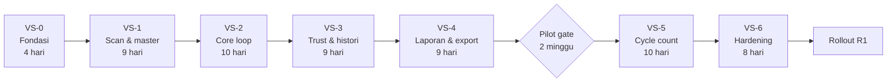

# Backlog Vertical Slice — Warehouse Mobile App v2

| Field | Nilai |
|---|---|
| Versi | 1.0 |
| Tanggal | 17 November 2026 |
| Prasyarat | SPK-01 & SPK-02 **lulus**, Q1/Q4/Q7 diputuskan |
| Tim asumsi | 1 Flutter dev, 1 backend dev, 1 QA (50%), 1 desainer (sudah hi-fi) |
| Total estimasi | **±64 hari-dev** → 7–8 minggu kalender (2 dev paralel) |
| Dokumen acuan | `PRD-v2.md`, `use-case-matrix.md`, `ux-flow-spec.md`, `firestore-schema.md`, `spike-backlog.md` |
| Status | Siap dieksekusi setelah Go/No-Go spike |

---

## 1. Apa itu vertical slice di proyek ini

Satu slice = **satu alur yang bisa dipakai operator sungguhan dari awal sampai akhir**, bukan satu lapisan teknologi.

| Bukan vertical slice | Vertical slice |
|---|---|
| "Selesaikan semua 22 layar" | "Operator bisa scan → simpan → data sampai server → saldo benar" |
| "Backend dulu, UI nanti" | Setiap slice menyentuh UI, SQLite, Firestore, Function, dan test |
| "90% selesai" | Demo di device nyata atau belum selesai |

**Aturan main:**

1. Setiap slice punya **demo script** yang dijalankan di device fisik di akhir slice.
2. Tidak ada mock setelah VS-2. Sebelum itu, mock hanya untuk layar yang belum tersambung.
3. Fitur yang belum masuk slice **tidak dibuat**, walau "tinggal sedikit".
4. Setiap slice menambah **satu** kemampuan yang bisa dipakai; tidak ada slice "persiapan" lebih dari 1 minggu.
5. Kalau waktu habis, potong scope dengan daftar di §10 — jangan geser tanggal diam-diam.

---

## 2. Prasyarat

- [ ] SPK-01 (outbox exactly-once) **Lulus**.
- [ ] SPK-02 (saldo = ledger) **Lulus**.
- [ ] Q1 device, Q4 full/sampling count, Q7 shared device sudah diputuskan (`PRD-v2.md` §14).
- [ ] Firebase project **dev** + **prod** terpisah; billing Functions aktif.
- [ ] 2 device uji (1 low-end), akun Google untuk 3 role.
- [ ] Hi-fi minimal untuk SCR-01..05, 08, 20 (alur kritis #1 & #2); SCR-14..19 sebelum VS-5.
- [ ] Template import produk + Apps Script siap (`docs/product-import-spec.md`, `apps-script/`).

---

## 3. Peta slice



| Slice | Kemampuan baru | Durasi | Gate |
|---|---|---|---|
| **VS-0** | Login ber-role, database terenkripsi, rules & CI jalan | 4 | **G0** — bisa login & deploy |
| **VS-1** | Scan barcode & cari produk **tanpa jaringan** | 9 | **G1** — 2.000 SKU offline |
| **VS-2** | Transaksi masuk/keluar tersimpan lokal & sampai server, saldo benar | 10 | **G2** — exactly-once terbukti di project dev |
| **VS-3** | Operator & supervisor bisa **percaya** status sync, reversal, histori | 9 | **G3** — tidak ada data "hilang" |
| **VS-4** | Closing harian, stock card, export Sheets, admin monitoring | 9 | **G4** — pilot gate |
| **VS-5** | Cycle count → adjustment → approval | 10 | **G5** — saldo = fisik |
| **VS-6** | Kualitas, observability, kesiapan rollout | 8 | **G6** — rollout R1 |

> Urutan ini mengikuti `spike-backlog.md` §11: pilot dijalankan **setelah** core loop + laporan stabil, cycle-count menyusul sebelum rollout penuh.
>
> **Durasi** adalah hari kalender dengan 2 dev bekerja paralel di dalam slice. Jumlah hari-dev tiket per slice lebih besar dari durasinya (mis. VS-2 = 11 hari-dev → 10 hari kalender). Total tiket ±64 hari-dev, atau ±65,5 bila VS4-07 (PDF/CSV) ikut dikerjakan.

---

## 4. Definition of Ready (per tiket)

- [ ] Ada referensi `FR-*` dan `UC-*`.
- [ ] Acceptance criteria bisa diuji (angka/status, bukan "berfungsi baik").
- [ ] Layar/komponen sudah ada di `ux-flow-spec.md` (atau disepakati desainer).
- [ ] Dependensi tiket lain ditutup atau tersedia stub-nya.
- [ ] Data uji tersedia (produk, barcode, saldo awal).

## 5. Definition of Done (per tiket & per slice)

**Tiket:**

- [ ] AC terpenuhi, dibuktikan screenshot/log/test, bukan klaim.
- [ ] Unit test untuk logika non-UI; widget test untuk alur layar baru.
- [ ] Tidak menambah `TODO` tanpa tiket.
- [ ] Telemetri/error logging untuk jalur baru.
- [ ] Code review ≥1 orang.

**Slice (gate):**

- [ ] Demo script dijalankan di **2 device fisik** (low-end + mid-range).
- [ ] `flutter test`, test Functions, dan **rules emulator test** hijau di CI.
- [ ] Migrasi SQLite diuji dari versi sebelumnya (bukan hanya install bersih).
- [ ] Budget performa yang tersentuh slice ini diukur dan dicatat.
- [ ] Audit aksesibilitas cepat: target ≥48dp, kontras AA, teks ≥14sp.
- [ ] 0 bug P0/P1 terbuka; P2 punya tiket.
- [ ] `docs/` diperbarui bila perilaku berubah.
- [ ] Rilis internal (feature flag aktif untuk tim) + changelog.

---

## 6. Detail slice

### VS-0 — Fondasi & walking skeleton

| | |
|---|---|
| **Tujuan** | Satu pengguna bisa login, melihat role-nya, dan aplikasi bisa dideploy ke device lewat CI. |
| **Durasi** | ±4 hari |
| **Ref** | FR-AUTH-01..05, UC-AUTH-01/02, SCR-01/02, NFR-SEC-02/04, NFR-MNT-01 |
| **Demo** | Login 3 akun berbeda → menu berbeda; akun nonaktif ditolak; app ditutup-buka tetap login. |

| ID | Tiket | Ref | hd | Selesai bila |
|---|---|---|---|---|
| VS0-01 | Repo, CI, flavor dev/prod | NFR-MNT-01 | 1 | `flutter analyze/test` + test Functions + build APK hijau di CI; tidak ada kredensial di repo |
| VS0-02 | Firebase project dev + emulator lokal | — | 0.5 | Satu perintah menyalakan emulator Auth/Firestore/Functions; app dev menunjuk ke project dev |
| VS0-03 | Login Google + `users/{uid}` + role gate | FR-AUTH-01..05 | 1.5 | 3 role masuk ke beranda berbeda; `active=false` → SCR-02; sesi bertahan setelah app ditutup |
| VS0-04 | Rules v1 + rules unit test | NFR-SEC-04 | 1 | ≥12 kasus izin/tolak hijau di CI; `transactions` menolak update/delete klien |
| VS0-05 | SQLite + SQLCipher + migrasi v1 | NFR-SEC-02 | 1 | File DB tidak terbaca tanpa kunci; migrasi dari kosong & dari v1 idempoten |
| VS0-06 | Crash & log baseline | NFR-MNT-01 | 0.5 | Crash uji muncul di Crashlytics; event `app_open` + `login_success` tercatat |

**Tidak dikerjakan:** layar stok, scan, sync, notifikasi.

**Exit (G0):** APK terpasang di 2 device, login jalan, rules teruji, DB terenkripsi.

---

### VS-1 — Scan & master data offline

| | |
|---|---|
| **Tujuan** | Operator bisa memindai barcode dan melihat produk + saldo **tanpa jaringan**. |
| **Durasi** | ±9 hari (1 sprint) |
| **Ref** | FR-MST-01..05, FR-SCN-01/02/03/10, UC-SCN-01 (baca), UC-SCN-03/04, UC-ADM-01, SCR-03/06/07, NFR-PERF-02 |
| **Demo** | Airplane mode → scan 10 produk asli → nama, UoM, saldo muncul <300 ms; scan barcode asing → SCR-06. |

| ID | Tiket | Ref | hd | Selesai bila |
|---|---|---|---|---|
| VS1-01 | Sync master full + delta | FR-MST-01, BR-11 | 2 | 2.000 produk/10.000 barcode ≤60 s @3 Mbps; delta 50 perubahan ≤5 s; `lastSyncAt` tersimpan |
| VS1-02 | Layar scan + izin kamera + debounce | FR-SCN-01/02 | 2 | 20 barcode nyata terbaca; hasil ganda <800 ms diabaikan; izin ditolak → pesan + tombol setelan |
| VS1-03 | Lookup lokal + barcode tak dikenal | FR-MST-02, FR-SCN-03 | 1 | p95 lookup ≤50 ms pada 10.000 barcode; barcode asing → SCR-06 tanpa jaringan |
| VS1-04 | Cari & input manual | FR-SCN-10 | 1.5 | Cari 3 karakter ≤300 ms; kode persis membuka lembar transaksi; kode tidak ada → pesan jelas |
| VS1-05 | Banner master usang | FR-MST-03 | 0.5 | Muncul tepat setelah >24 jam; hilang setelah sync sukses |
| VS1-06 | Pipeline import produk | FR-MST-04/05, BR-13 | 1.5 | 100 produk dari template masuk ke `products` + `barcodes`; barcode duplikat ditolak; device menerima di delta berikutnya |
| VS1-07 | Baseline latency scan (M5) | NFR-PERF-02 | 0.5 | Event durasi `scan_start→product_shown` tercatat; p50/p95 bisa dihitung dari data |

**Catatan:** VS1-06 memakai artefak yang sudah ada (`templates/`, `apps-script/`, `tools/validate-products.ps1`) — tidak membangun UI import baru di slice ini.

**Tidak dikerjakan:** menyimpan transaksi, saldo server, cycle count.

**Exit (G1):** 2 device, 2.000 SKU, lookup & scan memenuhi NFR saat offline; master bisa diperbarui admin end-to-end.

---

### VS-2 — Core loop: transaksi offline → sync → saldo

| | |
|---|---|
| **Tujuan** | Satu transaksi keluar/masuk dibuat offline, sampai ke Firestore **tepat sekali**, dan saldo benar di device & server. |
| **Durasi** | ±10 hari (1 sprint) |
| **Ref** | FR-SCN-04..07/09, FR-SYN-01, FR-STK-01/02, BR-01/03/04, UC-SCN-01/02/05/07, SCR-04/05/08/09/12/13, NFR-REL-01/04 |
| **Demo** | Airplane mode → scan → keluar 3 → simpan (≤1,5 s) → aktifkan jaringan → transaksi `synced`, saldo turun 3 di device dan Firestore. |

| ID | Tiket | Ref | hd | Selesai bila |
|---|---|---|---|---|
| VS2-01 | Lembar transaksi (jenis, qty, +/−) | FR-SCN-04/05 | 2 | Masuk/keluar; qty 0 ditolak; maksimum 3 tap dari scan ke simpan |
| VS2-02 | Submit idempoten + UUIDv7 + SQLite atomik | FR-SCN-06/07, BR-04 | 2 | Tap 5× → **1** baris; force-stop 20× → **0** baris setengah; p95 ≤1,5 s offline |
| VS2-03 | Outbox worker (WorkManager) | FR-SYN-01, BR-04 | 2 | 300 transaksi setelah airplane 30 menit → **100%** terkirim; replay 10× → tetap 300 dokumen |
| VS2-04 | Function `applyBalance` | BR-01/03 | 2 | 1.000 operasi acak → saldo = Σ `signedQty` (selisih 0); replay 100× → saldo berubah **1×** |
| VS2-05 | Stok negatif + override supervisor | FR-SCN-09, BR-03 | 1.5 | Keluar > saldo → SCR-08, saldo tidak berubah; override supervisor wajib alasan, tercatat `auditLogs` |
| VS2-06 | Saldo & stock card lokal | FR-STK-01/02 | 1.5 | Saldo berubah ≤1 s setelah submit; stock card hari ini cocok dengan jumlah ledger |

**Tidak dikerjakan:** layar status sync lengkap, retry manual, reversal, konflik, laporan.

**Exit (G2):** exactly-once terbukti di project dev dengan 2 device bersamaan; tidak ada drift saldo setelah 1.000 transaksi.

---

### VS-3 — Kepercayaan: status sync, retry, konflik, histori

| | |
|---|---|
| **Tujuan** | Operator tahu **status setiap transaksi**, dan supervisor bisa memperbaiki kesalahan tanpa mengedit database. |
| **Durasi** | ±9 hari (1 sprint) |
| **Ref** | FR-SYN-02/03/04, FR-STK-09, FR-SCN-08, FR-RPT-01, FR-ADM-03, FR-AUTH-06, BR-06/09/12, UC-SYN-02, UC-SCN-06, UC-STK-07, UC-RPT-01, SCR-10/11/20 |
| **Demo** | Matikan jaringan saat sync → status `failed` + alasan → "Sync sekarang" → `synced`; buat konflik → muncul di tab supervisor → selesaikan. |

| ID | Tiket | Ref | hd | Selesai bila |
|---|---|---|---|---|
| VS3-01 | Layar sinkronisasi + status per transaksi | FR-SYN-03 | 2 | 4 status tampil dengan warna & teks; alasan gagal terbaca; badge pending di beranda |
| VS3-02 | Sync manual | FR-SYN-04 | 0.5 | Tombol memicu worker; umpan balik ≤300 ms; tidak bisa dobel-trigger |
| VS3-03 | Retry/backoff + status failed | FR-SYN-02 | 1.5 | Berhenti setelah 5 percobaan; alasan tersimpan; tidak ada loop tanpa akhir |
| VS3-04 | Konflik saldo + resolusi | FR-STK-09, BR-12 | 2 | Device ≠ server → entri `stockConflicts`; supervisor menyelesaikan dgn alasan; angka akhir konsisten |
| VS3-05 | Reversal + audit | FR-SCN-08, BR-06 | 2 | Reversal ganda ditolak; transaksi asli tetap ada; `auditLogs` memuat aktor, alasan, entity |
| VS3-06 | Histori + filter | FR-RPT-01, BR-09 | 1.5 | Filter 7 hari/jenis/produk; operator hanya melihat miliknya; supervisor melihat gudang |
| VS3-07 | Sesi offline 7 hari | FR-AUTH-06 | 0.5 | Hari ke-8 wajib login ulang; transaksi `pending` tidak hilang saat re-auth |

**Tidak dikerjakan:** export Sheets, closing, cycle count.

**Exit (G3):** skenario "sync gagal 3 hari" bisa dijelaskan & dipulihkan tanpa bantuan developer.

---

### VS-4 — Laporan, closing, export Sheets, admin

| | |
|---|---|
| **Tujuan** | Supervisor bisa menutup hari, membaca stock card, dan mengekspor D-1 ke Sheets yang cocok dengan Firestore. |
| **Durasi** | ±9 hari (1 sprint) |
| **Ref** | FR-STK-02/08, FR-RPT-02/03/04/05, FR-SYN-05/06/07, FR-ADM-01/02, BR-05, UC-STK-06, UC-RPT-02, UC-SYN-03/04, UC-ADM-02/03, SCR-13/19 |
| **Demo** | Tutup periode → stock card read-only → export D-1 → bandingkan jumlah baris & checksum → edit 1 baris Sheet → rekonsiliasi menandai `tampered`. |

| ID | Tiket | Ref | hd | Selesai bila |
|---|---|---|---|---|
| VS4-01 | Periode + closing harian 00:05 WIB | FR-STK-08 | 2 | Snapshot dibuat; periode terkunci; transaksi telat masuk periode berikutnya dan muncul di laporan rekonsiliasi |
| VS4-02 | Stock card periode | FR-STK-02/FR-RPT-02 | 2 | `opening + in − out + adj = ending` untuk semua produk; periode tertutup read-only |
| VS4-03 | Export Sheets D-1 | FR-SYN-05/06, BR-05 | 2 | 5.000 baris ≤5 menit; export ulang **0 duplikat**; `sheetExports` mencatat `rowCount` |
| VS4-04 | Rekonsiliasi + deteksi edit | FR-SYN-07 | 1.5 | Checksum cocok; edit manual 1 baris → status `tampered` + laporan selisih |
| VS4-05 | Admin: user & monitoring | FR-ADM-01/02 | 1.5 | Tambah/nonaktif user; daftar `failed` + retry paksa; semua tercatat audit |
| VS4-06 | Dashboard ringkas | FR-RPT-05 | 1 | Total produk, transaksi hari ini, perlu restock; tampil ≤2 s di device mid-range |
| VS4-07 | Export PDF & CSV *(Should, bisa dipotong)* | FR-RPT-03/04 | (1.5) | A4 + kop gudang; CSV bisa dibuka di Excel tanpa kerusakan encoding |

**Tidak dikerjakan:** cycle count, multi-gudang, arsip >24 bulan.

**Exit (pilot gate):** semua angka pada §9 terukur, 0 bug P0/P1, operator bisa memakai tanpa pendampingan developer.

---

### VS-5 — Cycle count → adjustment → approval

| | |
|---|---|
| **Tujuan** | Satu sesi hitung fisik menghasilkan saldo = fisik, lewat adjustment yang bisa diaudit, tanpa menimpa ledger. |
| **Durasi** | ±10 hari (1 sprint) |
| **Ref** | FR-STK-03..07/09, BR-02/10, UC-STK-02..05/07, SCR-14..19, M1, M7 |
| **Demo** | Sesi 120 baris → hitung → review variance → submit → supervisor approve → saldo = `countedQty`; approve 2× tidak menggandakan adjustment. |

| ID | Tiket | Ref | hd | Selesai bila |
|---|---|---|---|---|
| VS5-01 | Mulai sesi + aturan satu sesi open | FR-STK-03, BR-10 | 1.5 | Sesi kedua ditolak dengan pesan jelas; sesi bisa dibuat saat offline lalu tersinkron |
| VS5-02 | Hitung fisik + autosave | FR-STK-04 | 2 | 120 baris; app di-kill → progres utuh; produk dihitung 2× → minta konfirmasi |
| VS5-03 | Review variance + submit | FR-STK-05/06, BR-02 | 2 | `variance = counted − system`; variance 0 tidak membuat adjustment; submit offline masuk antrean |
| VS5-04 | Approval/reject + adjustment idempoten | FR-STK-07 | 2 | Approve 2× → **1 set** adjustment; reject wajib alasan; saldo akhir = `countedQty` |
| VS5-05 | Status sesi + auto-approve variance 0 | FR-STK-06 | 1 | Semua variance 0 → `approved` tanpa adjustment |
| VS5-06 | Tab konflik pada layar persetujuan | FR-STK-09 | 0.5 | Daftar konflik + aksi resolusi tersedia bagi supervisor |
| VS5-07 | Ukur M1 & M7 | M1, M7 | 1 | Stock accuracy & durasi sesi terhitung dari data nyata; dilaporkan per sesi |

**Tidak dikerjakan:** sampling/partial count (R2), blind count, penugasan zona rak.

**Exit (G5):** 3 sesi nyata di gudang uji; selisih saldo vs fisik **0**; audit lengkap.

---

### VS-6 — Hardening & kesiapan rollout

| | |
|---|---|
| **Tujuan** | Produk layak dipakai 20+ operator setiap hari, dengan alarm saat angka mulai menyimpang. |
| **Durasi** | ±8 hari |
| **Ref** | NFR-SEC-01..05, NFR-PERF-01..04, NFR-REL-02/03, NFR-USA-01/02, NFR-DATA-01..03, M1–M7 |
| **Demo** | Dashboard metrik menampilkan 7 hari terakhir; alarm sync gagal terpicu; restore dari backup diuji. |

| ID | Tiket | Ref | hd | Selesai bila |
|---|---|---|---|---|
| VS6-01 | Rules test suite lengkap + review akses | NFR-SEC-04 | 1.5 | ≥40 kasus; semua koleksi tercakup; tidak ada aturan `if true` |
| VS6-02 | Perf budget di device low-end | NFR-PERF-01/02 | 1.5 | p95 sesuai NFR di 2 device; regresi >10% menggagalkan CI |
| VS6-03 | Audit aksesibilitas | NFR-USA-01/02 | 1 | Kontras AA, target 48dp, ≤3 tap; temuan P1 nol |
| VS6-04 | Empty & error state global | UX §8.5 | 1 | 10 kondisi punya layar/pesan sesuai copy deck |
| VS6-05 | Observability M1–M7 | M1–M7 | 1.5 | Tiap metrik punya query + alarm; sync gagal >1% memicu notifikasi |
| VS6-06 | Latihan restore & rollback | NFR-DATA-03 | 1 | RTO ≤4 jam, RPO ≤15 menit terbukti di dev |
| VS6-07 | Materi pilot + seeding 100 SKU | — | 1 | 100 SKU asli terimpor; 3 operator terlatih; checklist harian tersedia |

**Exit (rollout R1):** pilot 2 minggu lulus, tim ops bisa menangani insiden tanpa developer.

---

## 7. Traceability Requirement → slice

| FR | Slice | Catatan |
|---|---|---|
| FR-AUTH-01..05 | VS-0 | Login, role, penolakan akun |
| FR-AUTH-06 | VS-3 | Sesi offline 7 hari |
| FR-MST-01 | VS-1 | Full + delta sync |
| FR-MST-02 | VS-1 | Pencarian lokal |
| FR-MST-03 | VS-1 | Banner >24 jam |
| FR-MST-04 | VS-1 | Import (template + Apps Script sudah ada) |
| FR-MST-05 | VS-1 | Multi-barcode per produk |
| FR-SCN-01/02 | VS-1 | Scan & tampilan produk |
| FR-SCN-03 | VS-1 | Barcode tak dikenal |
| FR-SCN-04/05 | VS-2 | Jenis transaksi & qty |
| FR-SCN-06/07 | VS-2 | Idempotensi & simpan ≤1,5 s |
| FR-SCN-08 | VS-3 | Reversal |
| FR-SCN-09 | VS-2 | Stok negatif & override |
| FR-SCN-10 | VS-1 | Input manual |
| FR-STK-01 | VS-2 | Saldo lokal |
| FR-STK-02 | VS-2 (harian) → VS-4 (periode) | Bertahap |
| FR-STK-03/04/05/06/07 | VS-5 | Cycle count & approval |
| FR-STK-08 | VS-4 | Closing harian |
| FR-STK-09 | VS-3 | Konflik saldo |
| FR-RPT-01 | VS-3 | Histori |
| FR-RPT-02 | VS-4 | Laporan periode |
| FR-RPT-03/04 | VS-4 (opsional) | PDF/CSV; boleh ke R2 |
| FR-RPT-05 | VS-4 | Dashboard |
| FR-SYN-01 | VS-2 | Outbox otomatis |
| FR-SYN-02 | VS-3 | Retry/backoff |
| FR-SYN-03/04 | VS-3 | Status & sync manual |
| FR-SYN-05/06 | VS-4 | Export Sheets |
| FR-SYN-07 | VS-4 | Rekonsiliasi |
| FR-ADM-01 | VS-4 | Kelola user |
| FR-ADM-02 | VS-4 | Monitoring `failed` |
| FR-ADM-03 | VS-3 (mekanisme) → VS-4 (UI) | Audit log ditulis sejak VS-2/VS-3 |

**NFR:** SEC-02 → VS-0, REL-01/04 → VS-2, REL-02/03 → VS-3 & VS-6, PERF-01/02 → VS-1/VS-2 (diukur ulang VS-6), PERF-03/04 → VS-4, USA → VS-6, DATA-03 → VS-6, MNT → VS-0.

## 8. Traceability Use Case → slice

| Slice | Use case |
|---|---|
| VS-0 | UC-AUTH-01, UC-AUTH-02 |
| VS-1 | UC-SCN-01 (baca), UC-SCN-03, UC-SCN-04, UC-ADM-01 |
| VS-2 | UC-SCN-01, UC-SCN-02, UC-SCN-05, UC-SCN-07, UC-STK-01 |
| VS-3 | UC-AUTH-03/04, UC-SCN-06, UC-STK-07, UC-RPT-01, UC-SYN-01, UC-SYN-02 |
| VS-4 | UC-STK-06, UC-RPT-02, UC-SYN-03/04, UC-ADM-02, UC-ADM-03 |
| VS-5 | UC-STK-02/03/04/05 |

---

## 9. Gate & metrik

| Gate | Kapan | Syarat lulus |
|---|---|---|
| **G0** | akhir VS-0 | Login 3 role; rules test hijau; DB terenkripsi |
| **G1** | akhir VS-1 | 2.000 SKU offline; lookup p95 ≤50 ms; scan→tampil ≤300 ms |
| **G2** | akhir VS-2 | Exactly-once 300/300; replay 10× tanpa duplikat; drift saldo 0 |
| **G3** | akhir VS-3 | Sync gagal bisa dipulihkan operator; 0 transaksi hilang |
| **G4 (pilot)** | akhir VS-4 + 2 minggu | M1 ≥98%, M2 ≥99,5%, M3 ≤15 menit, M5 ≤1,5 s, 0 bug P0/P1 |
| **G5** | akhir VS-5 | Saldo = fisik di 3 sesi; adjustment idempoten |
| **G6 (rollout)** | akhir VS-6 | RTO ≤4 jam & RPO ≤15 menit terbukti; alarm aktif |

**Cara mengukur (tanpa menebak):**

- M1 dari `cycleCounts`: `1 - Σ|variance| / Σ counted`.
- M2/M3 dari `transactions` (`createdAtClient`, `syncedAt`, `serverStatus`).
- M5 dari telemetri lokal `scan→saved`, minimal 200 sampel.
- M6 dari `auditLogs` (operator aktif mingguan).
- Angka tanpa device & tanggal **tidak dihitung**.

---

## 10. Kalau mepet: urutan pemotongan

Potong dari bawah, jangan dari tengah alur:

1. VS4-07 (PDF/CSV) → R2.
2. VS4-06 (dashboard ringkas) → R2.
3. VS6-03 audit aksesibilitas → cukup checklist + perbaikan temuan P1 (bukan audit menyeluruh).
4. VS3-07 sesi offline → 14 hari sementara, dicatat di catatan rilis.
5. **Jangan potong:** VS2-02, VS2-04, VS3-03, VS4-03, VS5-04 — semuanya penjaga integritas data.

---

## 11. Risiko khusus slice

| Risiko | Muncul di | Mitigasi |
|---|---|---|
| WorkManager tidak jalan di device OEM agresif | VS-2 | Uji di 2 merek; sediakan sync manual (VS3-02) lebih awal bila perlu |
| Aturan "satu sesi open" bentrok saat offline | VS-5 | Sesi dibuat lokal dulu, konflik diselesaikan server; tampilkan status `pending` |
| Closing & export bertabrakan dengan transaksi telat | VS-4 | Transaksi telat masuk periode berikutnya dan dilaporkan di rekonsiliasi; jangan ubah periode tertutup |
| Device shared membuat histori "milik sendiri" membingungkan | VS-3 | Keputusan Q7; jika shared, tampilkan semua transaksi device + filter operator |
| Laporan Sheets dianggap sumber kebenaran | VS-4 | Banner "laporan, bukan database" + rekonsiliasi harian |
| Scope creep ke multi-gudang | semua | `warehouseId` ada di skema, UI tetap 1 gudang |

---

## 12. Setelah R1 (R2)

Bukan bagian vertical slice, tapi sudah punya tempat: sampling cycle-count, multi-gudang, batch/expiry, multi-UoM, ERP integration, label printing, approval berjenjang, arsip >24 bulan, offline map rak, DSAR/export data operator.

---

## 13. Template tiket (copy ke Jira/Trello)

```
Judul      : [VS-x-yy] <ringkas>
Tipe       : Feature / Backend / QA
Slice      : VS-x
Ref        : FR-..., UC-..., SCR-...
Estimasi   : <n> hari-dev
Dependensi : <ID>

Konteks
<kenapa tiket ini ada, 2-3 baris>

Scope
- ...
- ...

Di luar scope
- ...

Acceptance criteria
[ ] <terukur>
[ ] <terukur>

Bukti wajib
- screenshot / log / query
- hasil test (nama test + status)
```

---

## 14. Checklist kesiapan mulai

- [ ] Go/No-Go spike ditandatangani (SPK-01 & SPK-02 lulus).
- [ ] Q1/Q4/Q7 terjawab dan dicatat di PRD §14.
- [ ] Backlog VS-0 & VS-1 masuk papan kerja dengan estimasi.
- [ ] 2 device uji tersedia, bukan pinjaman harian.
- [ ] Akun & data uji siap (produk asli, bukan "Produk A").
- [ ] Jadwal demo di akhir setiap slice sudah ada di kalender stakeholder.

---

## 15. Export tiket (Jira / Trello)

CSV dihasilkan dari dokumen ini, bukan diketik ulang:

```powershell
powershell -NoProfile -ExecutionPolicy Bypass -File .\tools\export-tickets.ps1
```

| Hasil | Lokasi |
|---|---|
| 47 tiket, 10 kolom | `backlog/vertical-slice-tickets.csv` |
| Petunjuk impor & pemetaan field | `backlog/README.md` |
| Generator | `tools/export-tickets.ps1` |

Kolom: `id, epic, judul, jenis, ref, estimasi_hari, estimasi_jam, milestone, opsional, acceptance_criteria`.

**Aturan pemeliharaan:** kalau scope, estimasi, atau AC berubah, ubah **tabel di §6** lalu jalankan ulang generator. Jangan mengedit CSV langsung, dan jangan mengubah papan kerja tanpa memperbarui dokumen ini — traceability FR → slice bergantung pada keduanya tetap sinkron.
